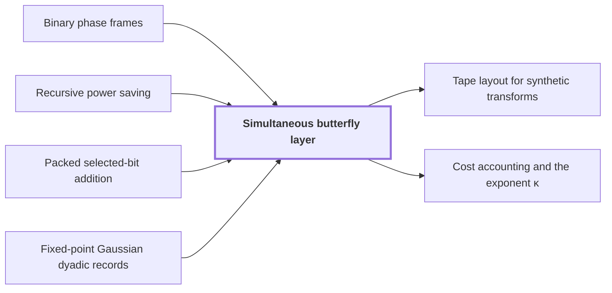

# Simultaneous butterfly layer

!!! info "Before this page"

    Simultaneous butterfly layer *is handled by the network of* [Binary phase frames](phase-frames.md "The group is handled by the network of Binary phase frames, with $W$ wires and $s$ smaller calls."), *follows the recursion of* [Recursive power saving](rank-recurrence.md "The cost of the layer follows the recursion of Recursive power saving: since $s<Wm$, $s/W\le m^\sigma$ for a fixed $\sigma<1$, so each factor $m$ in $e$ multiplies the cost per unit volume by at most $m^\sigma$, not $m$."), *performs each row addition by* [Packed selected-bit addition](packed-bit-addition.md "The layer performs each row addition by Packed selected-bit addition, which XORs them with a third chunk as restored scratch, by eight cyclic shifts of whole chunk ranges plus a repair of a bounded set of exceptional addresses.") and *is evaluated in* [Fixed-point Gaussian dyadic records](fixed-point.md "The layer is evaluated in Fixed-point Gaussian dyadic records.").

!!! abstract "Where this fits"

    1. A single deterministic Turing machine with a fixed finite alphabet and a fixed finite number of one-dimensional tapes multiplies two $n$-bit integers exactly in $O(n(\lg n)^{1-\kappa})$ worst-case time with $\kappa=2^{-182}$, disproving the $n\log n$ optimality conjecture of Sch\"onhage and Strassen in this model. — how: Build two power-saving tape procedures (chunk interchange and simultaneous butterfly layer) from fixed finite linear networks; use them to accelerate the synthetic polynomial transforms and ring convolution; use Gaussian resampling with retained permutations and chirps to reduce the prime-length cyclic convolution of the radix-digit coefficients to those power-of-two transforms; assemble the exact product with a proof that the error is below $1/2$; and total the cost to show a power of $\log n$ is saved. ([Power-saving integer multiplication](main-result.md "A deterministic fixed-tape Turing machine multiplying two n-bit integers exactly in O(n(lg n)^{1−κ}) time with κ = 2^{−182}, disproving the n log n optimality conjecture in this model."))
    2. Both tape primitives (the interchange of two address chunks of $u$ digits and the simultaneous butterfly layer on up to $d$ axes) cost the volume times a power below one of their width, because a call at parameter $mf$ makes $s$ calls at parameter $f$ on streams of volume $V/W$ with $s<Wm$, so the cost per unit volume grows by $s/W<m$ per factor $m$ of the parameter. — how: Build a fixed finite linear network of $W$ wires that exchanges two banks and restores all scratch values, make the representation of each wire's array vary along the network through frames so that an edge costs one smaller call per unit of rank, show the total rank $s$ is below $Wm$, fix an exponent, and solve the recurrence in the bit variant (interchange) and the complex variant (butterfly layer). ([Recursive power saving](rank-recurrence.md "Each call at parameter m·f makes s calls at parameter f on streams of 1/W the volume, so cost per unit volume grows by s/W < m per factor m, giving a power saving."))
    3. **This page:** Complex variant: the tensor product of $H_0=\frac12\begin{pmatrix}1&1\\1&-1\end{pmatrix}$ on one bit of each of $D\le d$ address chunks (each of $K$ bits, selected at a common offset), acting coefficientwise on polynomial records with $r$ complex $p$-bit coefficients, is computed exactly followed by one truncation $Q_p$, in $O(Vd^{\lambda'})$ time with $\lambda'<1$, rather than $D$ whole-array passes.

??? note "Symbols from earlier pages"

    - $d$ — axis count: The number of axes of the underlying cyclic convolution. (on [Cyclic convolution](convolution.md "The product of two sequences (or elements of a polynomial quotient ring) where indices wrap around: (f∗g)_k = Σ f_j g_{k−j}."))
    - $K$ — chunk width: The width in bits of an address chunk. (on [Parameter and prime-length choice](parameter-choice.md "Fixed rational exponents and sizes (precision p = 6b, d axes, K = d^c, T and r powers of two, prime lengths s_i just below t_i) making every hypothesis of the lemmas hold."))
    - $V$ — bit volume: The number of stored bits on which the layer cost is measured. (on [Parameter and prime-length choice](parameter-choice.md "Fixed rational exponents and sizes (precision p = 6b, d axes, K = d^c, T and r powers of two, prime lengths s_i just below t_i) making every hypothesis of the lemmas hold."))
    - $\lambda'$ — layer exponent: The final exponent of the layer cost V d^{lambda'}. (on [Parameter and prime-length choice](parameter-choice.md "Fixed rational exponents and sizes (precision p = 6b, d axes, K = d^c, T and r powers of two, prime lengths s_i just below t_i) making every hypothesis of the lemmas hold."))
    - $H_0$ — averaging step: The matrix of the two-point averaging and differencing step. (on [Two-point kernel C](phase-kernel.md "The matrix C = aI + bX with a = (1+i)/2, b = (1−i)/2, a square root of the bit flip, linked to the butterfly by H₀ = b·S·C·S with S = diag(1, i)."))
    - $\mathsf S$ — phase matrix: The diagonal matrix diag(1, i) multiplying the second entry of a pair by i. (on [Two-point kernel C](phase-kernel.md "The matrix C = aI + bX with a = (1+i)/2, b = (1−i)/2, a square root of the bit flip, linked to the butterfly by H₀ = b·S·C·S with S = diag(1, i)."))
    - $C$ — two-point kernel: The matrix aI + bX. (on [Two-point kernel C](phase-kernel.md "The matrix C = aI + bX with a = (1+i)/2, b = (1−i)/2, a square root of the bit flip, linked to the butterfly by H₀ = b·S·C·S with S = diag(1, i)."))
    - $a$ — kernel constant: The complex constant (1+i)/2. (on [Two-point kernel C](phase-kernel.md "The matrix C = aI + bX with a = (1+i)/2, b = (1−i)/2, a square root of the bit flip, linked to the butterfly by H₀ = b·S·C·S with S = diag(1, i)."))
    - $b$ — kernel coefficient: The complex coefficient (1-i)/2 of the bit flip in the kernel. (on [Two-point kernel C](phase-kernel.md "The matrix C = aI + bX with a = (1+i)/2, b = (1−i)/2, a square root of the bit flip, linked to the butterfly by H₀ = b·S·C·S with S = diag(1, i)."))
    - $I$ — identity matrix: The 2x2 identity matrix. (on [Two-point kernel C](phase-kernel.md "The matrix C = aI + bX with a = (1+i)/2, b = (1−i)/2, a square root of the bit flip, linked to the butterfly by H₀ = b·S·C·S with S = diag(1, i)."))
    - $X$ — bit flip: The 2x2 matrix swapping the two entries of a pair. (on [Two-point kernel C](phase-kernel.md "The matrix C = aI + bX with a = (1+i)/2, b = (1−i)/2, a square root of the bit flip, linked to the butterfly by H₀ = b·S·C·S with S = diag(1, i)."))
    - $W$ — wire count: The number of wires of the network under consideration, W_b for the bit network or W_c for the complex one (not a stream count). (on [Nested subspace labels and rank deficit](subspace-labels.md "Assigning nondegenerate subspaces of an m-dimensional space to gates so adjacent labels are nested; the total dimension change over edges, the number s of smaller calls, is strictly less than W·m."))
    - $s$ — smaller-call count: The total number of smaller calls made by the edges of the network under consideration. (on [Nested subspace labels and rank deficit](subspace-labels.md "Assigning nondegenerate subspaces of an m-dimensional space to gates so adjacent labels are nested; the total dimension change over edges, the number s of smaller calls, is strictly less than W·m."))
    - $v$ — binary vector: A binary vector in F_2^m (not the number of triples). (on [Binary phase frames](phase-frames.md "Frames C_U = H^{⊗m} diag(i^{wt(P_U x) mod 4}) H^{⊗m} whose edge differences are products of translation kernels aI + bX_v, one per vector of an orthonormal residual basis."))
    - $X_v$ — translation by v: The translation of functions of x by the binary vector v. (on [Binary phase frames](phase-frames.md "Frames C_U = H^{⊗m} diag(i^{wt(P_U x) mod 4}) H^{⊗m} whose edge differences are products of translation kernels aI + bX_v, one per vector of an orthonormal residual basis."))
    - $Z$ — sign matrix: The diagonal matrix diag(1,-1). (on [Binary phase frames](phase-frames.md "Frames C_U = H^{⊗m} diag(i^{wt(P_U x) mod 4}) H^{⊗m} whose edge differences are products of translation kernels aI + bX_v, one per vector of an orthonormal residual basis."))
    - $\tau$ — interchange exponent: The fixed exponent below $1$ in the cost $O(Vu^\tau)$ of the interchange. (on [Fast address-chunk interchange](address-interchange.md "The first tape procedure: exchanging two disjoint equal-width address fields of u digits in time O(V·u^τ) for a fixed τ < 1, using XOR combinations of intermediate data."))
    - $j$ — recursion depth: The number of recursion levels below the top call, indexing the terms of the unrolled sum; here not a stage number. (on [Recursive power saving](rank-recurrence.md "Each call at parameter m·f makes s calls at parameter f on streams of 1/W the volume, so cost per unit volume grows by s/W < m per factor m, giving a power saving."))
    - $\beta$ — threshold exponent: The exponent of the threshold d^beta below which active chunks are handled singly. (on [Parameter and prime-length choice](parameter-choice.md "Fixed rational exponents and sizes (precision p = 6b, d axes, K = d^c, T and r powers of two, prime lengths s_i just below t_i) making every hypothesis of the lemmas hold."))
    - $\sigma$ — recursion growth exponent: The bound on the growth exponent of recursive calls. (on [Parameter and prime-length choice](parameter-choice.md "Fixed rational exponents and sizes (precision p = 6b, d axes, K = d^c, T and r powers of two, prime lengths s_i just below t_i) making every hypothesis of the lemmas hold."))
    - $C_1$ — guard-bit exponent: The exponent of the guard bits. (on [Parameter and prime-length choice](parameter-choice.md "Fixed rational exponents and sizes (precision p = 6b, d axes, K = d^c, T and r powers of two, prime lengths s_i just below t_i) making every hypothesis of the lemmas hold."))
    - $\Delta$ — reserved extra bits: The number of extra bits reserved, at least the maximal depth reached in the layer. (on [Fixed-point Gaussian dyadic records](fixed-point.md "Complex values stored as signed two's-complement integers over a power-of-two denominator 2^{-p}; intermediate values are exact and one truncation Q_p rounds back to the p-bit grid."))
    - $p$ — fractional bits: The number of fractional bits of the grid on which stored values lie. (on [Fixed-point Gaussian dyadic records](fixed-point.md "Complex values stored as signed two's-complement integers over a power-of-two denominator 2^{-p}; intermediate values are exact and one truncation Q_p rounds back to the p-bit grid."))
    - $\epsilon$ — axis-count exponent: The exponent of the axis count d=floor(b^epsilon). (on [Parameter and prime-length choice](parameter-choice.md "Fixed rational exponents and sizes (precision p = 6b, d axes, K = d^c, T and r powers of two, prime lengths s_i just below t_i) making every hypothesis of the lemmas hold."))
    - $Q_p$ — truncation: The truncation that drops the bits below 2^{-p} in each real and imaginary part, returning a record to the p-bit grid. (on [Fixed-point Gaussian dyadic records](fixed-point.md "Complex values stored as signed two's-complement integers over a power-of-two denominator 2^{-p}; intermediate values are exact and one truncation Q_p rounds back to the p-bit grid."))

The simultaneous butterfly layer applies the two-point step $H_0(u,v)=((u+v)/2,(u-v)/2)$ to one bit of each of $D\le d$ selected address chunks of $K$ bits, coefficientwise on records of $r$ complex $p$-bit coefficients, in time $O(Vd^{\lambda'})$ for a fixed $\lambda'<1$, where $V$ is the bit volume of the array.

A tape machine performs one butterfly factor per whole-array pass, so $D$ separate factors would require $D$ whole-array passes<cite class="exegenius-ref" data-source="paper" data-locator="§5 Fast simultaneous synthetic butterfly layers" data-quote="factors would require $D$ whole-array passes." title="factors would require $D$ whole-array passes."> (see §5 Fast simultaneous synthetic butterfly layers)</cite> A round over $d$ axes would thus cost $d$ passes. The layer rewrites $H_0^{\otimes D}$ through a simpler kernel that a fixed network computes recursively, each call on $1/W$ of the data, so the cost per unit volume grows as a power of the axis count below 1, not linearly.

With $\mathsf S=\operatorname{diag}(1,i)$, the [Two-point kernel C](phase-kernel.md "The matrix C = aI + bX with a = (1+i)/2, b = (1−i)/2, a square root of the bit flip, linked to the butterfly by H₀ = b·S·C·S with S = diag(1, i).") $C=aI+bX$, with $X$ the bit flip, satisfies $H_0=b\,\mathsf SC\mathsf S$, $C^2=X$ and $C^4=I$<cite class="exegenius-ref" data-source="paper" data-locator="§5.1 Phase frames for a simultaneous butterfly layer" data-quote="H_0=b\mathsf SC\mathsf S,\qquad C^2=X,\qquad C^4=I,\qquad" title="H_0=b\mathsf SC\mathsf S,\qquad C^2=X,\qquad C^4=I,\qquad"> (see §5.1 Phase frames for a simultaneous butterfly layer)</cite>. Write $x_1,\dots,x_D$ for the selected bits of an address $x$, and $H_0^{\otimes D}$ for $H_0$ applied to each of them. Applying the identity on every selected bit gives $H_0^{\otimes D}=b^D\mathcal S_DC^{\otimes D}\mathcal S_D$, where the diagonal operator $\mathcal S_D$ acts on an array $z$ by $(\mathcal S_Dz)(x)=i^{x_1+\dots+x_D}z(x)$. The scalar $b^D=(-i/2)^{\lfloor D/2\rfloor}b^{D\bmod2}$ is a shift, a fourth-root phase and at most one factor $b$, so all this is exact Gaussian dyadic.

Take $e=mf$ selected axes ($e$ counts axes here, not chunk digits as on [Fast address-chunk interchange](address-interchange.md "The first tape procedure: exchanging two disjoint equal-width address fields of u digits in time O(V·u^τ) for a fixed τ < 1, using XOR combinations of intermediate data.")), split into $m$ slots of $f$ axes. The $j$th bits of the slots form a column in $\mathbb F_2^m$. The group is handled by the network of [Binary phase frames](phase-frames.md "Frames C_U = H^{⊗m} diag(i^{wt(P_U x) mod 4}) H^{⊗m} whose edge differences are products of translation kernels aI + bX_v, one per vector of an orthonormal residual basis."), with $W$ wires and $s$ smaller calls. Along an edge the frame of each column changes by a product, over residual basis vectors $v_\xi$, of kernels $C_{v_\xi}^{\pm1}$, where $C_v=aI+bX_v$ and $X_v$ adds $v$ to a column modulo 2. Take an invertible $\mathbb F_2$-matrix $\Gamma$ whose first columns are the $v_\xi$, and the address permutation $\mathcal P_\Gamma:x\mapsto\Gamma x$. Then $\mathcal P_\Gamma X_v\mathcal P_\Gamma^{-1}=X_{\Gamma v}$<cite class="exegenius-ref" data-source="paper" data-locator="§5.1 Phase frames for a simultaneous butterfly layer" data-quote="\mathcal P_MX_v\mathcal P_M^{-1}=X_{Mv}." title="\mathcal P_MX_v\mathcal P_M^{-1}=X_{Mv}."> (see §5.1 Phase frames for a simultaneous butterfly layer)</cite>. So the edge change is $\mathcal P_\Gamma(\prod_\xi C_{\mathbf 1_\xi}^{\pm1})\mathcal P_\Gamma^{-1}$, with $\mathbf 1_\xi$ the $\xi$th standard basis vector, acting on slot $\xi$ alone. Apply $\mathcal P_\Gamma^{-1}$ to every column, then $(C^{\pm1})^{\otimes f}$ to the $f$ bits of slot $\xi$, then $\mathcal P_\Gamma$: one child on $f=e/m$ axes per residual vector, exactly $s$ children in all. A negative power needs no extra child: $(C^{-1})^{\otimes f}=(-i)^fZ^{\otimes f}C^{\otimes f}Z^{\otimes f}$ with $Z=\operatorname{diag}(1,-1)$.

Gaussian elimination writes $\Gamma$ as at most $m(m-1)+3m$ row additions, each XORing selected bits of one slot into another. The layer performs each row addition by [Packed selected-bit addition](packed-bit-addition.md "XORing selected bits between two address chunks (with a third chunk as restored scratch) using cyclic shifts of whole chunk ranges plus a repair of explicitly bounded exceptional addresses."), which XORs them with a third chunk as restored scratch, by eight cyclic shifts of whole chunk ranges plus a repair of a bounded set of exceptional addresses. As their number is fixed, the complete binary change of basis and its inverse on $e$ axis chunks cost $O(V((eK)^\tau+1))$<cite class="exegenius-ref" data-source="paper" data-locator="§5.2 Packed changes of selected address bits" data-quote="O(V((eK)^\tau+1))" title="O(V((eK)^\tau+1))"> (see §5.2 Packed changes of selected address bits)</cite>.

Let $\Xi(e)$ be the time for the $e$ axes divided by their stream volume. The $s$ children run on streams of volume $V/W$, since rows are dealt to the $W$ wire roles. With $\beta=\tfrac12$ and individual kernels (cost $O(Ve)$) below $d^\beta$ axes,
$$\Xi(e)\le \tfrac sW \Xi(e/m)+O((eK)^\tau+1)\ (e\ge d^\beta),\qquad \Xi(e)=O(e)\ (e<d^\beta).$$
The cost of the layer follows the recursion of [Recursive power saving](rank-recurrence.md "Each call at parameter m·f makes s calls at parameter f on streams of 1/W the volume, so cost per unit volume grows by s/W < m per factor m, giving a power saving."): since $s<Wm$, $s/W\le m^\sigma$ for a fixed $\sigma<1$, so each factor $m$ in $e$ multiplies the cost per unit volume by at most $m^\sigma$, not $m$. To keep row counts divisible by $W$, the first $q_0=\lceil\log_2W\rceil\lceil\log_m(2d)\rceil$ chunks get individual $C$ kernels, in $O(V\log d)$, and serve as a row index padded with zero rows, which at most doubles the volume.

At an internal node $e\ge d^\beta$, so $K\le d^c\le e^{c/\beta}$ and the overhead is $O(e^{\tau(1+c/\beta)}+1)=O(e^\lambda)$ for a fixed $\lambda<1$ above $\sigma$ and $\tau$. As $s/W<m^\lambda$, the internal costs sum geometrically to $O(e^\lambda)$. A leaf after $j$ levels holds $e/m^j<d^\beta$ chunks and carries the factor $(s/W)^j\le m^{j\sigma}$, so leaves add at most $O\big(e^\sigma(e/m^j)^{1-\sigma}\big)\le O(e^\sigma d^{\beta(1-\sigma)})$. Writing $D-q_0$ in base $m$ cuts the other chunks into at most $(m-1)(1+\lfloor\log_md\rfloor)$ pieces of $m^j$ chunks; adding the pieces gives $O(\log(2d)[d^\lambda+d^{\sigma+\beta(1-\sigma)}+1])=O(d^{\lambda'})$ for any fixed $\lambda'<1$ above $\lambda$ and $\sigma+\beta(1-\sigma)$. The paper takes $\lambda'=1-2^{-54}$<cite class="exegenius-ref" data-source="paper" data-locator="§9.1 A fixed rational choice" data-quote="\lambda'=1-2^{-54}," title="\lambda'=1-2^{-54},"> (see §9.1 A fixed rational choice)</cite>, barely below $D\le d$ passes, because $s/W$ is barely below $m$.

The layer is evaluated in [Fixed-point Gaussian dyadic records](fixed-point.md "Complex values stored as signed two's-complement integers over a power-of-two denominator 2^{-p}; intermediate values are exact and one truncation Q_p rounds back to the p-bit grid."). Let $\chi(e)$ bound the operations on a chain from an input coefficient to an intermediate one. An invocation takes $24W^3+4s+4W+4$ operations, below $E=64(W+m+1)^3$ since $s<Wm$ ($E$ is an operation bound here). A chain passes through all $s$ children, not $s/W$ of them:
$$\chi(e)\le s\chi(e/m)+E,\qquad \chi(e)\le8e\ (\text{leaf}).$$
With $\Psi=s+E$, $s\varphi+E\le\Psi\varphi$ for $\varphi\ge1$, so each of at most $\lceil\log_md\rceil$ levels multiplies the bound by at most $\Psi$, and $\chi(e)\le8d\Psi^{\lceil\log_md\rceil+1}\le8\Psi^2d^{\vartheta+1}$, where $\vartheta=\min\{j\ge1:m^j\ge\Psi\}$. The pieces and other operations total below $128m\Psi^2d^{\vartheta+3}\le\Delta=\lceil C_0d^{C_1}\rceil$, where $C_0=128m\Psi^2$ and $C_1=\max\{20,\vartheta+3\}$.

A value after $\ell$ operations lies in $2^{-(p+\ell)}\mathbb Z[i]$ with modulus at most $2^\ell$ (addition doubles the modulus at most, halving adds a bit). So reserving $p+\Delta$ fractional bits and $\Delta+3$ integer and sign bits per real component represents every intermediate coefficient exactly<cite class="exegenius-ref" data-source="paper" data-locator="§5.4 An explicit guard-width bound" data-quote="represents every intermediate coefficient exactly and prevents overflow" title="represents every intermediate coefficient exactly and prevents overflow"> (see §5.4 An explicit guard-width bound)</cite>. As $d=\Theta(p^\epsilon)$ and $\epsilon C_1<1$, $\Delta=o(p)$, so the width is $O(p)$.

Let $\mathcal H=H_0^{\otimes D}$. A row of $\mathcal H$ consists of all products of $D$ entries of $H_0$, one per selected bit, so its absolute row sum is $(\tfrac12+\tfrac12)^D=1$. By the triangle inequality $\mathcal H$ maps disk arrays (entries of modulus at most 1) to disk arrays<cite class="exegenius-ref" data-source="paper" data-locator="§5.4 An explicit guard-width bound" data-quote="absolute row sum one. Thus $\mathcal H$ maps disk arrays to disk" title="absolute row sum one. Thus $\mathcal H$ maps disk arrays to disk"> (see §5.4 An explicit guard-width bound)</cite>. Truncation $Q_p$ toward zero cannot increase either component of an entry in absolute value, so it keeps the disk, and changes each by less than $2^{-p}$<cite class="exegenius-ref" data-source="paper" data-locator="§5.4 An explicit guard-width bound" data-quote="truncation cannot increase the absolute value of either component" title="truncation cannot increase the absolute value of either component"> (see §5.4 An explicit guard-width bound)</cite>. So $\|Q_p(\mathcal Hz)-\mathcal Hz\|_\infty<\sqrt2\,2^{-p}$.

## Connections

Used by:

- [Tape layout for synthetic transforms](transform-layout.md "The tape layout reorders address bits so that each round of a synthetic polynomial transform on several axes runs as one simultaneous butterfly layer instead of one pass per axis, which is where the transform's cost drops below the standard pass count.") *runs as one* Simultaneous butterfly layer
- [Cost accounting and the exponent κ](cost-accounting.md "Each of at most $\ell$ simultaneous rounds costs $O(Vd^{\lambda'})$ by Simultaneous butterfly layer.") *costs simultaneous rounds by* Simultaneous butterfly layer

??? quote "From the sources"

    > Simultaneous normalized butterfly layer
    >
    > — [Integer multiplication below n log n (OpenAI, 2026)](https://github.com/openai/math/tree/fd4aeeb2ee4fc729c18d98444fed42fd0529eeeb/preprints/Integer-multiplication-below-n-log-n-September-23-2026)

    > simultaneously on selected coordinate bits of the numerical arrays.
    >
    > — [Integer multiplication below n log n (OpenAI, 2026)](https://github.com/openai/math/tree/fd4aeeb2ee4fc729c18d98444fed42fd0529eeeb/preprints/Integer-multiplication-below-n-log-n-September-23-2026)
