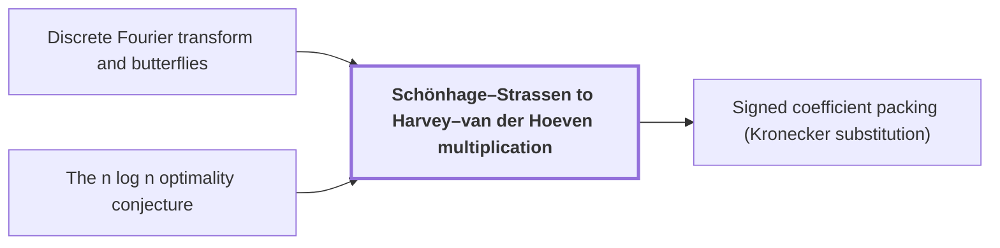

# Schönhage–Strassen to Harvey–van der Hoeven multiplication

!!! info "Before this page"

    Schönhage–Strassen to Harvey–van der Hoeven multiplication *computes its transforms by* [Discrete Fourier transform and butterflies](dft-fft.md "Each algorithm in the chain computes its transforms by the Discrete Fourier transform and butterflies, evaluating its coefficient lists at roots of unity in a suitable ring.") and *is measured against* [The n log n optimality conjecture](nlogn-conjecture.md "The chain's cost is measured against the The n log n optimality conjecture.").

!!! abstract "Where this fits"

    - Relied on to show: An $n$-bit integer product is computed by a fixed-tape machine in $O(n(\lg n)^{1-\kappa})$ time, $\kappa=2^{-182}$. ([Integer multiplication in O(n(lg n)^{1-κ}) time](main-theorem.md "Deterministic fixed-tape Turing machine multiplying n-bit integers in O(n(lg n)^{1-κ}), κ=2^{-182}, by reducing to ring convolution with fast address interchanges and simultaneous butterfly layers, disproving the n log n conjecture in this model."))

??? note "Symbols from earlier pages"

    - $n$ — integer length: The number of bits in each of the two integers being multiplied. (on [The n log n optimality conjecture](nlogn-conjecture.md "Schönhage–Strassen's proposal that n log n is the optimal order of cost for multiplying n-bit integers."))
    - $q$ — digit count: The number of radix digits of each input, equal to the ceiling of n divided by b. (on [Reduction of integer product to digit convolution](radix-digit-reduction.md "Splitting the inputs into radix digits turns the integer product into a convolution of short integer coefficients, followed by carry propagation."))
    - $b$ — digit width: The number of bits in each radix digit. (on [Reduction of integer product to digit convolution](radix-digit-reduction.md "Splitting the inputs into radix digits turns the integer product into a convolution of short integer coefficients, followed by carry propagation."))
    - $y$ — ring variable: The polynomial variable of the ring, whose powers act as roots of unity. (on [Polynomial ring modulo $y^r+1$](poly-ring-y-r.md "Complex-coefficient polynomials in y reduced by y^r = -1, so multiplying by a power of y is a signed shift of the coefficient list and powers of y serve as roots of unity."))
    - $r$ — ring degree: The number of complex coefficients in each element of the ring, a power of two. (on [Polynomial ring modulo $y^r+1$](poly-ring-y-r.md "Complex-coefficient polynomials in y reduced by y^r = -1, so multiplying by a power of y is a signed shift of the coefficient list and powers of y serve as roots of unity."))

Schönhage–Strassen to Harvey–van der Hoeven multiplication is the chain of multitape algorithms that lowers the cost of multiplying two integers from $O(n\log n\log\log n)$ to the unconditional $O(n\log n)$. Its two ends are the reference for the power saving in the main theorem.

Schönhage and Strassen showed that two $n$-bit integers can be multiplied<cite class="exegenius-ref" data-source="paper" data-locator="§1 Introduction" data-quote="in $O(n\log n\log\log n)$ time on a multitape Turing machine" title="in $O(n\log n\log\log n)$ time on a multitape Turing machine"> (see §1 Introduction)</cite>. Each algorithm in the chain computes its transforms by the [Discrete Fourier transform and butterflies](dft-fft.md "Evaluation of a coefficient list at roots of unity, computed in log-many levels of two-point butterfly operations; turns convolution into pointwise product."), evaluating its coefficient lists at roots of unity in a suitable ring.

The method splits each integer into $q$ digits of $b$ bits, so the product is a convolution of two digit lists with $q$ entries each. That linear convolution has $2q-1$ coefficients. Pad both lists with zeros to a power of two length $S \ge 2q-1$, so that $S$ is the number of entries in each padded list. The nonzero coefficients of the product then sit at indices $0$ to $2q-2<S$, so the cyclic convolution of length $S$ equals the linear one. Transform both padded lists, multiply the transforms entry by entry, and invert the transform. The entrywise products are multiplied by the same method, recursively, and Schönhage and Strassen's paper proves the resulting bound.

Later algorithms keep this scheme and change the ring. Fürer's 2007 bound replaces the factor $\log\log n$ by $2^{O(\log^* n)}$, where $\log^* n$ is the number of iterated logarithms needed to reach a constant. Later improvements reduced the exponential factor to $8^{\log^* n}$ and then $4^{\log^* n}$. Harvey and van der Hoeven removed the exponential factor, giving an unconditional algorithm running in $O(n\log n)$ time<cite class="exegenius-ref" data-source="paper" data-locator="§1 Introduction" data-quote="reached the unconditional $O(n\log n)$ upper bound" title="reached the unconditional $O(n\log n)$ upper bound"> (see §1 Introduction)</cite>.

The later stages use the ring modulo $y^r+1$, whose elements are polynomials of degree below $r$ with complex coefficients. There $y^r=-1$, so $y^{2r}=1$, and $y$ is a root of unity of order $2r$. No smaller positive power of $y$ is $1$. The powers $y^1,\dots,y^{r-1}$ are distinct basis monomials, $y^r=-1\neq 1$, and each of $y^{r+1},\dots,y^{2r-1}$ is minus one of $y^1,\dots,y^{r-1}$, so it is not $1$. Multiplying by a power of $y$ is therefore a cyclic shift of the coefficients with sign changes.

The $O(n\log n)$ bound matches the order Schönhage and Strassen proposed, but as an upper bound it does not show that $n\log n$ is optimal. The chain's cost is measured against the [The n log n optimality conjecture](nlogn-conjecture.md "Schönhage–Strassen's proposal that n log n is the optimal order of cost for multiplying n-bit integers.").

## Connections

Used by:

- [Signed coefficient packing (Kronecker substitution)](signed-packing.md "Signed coefficient packing computes its integer products by the Schönhage–Strassen to Harvey–van der Hoeven multiplication, an ordinary subroutine call that costs $O(n\log n)$.") *computes its integer products by* Schönhage–Strassen to Harvey–van der Hoeven multiplication

??? quote "From the sources"

    > Harvey and van der Hoeven reached the unconditional $O(n\log n)$ upper
    >
    > — [Integer multiplication below n log n (OpenAI, 2026)](https://github.com/openai/math/tree/fd4aeeb2ee4fc729c18d98444fed42fd0529eeeb/preprints/Integer-multiplication-below-n-log-n-September-23-2026)
