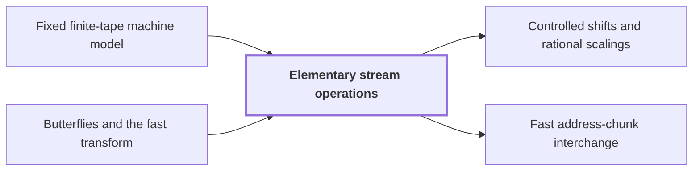

# Elementary stream operations

!!! info "Before this page"

    Elementary stream operations *runs on* [Fixed finite-tape machine model](machine-model.md "All four operations below run on the Fixed finite-tape machine model, where each head moves at most one cell per step, so one pass over the array costs time proportional to $V$.") and *rearranges data for transforms built from* [Butterflies and the fast transform](butterfly.md "A transform built from Butterflies and the fast transform applies two-point steps, each on one address bit, so it has $\Theta(\log n)$ levels, and each level needs the data rearranged for the paired entries to meet, then the arithmetic.").

!!! abstract "Where this fits"

    - Relied on to show: Bit variant: two disjoint address chunks of $u$ bits can be interchanged on a fixed number of tapes in $O(Vu^\tau)$ time, $\tau=1-2^{-50}$, although the intermediate steps form XOR combinations of data. ([Fast address-chunk interchange](address-interchange.md "The first tape procedure: exchanging two disjoint equal-width address fields of u digits in time O(V·u^τ) for a fixed τ < 1, using XOR combinations of intermediate data."))
    - Relied on to show: For a rational $m\times m$ matrix $A$ of rank $a$ and fields over $\mathbb Z/q^b\mathbb Z$, the shear $(H,D)\mapsto(H+AD,D)$ can be performed with exactly $a$ interchanges of pairs of $b$-digit fields and $O(V)$ further work. ([Matrix shear by triangular factorization](matrix-shear.md "Factoring a rational matrix as A = E₁ΠE₂ with lower triangular E₁, E₂ and partial permutation Π lets the shear (H,D)→(H+AD,D) be done with exactly rank(A) field interchanges."))
    - Relied on to show: Power-width interchange: if the circuit data satisfy the shear contract with $s<Wm$ and $s/W<m^\tau$, two disjoint chunks of $e=m^k$ radix-$q$ digits each (with a row field of length divisible by $W^k$ before both) can be interchanged in $O(Ve^\tau)$ time.
    - Relied on to show: For arbitrary widths $u$, prefixes, gaps and suffixes (including one-bit payloads) the interchange $(p,h,g,d,z)\mapsto(p,d,g,h,z)$ of two $u$-bit chunks costs $O(Vu^\tau)$.
    - Relied on to show: Complex variant: the tensor product of $H_0=\frac12\begin{pmatrix}1&1\\1&-1\end{pmatrix}$ on one bit of each of $D\le d$ address chunks (each of $K$ bits, selected at a common offset), acting coefficientwise on polynomial records with $r$ complex $p$-bit coefficients, is computed exactly followed by one truncation $Q_p$, in $O(Vd^{\lambda'})$ time with $\lambda'<1$, rather than $D$ whole-array passes. ([Simultaneous butterfly layer](simultaneous-layer.md "The second tape procedure: applying H₀ coefficientwise on the same bit of up to d address chunks in time O(V·d^λ′) for a fixed λ′ < 1, instead of d passes."))
    - Relied on to show: Selected bits of two chunks can be XORed (with a third chunk as restored scratch) by eight cyclic shifts of whole chunk ranges plus a repair of an explicitly bounded exceptional set of addresses, in time $O(V(L^\tau+1)+MA_{\rm rect}^3+\delta_{\rm bad}MA_{\rm rect}(R+A_{\rm rect}))$. ([Packed selected-bit addition](packed-bit-addition.md "XORing selected bits between two address chunks (with a third chunk as restored scratch) using cyclic shifts of whole chunk ranges plus a repair of explicitly bounded exceptional addresses."))
    - Relied on to show: Synthetic transforms over $\mathcal R_r$ on $d-1$ axes of lengths $t_i\in\{2^{\ell-1},2^\ell\}$ with outputs kept in a retained layout $LB$ cost $O(Tp[dK+pK^{\tau-1}+\ell d^{\lambda'}])$ with error less than $\sqrt2\ell\,2^{-p}$. ([Tape layout for synthetic transforms](transform-layout.md "Placing the selected bits of the participating axes at a common offset in K-bit chunks so each round of the synthetic transform is one simultaneous layer, costing less than log t passes."))
    - Relied on to show: Applied one coordinate line at a time to a padded box of $T=\prod_it_i$ entries, with $\gamma=2d\alpha^2$, $R F_{\boldsymbol s}=2^\gamma\mathcal B_0QF_{\boldsymbol t}\mathcal A$, both $\mathcal A$ and $\mathcal B_0$ are contractions with error less than $dp^2$, computed in $O(dTp^{3/2+\delta}\alpha)$ plus $O(Tp\,d^2(1+\ell^\tau))$ for exposing lines.
    - Relied on to show: The Chinese-remainder map $\Phi:\mathbb C[x]/(x^S-1)\to\mathbb C[x_1,\dots,x_d]/(x_i^{s_i}-1)$, $x\mapsto\prod_ix_i^{\mu_i}$, is an isomorphism preserving cyclic convolution, and it (with its inverse and padding) is implemented by triangular controlled shifts in $O(Tp\,d^2(1+\ell^\tau))$ time. ([Chinese-remainder address map](crt-map.md "An isomorphism that places a cyclic convolution of length S = s₁⋯s_d on pairwise coprime prime axes, implemented as triangular controlled shifts."))

??? note "Symbols from earlier pages"

    - $n$ — bit length: The number of bits in each of the two integers being multiplied. (on [Schönhage–Strassen optimality conjecture](conjecture.md "The 1971 proposal that n log n is the optimal order of growth for multiplying n-bit integers on a multitape Turing machine."))

Elementary stream operations are linear-time scans of an array stored on tape in lexicographic order; they are the data-movement primitives from which the later procedures for interchanging address fields are assembled, and they set the unit of cost, one pass, that those procedures must beat.

Throughout, $V$ is the volume of an array, the number of digits it stores, and $\beta\ge 2$ is the radix, the number of values one digit can take. Here $\beta$ is a radix, not a sequence length as on the [discrete Fourier transform](dft.md "The normalized transform (F_q u)_k = (1/q) Σ u_j e^{−2πi jk/q}, which turns convolution into pointwise multiplication.") and [cyclic convolution](convolution.md "The product of two sequences (or elements of a polynomial quotient ring) where indices wrap around: (f∗g)_k = Σ f_j g_{k−j}.") pages.

## Why one pass is the unit

All four operations below run on the [Fixed finite-tape machine model](machine-model.md "The computation model of the main theorem: one fixed finite alphabet and a fixed number of one-dimensional tapes, each head moving at most one cell per step."), where each head moves at most one cell per step, so one pass over the array costs time proportional to $V$. The $n$-bit inputs occupy $V=\Theta(n)$ stored bits, so a pass costs $\Theta(n)$.

A transform built from [Butterflies and the fast transform](butterfly.md "A two-point averaging/differencing step H₀(u,v) = ((u+v)/2, (u−v)/2) whose repeated use over address bits, with twiddle multiplications, computes a transform in log t layers.") applies two-point steps, each on one address bit, so it has $\Theta(\log n)$ levels, and each level needs the data rearranged for the paired entries to meet, then the arithmetic. Done naively, that is one pass per level, and scanning an array of $\Theta(n)$ stored bits at each of $\Theta(\log n)$ transform levels already costs $\Theta(n\log n)$<cite class="exegenius-ref" data-source="paper" data-locator="§1.1 The two tape operations" data-quote="Scanning an array of $\Theta(n)$ stored bits at each of $\Theta(\log n)$ transform levels already costs $\Theta(n\log n)$" title="Scanning an array of $\Theta(n)$ stored bits at each of $\Theta(\log n)$ transform levels already costs $\Theta(n\log n)$"> (see §1.1 The two tape operations)</cite>, the bound to be beaten.

The number of levels is fixed by the two-point structure, so what must shrink is the cost of a level: the same source concludes that savings are needed in both movement and arithmetic, and that two tape procedures supply them. The operations here are the baseline: each costs one pass, so they can be used a constant number of times but not once per level. Later pages build on them procedures that move address fields, or perform several levels together, in less than one pass per level.

## The operations

For a fixed radix, each of the following takes $O(V)$ steps on a fixed number of one-dimensional tapes<cite class="exegenius-ref" data-source="paper" data-locator="§2.1 Array order and elementary scans" data-quote="Each of the following operations on an array of volume $V$ takes $O(V)$ steps on a fixed number of one-dimensional tapes" title="Each of the following operations on an array of volume $V$ takes $O(V)$ steps on a fixed number of one-dimensional tapes"> (see §2.1 Array order and elementary scans)</cite>:

1. Permuting the pair of values at two chosen digit positions, adjacent or not.
2. Moving one chosen digit to another position, keeping the order of the positions in between.
3. Splitting on one chosen digit, applying a fixed pointwise map to the aligned streams, and merging them back.
4. Dealing whole rows cyclically into $W$ streams, where $W$ is the fixed number of streams, and, when $W$ divides the number of rows, merging the streams in any fixed order of the row classes.

In item 4 the array is indexed by $[P]\times[R]\times[B]$, where $P$ is the number of prefix values, $R$ is the number of rows (here $R$ is a row count, not the scalar ring) and $B$ is the number of entries per row.

The bounds include setting up counters and returning the work tapes to their initial state, and the constants depend on the radix, the pointwise map and $W$<cite class="exegenius-ref" data-source="paper" data-locator="§2.1 Array order and elementary scans" data-quote="The bounds include shape preparation, counter initialization and resets, and returning or clearing the visited portions of work tapes." title="The bounds include shape preparation, counter initialization and resets, and returning or clearing the visited portions of work tapes."> (see §2.1 Array order and elementary scans)</cite>

## Splitting

Splitting is a stable partition. A head scanning the array tracks its position with a counter and copies each entry onto the tape belonging to the value of the chosen digit, preserving order within each tape. Reading the $\beta$ tapes one after another lists the entries grouped by that digit, with the remaining digits still in their original order, which is exactly that digit moved to the front. For example, with digits $(a,b,c)$ and $b$ chosen, the stream for each value $j$ of $b$ holds the entries $(a,j,c)$ in their original order, and concatenating the streams gives the order $(j,a,c)$.

## Connections

Used by:

- [Controlled shifts and rational scalings](controlled-shifts.md "Each operation below is carried out by splitting into streams and merging back, as in Elementary stream operations.") *is carried out by* Elementary stream operations
- [Fast address-chunk interchange](address-interchange.md "Whole rows are split cyclically into $W$ role streams within each prefix, and row $Wx+w-1$ goes to stream $w$ as row $x$, using the scans of Elementary stream operations.") *splits rows using the scans of* Elementary stream operations

??? quote "From the sources"

    > Elementary stream operations
    >
    > — [Integer multiplication below n log n (OpenAI, 2026)](https://github.com/openai/math/tree/fd4aeeb2ee4fc729c18d98444fed42fd0529eeeb/preprints/Integer-multiplication-below-n-log-n-September-23-2026)

    > Scanning an array of $\Theta(n)$ stored bits at each of
    >
    > — [Integer multiplication below n log n (OpenAI, 2026)](https://github.com/openai/math/tree/fd4aeeb2ee4fc729c18d98444fed42fd0529eeeb/preprints/Integer-multiplication-below-n-log-n-September-23-2026)
