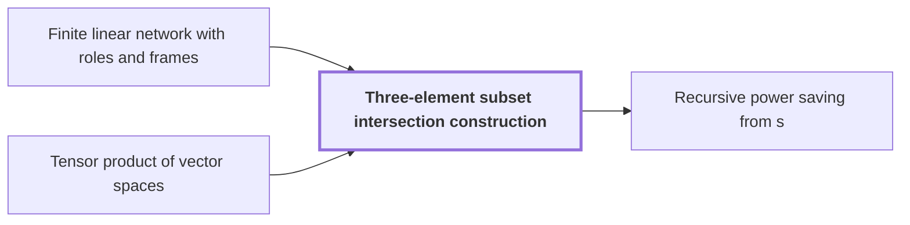

# Three-element subset intersection construction

!!! info "Before this page"

    Three-element subset intersection construction *is built inside* [Finite linear network with roles and frames](linear-network-roles.md "It is built inside a Finite linear network with roles and frames.") and *is built from* [Tensor product of vector spaces](glossary.md#tensor-product-of-vector-spaces "Let $\mathcal F=(\mathbb Q^h)^{\otimes 3}$, a space built from the Tensor product of vector spaces of three copies of $\mathbb Q^h$, of dimension $D=h^3$ (the label space dimension).").

!!! abstract "Where this fits"

    1. An $n$-bit integer product is computed by a fixed-tape machine in $O(n(\lg n)^{1-\kappa})$ time, $\kappa=2^{-182}$. — how: reduce multiplication to ring convolution and speed up its address moves and butterfly layers ([Integer multiplication in O(n(lg n)^{1-κ}) time](main-theorem.md "Deterministic fixed-tape Turing machine multiplying n-bit integers in O(n(lg n)^{1-κ}), κ=2^{-182}, by reducing to ring convolution with fast address interchanges and simultaneous butterfly layers, disproving the n log n conjecture in this model."))
    2. Two fixed-tape procedures, an address interchange and a simultaneous butterfly layer, cost $O(Vu^\tau)$ and $O(Vd^{\lambda'})$ for fixed exponents below 1, where $V$ is the stored bit volume. — how: build both procedures from one finite linear network and a recursion that saves a power
    3. **This page:** The network is built from three-element subsets with gather, scatter and cancelling auxiliary wires, so that the total number $s$ of smaller calls satisfies $s<Wm$.

??? note "Symbols from earlier pages"

    - $W$ — number of roles: The number of roles, the wires' fixed places in the network, over which rows are distributed. (on [Finite linear network with roles and frames](linear-network-roles.md "Fixed linear network exchanging two banks of values with prescribed signs and restoring auxiliary values; wires have roles, rows are distributed cyclically among roles, and invertible frame operators cancel along routes leaving an endpoint operator."))

The three-element subset intersection construction is a fixed network of gather, scatter and auxiliary wires that makes few enough smaller calls for the recursion to save a power. It is built inside a [Finite linear network with roles and frames](linear-network-roles.md "Fixed linear network exchanging two banks of values with prescribed signs and restoring auxiliary values; wires have roles, rows are distributed cyclically among roles, and invertible frame operators cancel along routes leaving an endpoint operator.").

Let $[h]=\{1,\dots,h\}$ be the ground set, with $h=100$ (the letter $h$ changes meaning here). For a three-element subset $T$ of $[h]$, called a triple, $t_T$ is its indicator vector, and $\mathcal T$ is the set of all triples. Call two triples $T,S$ *neighbors* when $|T\cap S|=1$. Each triple $T$ carries a value $g_T$.

**Coefficients.** Over $\mathbb F_2$, gather puts the sum of the $g_T$ with $T\ni e$ on a central wire $C_e$ for each element $e$, and scatter adds $\sum_{e\in S}C_e$ to the target $S$. So $g_T$ reaches $S$ with coefficient $|S\cap T|$ mod $2$. A copy of $g_T$ on an auxiliary wire $A_{ST}$ for each neighbor pair, injected back into $S$, adds $1$ exactly when $|S\cap T|=1$. The net coefficient $|S\cap T|+[|S\cap T|=1]$ mod $2$ is $0$ for sizes $0,1,2$ and $1$ for $T=S$, so only $g_S$ remains.

**Labels.** Over $\mathbb Q$, the bilinear form with matrix $I-J/9$, where $J$ is the all-one matrix (the letter $J$ changes meaning here), gives $\langle t_T,t_S\rangle=|T\cap S|-1$; neighbors are orthogonal. Let $\mathcal F=(\mathbb Q^h)^{\otimes 3}$, a space built from the [Tensor product of vector spaces](glossary.md#tensor-product-of-vector-spaces "The space built from tuples of vectors whose dimension is the product of the factors' dimensions, so (Q^h)^{⊗3} has dimension h^3.") of three copies of $\mathbb Q^h$, of dimension $D=h^3$ (the label space dimension). A label $U$ is a nondegenerate subspace of $\mathcal F$. For an index $\iota=(T_1,T_2,T_3)\in\mathcal T^3$, the label $U_\iota$ is the line spanned by $t_{T_1}\otimes t_{T_2}\otimes t_{T_3}$. Along a side wire, a label containing $t_T$ may grow to $t_S^\perp$, since $t_T\perp t_S$, adding $h-2$ dimensions.

**Counting.** Give each gate or sink with label $U$ the projection $P_U$ onto $U$ along $U^\perp$, and the source of index $\iota$ the matrix $-P_{U_\iota}$. If $U\subseteq V$, then $P_V-P_U$ is the identity on $V\cap U^\perp$ and zero on $U\oplus V^\perp$, so its rank is $\dim V-\dim U$. Let $s$, the total rank over all edges, change meaning here. Each unit of rank costs one smaller call.<cite class="exegenius-ref" data-source="paper" data-locator="§4 Faster interchange of address chunks" data-quote="An edge matrix of rank $a$ will require $a$ smaller interchanges." title="An edge matrix of rank $a$ will require $a$ smaller interchanges."> (see §4 Faster interchange of address chunks)</cite>

Let $N=\binom h3^3$, the number of indices $\iota$ (the letter $N$ changes meaning here). Signed label changes telescope along each wire, and gate labels cancel. Sources have dimension $1$, summing to $N$; sinks have dimension $D$, except the $N$ sinks that receive the sources, which have label $U_\iota^\perp$ and dimension $D-1$. So the signed total is $WD-2N$.

Let $L$ be the total dimension lost on decreasing edges (the letter $L$ changes meaning here). Each of the $3\binom h3^2$ invocations has $h$ central wires, each losing $h$ on a decreasing edge, so $L=3\binom h3^2h^2$. Absolute values add $2L$. The first edge out of each source has matrix $2P_{U_\iota}$, rank one, with no label change; these $N$ ranks give
$$s=WD-2N+2L+N=WD-N+2L$$

Now $L/N=3h^2/\binom h3=100/539$<cite class="exegenius-ref" data-source="paper" data-locator="§3.3 Subspaces attached to the gates" data-quote="The loss ratios have the exact values" title="The loss ratios have the exact values"> (see §3.3 Subspaces attached to the gates)</cite>, so $2L<N$ and $s<WD$. Here $\mathcal F$ is the fixed space, so the paper's dimension $m$ is $D$. The paper's decisive property is a bound on the number of smaller calls,<cite class="exegenius-ref" data-source="paper" data-locator="§1.2 Linear networks and the recursive saving" data-quote="smaller calls satisfies $s&lt;Wm$" title="smaller calls satisfies $s&lt;Wm$"> (see §1.2 Linear networks and the recursive saving)</cite>.

## Connections

Used by:

- [Recursive power saving from s<Wm](recursive-power-saving.md "The recursion is built on the Three-element subset intersection construction, which gives $s<Wm$ smaller calls.") *is built on* Three-element subset intersection construction

??? quote "From the sources"

    > The construction uses
    >
    > — [Integer multiplication below n log n (OpenAI, 2026)](https://github.com/openai/math/tree/fd4aeeb2ee4fc729c18d98444fed42fd0529eeeb/preprints/Integer-multiplication-below-n-log-n-September-23-2026)

    > three-element subsets
    >
    > — [Integer multiplication below n log n (OpenAI, 2026)](https://github.com/openai/math/tree/fd4aeeb2ee4fc729c18d98444fed42fd0529eeeb/preprints/Integer-multiplication-below-n-log-n-September-23-2026)
