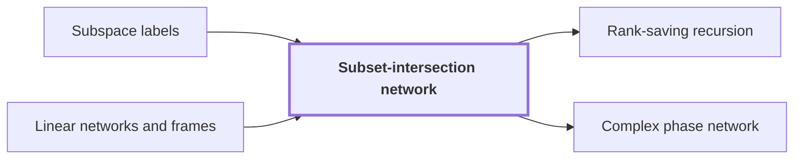

# Subset-intersection network

!!! info "Before this page"

    Subset-intersection network *attaches* [Subspace labels](subspace-labels.md "The network attaches subspace labels to its gates and terminals.") and *is based on* [Linear networks and frames](linear-network-frames.md "The network is based on linear networks and frames, so its wires carry scalars and its gates combine them.").

!!! abstract "Where this fits"

    1. A deterministic fixed-tape machine multiplies two $n$-bit integers exactly in $O(n(\lg n)^{1-\kappa})$ time, with $\kappa=2^{-182}$, below the $n\lg n$ conjecture in this model. — how: bound the cost of an exact multiplication whose transform layers are made cheap by two tape procedures, then fix parameters so every cost term fits ([Integer multiplication below n log n](main-theorem.md "A deterministic fixed-tape machine that multiplies two n-bit integers exactly in O(n (lg n)^(1−κ)) time with κ = 2^−182, which disproves the n log n optimality conjecture in this model."))
    2. Two disjoint equal address fields of $u$ bits in an array of stored volume $V$ can be interchanged in $O(V u^{\tau})$ time. — how: apply a fixed linear network that exchanges two banks while restoring scratch values, recursively on streams of $1/W$ of the volume, so each level costs a strictly smaller power ([Address-field interchange](address-interchange.md "A tape procedure that swaps two disjoint contiguous address fields of an array in time that grows like a power of the field width, rather than linearly."))
    3. **This page:** A fixed linear network on three-element subsets exchanges two banks of scalars and restores every scratch wire.

A subset-intersection network is a fixed linear network on the three-element subsets of a ground set. It is the exchange step that the [address-field interchange](address-interchange.md "A tape procedure that swaps two disjoint contiguous address fields of an array in time that grows like a power of the field width, rather than linearly.") applies recursively. It exchanges two banks of scalars while restoring every auxiliary wire, meaning every extra wire used as scratch space ends with the value it started with.

The network is based on [linear networks and frames](linear-network-frames.md "A fixed linear network that exchanges two banks of values while restoring scratch values, in which each vertex carries an invertible operator called its frame."), so its wires carry scalars and its gates combine them. Gates are the vertices that combine values, and terminals are the endpoints where the two banks attach. The network attaches [subspace labels](subspace-labels.md "Nondegenerate subspaces of a fixed bilinear space attached to each wire of a network, whose inclusions control how much work a change of representation costs.") to its gates and terminals. Here $m$ is the dimension of the fixed space from which the labels are drawn.

Take the ground set $\{1,2,3,4\}$. Two distinct three-element subsets of it always meet in exactly two elements. So a gate that depends only on intersection size treats every pair of distinct subsets alike, and it treats a subset paired with itself, which meets in three elements, differently.

Gather and scatter are the two operations that group values by intersection size. Gather combines the values of subsets that share an intersection size, and scatter spreads a value back over such subsets. The construction builds its coefficients this way.<cite class="exegenius-ref" data-source="paper" data-locator="§11 A consequence for matrix transposition, p. 4" data-quote="The construction uses three-element subsets: gather and scatter create coefficients depending on intersection size, and auxiliary wires cancel the unwanted coefficients." title="The construction uses three-element subsets: gather and scatter create coefficients depending on intersection size, and auxiliary wires cancel the unwanted coefficients."> (see §11 A consequence for matrix transposition, p. 4)</cite> Coefficients of this kind, with the rest cancelled, give an exchange whose subspace ranks can be controlled.

Here $s$ is the total number of smaller calls made by one call. Here $t$ is the factor by which the stream volume shrinks, so each smaller call works on a stream of $1/t$ of the volume. The step needs $s<tm$, the inequality the rest of the argument uses.

## Connections

Used by:

- [Rank-saving recursion](rank-saving-recursion.md "Rank-saving recursion is realized by a subset-intersection network on three-element subsets.") *is realized by* Subset-intersection network
- [Complex phase network](complex-phase-network.md "A complex phase network is built on a Subset-intersection network with a frame change on each edge.") *is built on* Subset-intersection network

??? quote "From the sources"

    > The construction uses three-element subsets: gather and scatter create coefficients
    >
    > — Integer multiplication below n log n (OpenAI, 2026)
