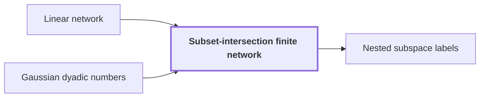

# Subset-intersection finite network

!!! info "Before this page"

    Subset-intersection finite network *is built as a* [Linear network](linear-network.md "The subset-intersection finite network is built as a linear network that exchanges two banks of scalars indexed by three-element subsets of a ground set.") and *takes its scalars from* [Gaussian dyadic numbers](glossary.md#gaussian-dyadic "The complex version takes its scalars from $\mathbb Z[i,1/2]$, the Gaussian dyadic numbers, and neighbours are distinct triples with even intersection.").

!!! abstract "Where this fits"

    - Relied on to show: Interchanging two equal address fields of width $u$ costs less than linear in $u$ per unit volume. ([Fast interchange of address chunks](tape-interchange.md "A fixed-tape procedure that swaps two disjoint equal-width address fields of an array in time O(V u^τ) for a fixed τ < 1, where V is the stored volume and u the field width, using XOR combinations of intermediate data."))

The subset-intersection finite network is built as a [linear network](linear-network.md "A fixed network of wires with gates that apply fixed linear maps to the values on their wires, used here to exchange two banks of values while restoring all auxiliary values.") that exchanges two banks of scalars indexed by three-element subsets of a ground set. [Fast interchange of address chunks](tape-interchange.md "A fixed-tape procedure that swaps two disjoint equal-width address fields of an array in time O(V u^τ) for a fixed τ < 1, where V is the stored volume and u the field width, using XOR combinations of intermediate data.") uses it for its scalar swap.

Let $[h]=\{1,\dots,h\}$ be the ground set, where $h$ is the number of its elements. Let $\mathcal T$ be the set of three-element subsets of $[h]$, and write $S,T\in\mathcal T$ for triples. Write $X$ and $Y$ for the two banks, which hold a scalar $x_S$ and a scalar $y_S$ for each triple $S$, and $x_T$ is the same family indexed by $T$.

In the bit version, scalars lie in $\mathbb F_2$, and $S,T$ are neighbours when $|S\cap T|=1$. The complex version takes its scalars from $\mathbb Z[i,1/2]$, the [Gaussian dyadic numbers](glossary.md#gaussian-dyadic "Complex numbers whose real and imaginary parts are both dyadic rationals, that is, have power-of-two denominators."), and neighbours are distinct triples with even intersection.

Scratch wires start with arbitrary values. Each ordered neighbouring pair $(S,T)$ has a side wire $A_{ST}$. Each element $g\in[h]$ has a central wire $C_g$, and the complex version adds one more central wire $C_\ast$. The four operations each add a sum of wires to one wire and leave the wires they read unchanged:

- Copy adds $x_T$ to $A_{ST}$.
- Gather adds $\sum_{T\ni g}x_T$ to $C_g$.
- Scatter adds $\sum_{g\in S}C_g$ to $y_S$.
- Side injection adds $\sum_T A_{ST}$, over the neighbours $T$ of $S$, to $y_S$.

In the complex version, gather also adds $\sum_T x_T$ to $C_\ast$, scatter adds $(\sum_{g\in S}C_g-C_\ast)/2$ to $y_S$, and side injection adds $-\frac{|S\cap T|-1}{2}A_{ST}$ for each neighbour $T$.

Gather then scatter adds $\sum_{g\in S}\sum_{T\ni g}x_T=\sum_T|S\cap T|\,x_T$ to $y_S$, because $T$ contains exactly $|S\cap T|$ elements of $S$. So $x_T$ reaches $y_S$ with weight $|S\cap T|$, and side injection removes the unwanted weight. In the bit version this weight is read mod 2: it is $1$ for neighbours and for $T=S$, and side injection cancels the neighbours over $\mathbb F_2$, leaving weight $1$ only for $T=S$. In the complex version scatter gives weight $(|S\cap T|-1)/2$ to $x_T$, and side injection gives $-(|S\cap T|-1)/2$ to each neighbour. A neighbour has $|S\cap T|\in\{0,2\}$, so its two terms cancel.<cite class="exegenius-ref" data-source="paper" data-locator="§3.1 Scalar operations and restored auxiliary values" data-quote="The side cancels it for distinct triples with intersection zero or two" title="The side cancels it for distinct triples with intersection zero or two"> (see §3.1 Scalar operations and restored auxiliary values)</cite> A distinct non-neighbour has $|S\cap T|=1$, so its weight is $0$, while $T=S$ keeps weight $1$. In both versions $x_T$ reaches $y_S$ with weight $1$ if $T=S$ and $0$ otherwise.

A forward invocation runs eight rows in order: subtract side injection, subtract scatter, copy, gather, scatter, side injection, undo gather, undo copy. Rows 0 and 1 remove the effect of the starting scratch values on $y_S$, rows 2 to 5 add the $x_T$ terms, and rows 6 and 7 restore the scratch wires. Since the starting values cancel whatever they are, $y_S\gets y_S+x_S$ for each $S$ and nothing else changes.

Each gate adds a fixed combination of wires that it does not change. So running the same rows in reverse order, with every gate negated, undoes a forward invocation. With $Y$ as source and $X$ as target, the inverse schedule gives $X\gets X-Y$<cite class="exegenius-ref" data-source="paper" data-locator="§3.1 Scalar operations and restored auxiliary values" data-quote="The inverse schedule with logical source $Y$ and target $X$ effects" title="The inverse schedule with logical source $Y$ and target $X$ effects"> (see §3.1 Scalar operations and restored auxiliary values)</cite>.

Three invocations in turn, forward, inverse and forward, take $(X,Y)$ to $(X,\,Y+X)$, then to $(-Y,\,Y+X)$, then to $(-Y,\,X)$. So the banks go from $(X,Y)$ to $(-Y,X)$<cite class="exegenius-ref" data-source="paper" data-locator="§3.1 Scalar operations and restored auxiliary values" data-quote="(X_a,Y_a)\longmapsto(-Y_a,X_a)" title="(X_a,Y_a)\longmapsto(-Y_a,X_a)"> (see §3.1 Scalar operations and restored auxiliary values)</cite>.

## Connections

Used by:

- [Nested subspace labels](subspace-labels.md "The labels are built on a Subset-intersection finite network.") *are built on* Subset-intersection finite network

??? quote "From the sources"

    > three-element subsets: gather and scatter create coefficients depending
    >
    > — [Integer multiplication below n log n (OpenAI, 2026)](https://github.com/openai/math/tree/fd4aeeb2ee4fc729c18d98444fed42fd0529eeeb/preprints/Integer-multiplication-below-n-log-n-September-23-2026)
