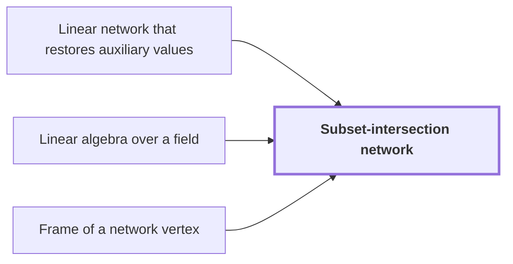

# Subset-intersection network

!!! info "Before this page"

    Subset-intersection network *is based on* [Linear network that restores auxiliary values](linear-network.md "It is based on a Linear network that restores auxiliary values of gates that exchange the banks $X_a$ and $Y_a$ with signs."), *is built on* [Linear algebra over a field](linear-algebra.md "Each gate and terminal carries a subspace label of one fixed space, so the network is built on Linear algebra over a field.") and *is computed from* [Frame of a network vertex](frame.md "The operator on each role is computed from the endpoint frames of the Frame of a network vertex, so only the two ends of a route matter.").

??? note "Symbols from earlier pages"

    - $X_a$ — data bank X: The first data bank, holding one value for each index $a$. (on [Linear network that restores auxiliary values](linear-network.md "A fixed network of linear gates that exchanges two banks of values with prescribed signs and returns every auxiliary value to its starting state."))
    - $Y_a$ — data bank Y: The second data bank, holding one value for each index $a$. (on [Linear network that restores auxiliary values](linear-network.md "A fixed network of linear gates that exchanges two banks of values with prescribed signs and returns every auxiliary value to its starting state."))
    - $h$ — ground set size: The number of elements of the ground set, from which the three-element subsets are taken. (on [Linear network that restores auxiliary values](linear-network.md "A fixed network of linear gates that exchanges two banks of values with prescribed signs and returns every auxiliary value to its starting state."))
    - $T$ — subset T: A three-element subset of $[h]$ used as a varying coordinate, not the linear map of the earlier page. (on [Linear network that restores auxiliary values](linear-network.md "A fixed network of linear gates that exchanges two banks of values with prescribed signs and returns every auxiliary value to its starting state."))
    - $S$ — subset S: A three-element subset of $[h]$ used as the varying target coordinate of an invocation. (on [Linear network that restores auxiliary values](linear-network.md "A fixed network of linear gates that exchanges two banks of values with prescribed signs and returns every auxiliary value to its starting state."))
    - $a$ — bank index: A triple of subsets $a=(a_1,a_2,a_3)$ that indexes each value of the two banks. (on [Linear network that restores auxiliary values](linear-network.md "A fixed network of linear gates that exchanges two banks of values with prescribed signs and returns every auxiliary value to its starting state."))

The subset-intersection network is a linear network whose labels are subspaces chosen from intersection sizes of three-element subsets. It shows that its number of smaller calls is less than its number of wires times the label dimension, the saving the main theorem uses.

It is based on a [Linear network that restores auxiliary values](linear-network.md "A fixed network of linear gates that exchanges two banks of values with prescribed signs and returns every auxiliary value to its starting state.") of gates that exchange the banks $X_a$ and $Y_a$ with signs. Each gate and terminal carries a subspace label of one fixed space, so the network is built on [Linear algebra over a field](linear-algebra.md "The theory of vector spaces, linear maps, invertible operators, subspaces, and the rank of a linear map."). Here $W$ is the number of wires, $m=h^3$ is the dimension of the label space, and $\sigma$ is the total number of smaller calls.

For a three-element subset $T$, let $t_T\in\mathbb Q^h$ be its indicator vector, with entry 1 at each element of $T$ and 0 elsewhere. Take the form
$$\langle x,y\rangle=\sum_i x_iy_i-\tfrac19\Bigl(\sum_i x_i\Bigr)\Bigl(\sum_i y_i\Bigr)$$
on $\mathbb Q^h$. The first sum counts common elements, and each indicator sums to 3, so $\langle t_S,t_T\rangle=|S\cap T|-\tfrac19\cdot3\cdot3=|S\cap T|-1$ and $\langle t_T,t_T\rangle=2$. The bank label $U_a$ is the span of $t_{a_1}\otimes t_{a_2}\otimes t_{a_3}$, a line.

Labels at the two ends of an edge are nested, so one contains the other.<cite class="exegenius-ref" data-source="paper" data-locator="§3.3 Subspaces attached to the gates" data-quote="Every edge joins comparable nondegenerate labels" title="Every edge joins comparable nondegenerate labels"> (see §3.3 Subspaces attached to the gates)</cite>. Changing a label's dimension by some amount costs that many smaller calls, since the projections onto the two labels differ by a matrix of that rank, and each unit of rational rank is one smaller interchange. So $\sigma$ is the sum of the ranks of all edge differences.

Each gate's label enters and leaves it, so gate contributions cancel in the signed sum of changes, leaving sinks minus sources. The sources total $N$, the number of banks $X_a$, since each $U_a$ is a line. Every sink label is the whole space, except the $N$ sinks $U_a^\perp$ of the $Y_a$, which have one dimension less, so the sinks total $Wm-N$. The signed sum is $Wm-2N$. Let $\lambda$ be the total dimension lost on decreasing edges. The sum of absolute changes is the signed sum plus $2\lambda$, namely $Wm-2N+2\lambda$.

The rational interface adds one rank per bank: the source matrix of $X_a$ is minus the projection onto $U_a$, of rank one, on an edge with no label change. The operator on each role is computed from the endpoint frames of the [Frame of a network vertex](frame.md "An invertible linear operator attached to a vertex of a linear network that changes how the array stored on each wire is represented."), so only the two ends of a route matter. Hence $\sigma=Wm-N+2\lambda$, and $\sigma<Wm$ exactly when $\lambda<N/2$.

The only decreasing edges are central-wire returns, each losing $h$ dimensions. For the two constructions the paper gives $\lambda/N=100/539$ and $101/539$;<cite class="exegenius-ref" data-source="paper" data-locator="§3.3 Subspaces attached to the gates" data-quote="both are smaller than $1/2$" title="both are smaller than $1/2$"> (see §3.3 Subspaces attached to the gates)</cite>. So the deficit is $Wm-\sigma=N-2\lambda=\tfrac{339}{539}N$ for the bit network, a fixed fraction of $N$ independent of the input length.

## Connections

??? quote "From the sources"

    > The construction uses three-element subsets
    >
    > — [Integer multiplication below n log n (OpenAI, 2026)](https://github.com/openai/math/tree/fd4aeeb2ee4fc729c18d98444fed42fd0529eeeb/preprints/Integer-multiplication-below-n-log-n-September-23-2026)
