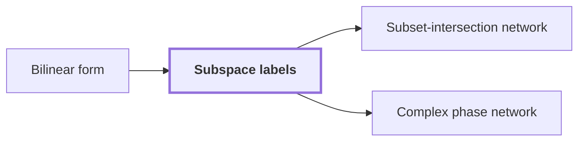

# Subspace labels

!!! info "Before this page"

    Subspace labels *is based on* [Bilinear form](glossary.md#bilinear-form "Subspace labels are based on the fixed bilinear space $F$, whose Bilinear form $\langle p,q\rangle$ is linear in each argument, where $p$ and $q$ are vectors of $F$.").

!!! abstract "Where this fits"

    - Relied on to show: A fixed linear network on three-element subsets exchanges two banks of scalars and restores every scratch wire. ([Subset-intersection network](subset-intersection-network.md "A linear network on the three-element subsets of a ground set, whose wires carry scalars and whose gates combine them by intersection size, so that it swaps two banks while cancelling arbitrary scratch values."))
    - Relied on to show: The total number $s$ of smaller calls satisfies $s<Wm$. ([Rank-saving recursion](rank-saving-recursion.md "The recursion in which each call splits into s smaller calls on streams of 1/W of the volume, where s < W m, so that the cost grows by the strictly smaller factor s/W per level."))

Subspace labels are the intermediate subspaces that a [linear network](linear-network-frames.md "A fixed linear network that exchanges two banks of values while restoring scratch values, in which each vertex carries an invertible operator called its frame.") attaches to its wires, chosen so that each change of representation along a wire is cheap. They make the scalar network's signed exchange affordable.

Subspace labels are based on the fixed bilinear space $F$, whose [Bilinear form](glossary.md#bilinear-form "A function of two vectors that is linear in each argument; a form is nondegenerate when no nonzero vector is orthogonal to every vector of the space.") $\langle p,q\rangle$ is linear in each argument, where $p$ and $q$ are vectors of $F$. We assume $F$ is nondegenerate: no nonzero vector is orthogonal to every vector of $F$.

A label $L$ is a nondegenerate subspace of $F$, meaning $L\cap L^{\perp}=\{0\}$, where $L^{\perp}$ is the set of vectors orthogonal to every vector of $L$. Each wire carries one label at each stage of the network.

On every edge one label contains the other. For an edge with $L\subseteq M$, $L$ and $M$ are its smaller and larger label. Its orthogonal residual is $R=M\cap L^{\perp}$, the orthogonal complement of the smaller label inside the larger one.

The residual's dimension is the change in label dimension across the edge. Since $L$ and $F$ are nondegenerate, $F=L\oplus L^{\perp}$ and $\dim L^{\perp}=\dim F-\dim L$ (standard linear algebra). For $p\in M$, write $p=c+r$ with $c\in L$ and $r\in L^{\perp}$; then $r=p-c\in M$, so $r\in R$. Hence $M=L+R$ with $L\cap R=\{0\}$, and $\dim R=\dim M-\dim L$.

Small residuals mean that few dimensions change on each edge, so a change of frame touches little data.

Example. Take $F=\mathbb{C}^3$ with $\langle p,q\rangle=p_1q_1+p_2q_2+p_3q_3$. This form is nondegenerate: if $\langle p,q\rangle=0$ for every $q$, then each $p_i=0$. Let $L=\operatorname{span}((1,0,0))\subseteq M=\operatorname{span}((1,0,0),(0,1,0))$. Then $L^{\perp}=\operatorname{span}((0,1,0),(0,0,1))$, so $R=M\cap L^{\perp}=\operatorname{span}((0,1,0))$, and $\dim R=1=\dim M-\dim L$.

## Connections

Used by:

- [Subset-intersection network](subset-intersection-network.md "The network attaches subspace labels to its gates and terminals.") *attaches* Subspace labels
- [Complex phase network](complex-phase-network.md "Each wire is labelled by Subspace labels.") *is labelled by* Subspace labels

??? quote "From the sources"

    > A label is a nondegenerate subspace of a fixed bilinear
    >
    > — Integer multiplication below n log n (OpenAI, 2026)
