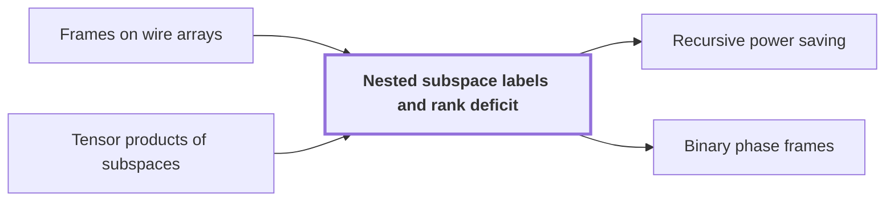

# Nested subspace labels and rank deficit

!!! info "Before this page"

    Nested subspace labels and rank deficit *chooses the frames of* [Frames on wire arrays](array-frames.md "The labelling chooses the frames of Frames on wire arrays so that a network of $W\in\{W_{\rm b},W_{\rm c}\}$ wires costs $s<Wm$ smaller calls, the saving the recursion needs.") and *rests on facts about* [Tensor products of subspaces](tensor-product-of-spaces.md "Dimension counting rests on three facts about tensor products of subspaces: for subspaces $E,E',G$ of tensor powers of $F$, $\dim(E\otimes G)=\dim E\cdot\dim G$; the form multiplies factorwise, so products of nondegenerate subspaces are nondegenerate; and $(E\perp E')\otimes G=(E\otimes G)\perp(E'\otimes G)$.").

!!! abstract "Where this fits"

    1. A single deterministic Turing machine with a fixed finite alphabet and a fixed finite number of one-dimensional tapes multiplies two $n$-bit integers exactly in $O(n(\lg n)^{1-\kappa})$ worst-case time with $\kappa=2^{-182}$, disproving the $n\log n$ optimality conjecture of Sch\"onhage and Strassen in this model. — how: Build two power-saving tape procedures (chunk interchange and simultaneous butterfly layer) from fixed finite linear networks; use them to accelerate the synthetic polynomial transforms and ring convolution; use Gaussian resampling with retained permutations and chirps to reduce the prime-length cyclic convolution of the radix-digit coefficients to those power-of-two transforms; assemble the exact product with a proof that the error is below $1/2$; and total the cost to show a power of $\log n$ is saved. ([Power-saving integer multiplication](main-result.md "A deterministic fixed-tape Turing machine multiplying two n-bit integers exactly in O(n(lg n)^{1−κ}) time with κ = 2^{−182}, disproving the n log n optimality conjecture in this model."))
    2. Both tape primitives (the interchange of two address chunks of $u$ digits and the simultaneous butterfly layer on up to $d$ axes) cost the volume times a power below one of their width, because a call at parameter $mf$ makes $s$ calls at parameter $f$ on streams of volume $V/W$ with $s<Wm$, so the cost per unit volume grows by $s/W<m$ per factor $m$ of the parameter. — how: Build a fixed finite linear network of $W$ wires that exchanges two banks and restores all scratch values, make the representation of each wire's array vary along the network through frames so that an edge costs one smaller call per unit of rank, show the total rank $s$ is below $Wm$, fix an exponent, and solve the recurrence in the bit variant (interchange) and the complex variant (butterfly layer). ([Recursive power saving](rank-recurrence.md "Each call at parameter m·f makes s calls at parameter f on streams of 1/W the volume, so cost per unit volume grows by s/W < m per factor m, giving a power saving."))
    3. **This page:** Attaching to the gates nondegenerate subspaces of an $m$-dimensional space, nested along every edge, the number of smaller calls (the total rank of the edge changes) is $s_{\rm b}=W_{\rm b}m-N+2L_{\rm b}$ for the bit network and $s_{\rm c}=W_{\rm c}m-2N+2L_{\rm c}$ for the complex network, both strictly less than $Wm$, because $L/N<1/2$.

??? note "Symbols from earlier pages"

    - $m$ — label-space dimension: The dimension of the label space used on later pages. (on [Linear exchange network with restored scratch wires](exchange-network.md "A fixed network of linear gates on wires holding values that swaps two banks with a prescribed sign while undoing the effect of arbitrary initial scratch values, built from three-element subsets."))
    - $F$ — base space: A space of dimension h with a nondegenerate form, whose triple power is the label space. (on [Tensor products of subspaces](tensor-product-of-spaces.md "The space built from two spaces whose dimension is the product of their dimensions, in which operators and bilinear forms act factorwise."))
    - $h$ — ground-set size: The size of the ground set [h] whose three-element subsets index the banks. (on [Linear exchange network with restored scratch wires](exchange-network.md "A fixed network of linear gates on wires holding values that swaps two banks with a prescribed sign while undoing the effect of arbitrary initial scratch values, built from three-element subsets."))
    - $X$ — first data bank: One of the two data banks, with entries X_a. (on [Linear exchange network with restored scratch wires](exchange-network.md "A fixed network of linear gates on wires holding values that swaps two banks with a prescribed sign while undoing the effect of arbitrary initial scratch values, built from three-element subsets."))
    - $Y$ — second data bank: The other data bank, with entries Y_a. (on [Linear exchange network with restored scratch wires](exchange-network.md "A fixed network of linear gates on wires holding values that swaps two banks with a prescribed sign while undoing the effect of arbitrary initial scratch values, built from three-element subsets."))
    - $a$ — bank index: A triple of three-element subsets of [h] indexing the entries of the banks. (on [Linear exchange network with restored scratch wires](exchange-network.md "A fixed network of linear gates on wires holding values that swaps two banks with a prescribed sign while undoing the effect of arbitrary initial scratch values, built from three-element subsets."))
    - $N$ — bank size: The number of values in each data bank. (on [Linear exchange network with restored scratch wires](exchange-network.md "A fixed network of linear gates on wires holding values that swaps two banks with a prescribed sign while undoing the effect of arbitrary initial scratch values, built from three-element subsets."))
    - $v$ — number of triples: The number of three-element subsets of [h]. (on [Linear exchange network with restored scratch wires](exchange-network.md "A fixed network of linear gates on wires holding values that swaps two banks with a prescribed sign while undoing the effect of arbitrary initial scratch values, built from three-element subsets."))
    - $I$ — invocation count: The number of invocations over all three stages. (on [Linear exchange network with restored scratch wires](exchange-network.md "A fixed network of linear gates on wires holding values that swaps two banks with a prescribed sign while undoing the effect of arbitrary initial scratch values, built from three-element subsets."))
    - $c_{\rm b}$ — bit central wires: The number of central wires per invocation in the bit network. (on [Linear exchange network with restored scratch wires](exchange-network.md "A fixed network of linear gates on wires holding values that swaps two banks with a prescribed sign while undoing the effect of arbitrary initial scratch values, built from three-element subsets."))
    - $c_{\rm c}$ — complex central wires: The number of central wires per invocation in the complex network. (on [Linear exchange network with restored scratch wires](exchange-network.md "A fixed network of linear gates on wires holding values that swaps two banks with a prescribed sign while undoing the effect of arbitrary initial scratch values, built from three-element subsets."))
    - $W_{\rm b}$ — bit wire count: The total number of wires in the bit network. (on [Linear exchange network with restored scratch wires](exchange-network.md "A fixed network of linear gates on wires holding values that swaps two banks with a prescribed sign while undoing the effect of arbitrary initial scratch values, built from three-element subsets."))
    - $W_{\rm c}$ — complex wire count: The total number of wires in the complex network. (on [Linear exchange network with restored scratch wires](exchange-network.md "A fixed network of linear gates on wires holding values that swaps two banks with a prescribed sign while undoing the effect of arbitrary initial scratch values, built from three-element subsets."))
    - $z_{\rm b}$ — bit neighbour count: The number of neighbours of a fixed triple in the bit construction. (on [Linear exchange network with restored scratch wires](exchange-network.md "A fixed network of linear gates on wires holding values that swaps two banks with a prescribed sign while undoing the effect of arbitrary initial scratch values, built from three-element subsets."))

Nested subspace labels attach to each vertex of the [exchange network](exchange-network.md "A fixed network of linear gates on wires holding values that swaps two banks with a prescribed sign while undoing the effect of arbitrary initial scratch values, built from three-element subsets.") a subspace of a fixed $m$-dimensional space, nested along edges, whose dimension changes count *smaller calls*, recursive calls at an $m$ times smaller parameter. The labelling chooses the frames of [Frames on wire arrays](array-frames.md "Replacing each wire scalar by an array and assigning an invertible operator D_v (a frame) at each gate so the pointwise gate commutes with the frame and only the endpoint frames matter.") so that a network of $W\in\{W_{\rm b},W_{\rm c}\}$ wires costs $s<Wm$ smaller calls, the saving the recursion needs.

A subspace $U$ is *nondegenerate* when the form restricted to it is; then the space is the orthogonal sum $U\perp U^\perp$. Bit labels use $F=\mathbb Q^h$ with the form $x\cdot y-\frac19(x\cdot\mathbf 1)(y\cdot\mathbf 1)$ for vectors $x,y\in F$, nondegenerate as its matrix fixes vectors orthogonal to $\mathbf 1=(1,\dots,1)$ and scales $\mathbf 1$ by $1-h/9=-91/9$. Complex labels use $F=\mathbb F_2^h$ with the dot product.

Triples $S,S'\in\mathcal T$ have indicator vectors $t_S,t_{S'}$ with dot product $|S\cap S'|$ and entry sums $3$, so $\langle t_S,t_{S'}\rangle=|S\cap S'|-1$, or $|S\cap S'|\bmod2$ over $\mathbb F_2$. Hence each *triple line* $\langle t_S\rangle$ (its span) is nondegenerate, as $\langle t_S,t_S\rangle\in\{2,1\}$, and *neighbours* are orthogonal: triples sharing one element (bit), or distinct triples sharing zero or two (complex).

Dimension counting rests on three facts about [tensor products of subspaces](tensor-product-of-spaces.md "The space built from two spaces whose dimension is the product of their dimensions, in which operators and bilinear forms act factorwise."): for subspaces $E,E',G$ of tensor powers of $F$, $\dim(E\otimes G)=\dim E\cdot\dim G$; the form multiplies factorwise, so products of nondegenerate subspaces are nondegenerate; and $(E\perp E')\otimes G=(E\otimes G)\perp(E'\otimes G)$. Labels lie in $\mathcal F=F\otimes F\otimes F$, of dimension $h^3=m$. With $U_a=\langle t_{a_1}\otimes t_{a_2}\otimes t_{a_3}\rangle$, the terminal labels are

$$
\begin{array}{c|cc}&\text{source}&\text{sink}\\\hline X_a&U_a&\mathcal F\\ Y_a&0&U_a^\perp\\ \text{scratch}&0&\mathcal F\end{array}
$$

Source dimensions sum to $N$, sink dimensions to $Nm+N(m-1)+(W-2N)m=Wm-N$. A wire enters and leaves each gate with that gate's label, so its signed changes telescope to sink minus source dimension, summing to $Wm-2N$ over all wires. If decreasing edges lose $L\in\{L_{\rm b},L_{\rm c}\}$ dimensions in total, absolute changes sum to $Wm-2N+2L$. Bit-network edges cost their absolute change plus one call per input $X_a$ (below), so $s_{\rm b}=W_{\rm b}m-(N-2L_{\rm b})$: to save, the labels must confine all loss to one small edge.

Stage $j\in\{1,2,3\}$ ($j$ now indexes stages) varies $a_j$. In one invocation, $A=F^{\otimes(j-1)}$ contains the line $P=\langle t_{a_1}\otimes\cdots\otimes t_{a_{j-1}}\rangle$ of earlier factors, with complement $B=P^\perp$; $Q=\langle t_{a_{j+1}}\otimes\cdots\otimes t_{a_3}\rangle$ is the line of later factors. Empty products are the scalars, so at stage 1, $B=0$. As $P$ is nondegenerate, $A=B\perp P$ and $\dim B=h^{j-1}-1$. For subspaces $G,E\subseteq F$ write

$$
[G\mid E]=\bigl((B\otimes G)\perp(P\otimes E)\bigr)\otimes Q ,
$$

of dimension $(h^{j-1}-1)\dim G+\dim E$; it lies in $[G'\mid E']$ whenever $G\subseteq G',\ E\subseteq E'$, as its parts lie in the orthogonal pieces $B\otimes F\otimes Q$ and $P\otimes F\otimes Q$. With $t_{a_j}$ the indicator of the wire's $j$th triple, the data labels move as

$$
X_a:\ [\langle t_{a_j}\rangle\mid\langle t_{a_j}\rangle]\to[F\mid F],\qquad Y_a:\ [\langle t_{a_j}\rangle\mid0]\to[F\mid t_{a_j}^\perp].
$$

The next stage has $A'=A\otimes F$ and $P'=P\otimes\langle t_{a_j}\rangle$. Splitting $A=B\perp P$ and $F=\langle t_{a_j}\rangle\perp t_{a_j}^\perp$ cuts $A'$ into four orthogonal pieces, and $B'=P'^\perp=(B\otimes F)\perp(P\otimes t_{a_j}^\perp)$ is the other three. With $Q=\langle t_{a_{j+1}}\rangle\otimes Q'$ the outgoing labels are $A'\otimes\langle t_{a_{j+1}}\rangle\otimes Q'$ and $B'\otimes\langle t_{a_{j+1}}\rangle\otimes Q'$, the next incoming labels. Stage 1 starts at $U_a$ and $0$; stage 3 ends at $\mathcal F$ and, as $P'=U_a$ there, $U_a^\perp$.

Gates act at times $0,\dots,7$, each giving its wires one label. With $t_X,t_Y$ the indicators of the $j$th triples of the $X$- and $Y$-entries a wire serves (for side wires, the joined neighbours), each wire's labels, gate times subscripted, are

$$
\begin{aligned}\text{centre: }&0\to[F\mid0]_1\to[F\mid F]_3\to[F\mid0]_4\to[F\mid F]_6\to\mathcal F\\ \text{side: }&0\to[\langle t_Y\rangle\mid0]_0\to[F\mid\langle t_X\rangle]_2\to[F\mid t_Y^\perp]_5\to[F\mid F]_7\to\mathcal F\\ X:\ &[\langle t_X\rangle\mid\langle t_X\rangle]\to[F\mid\langle t_X\rangle]_2\to[F\mid F]_{3,6,7}\\ Y:\ &[\langle t_Y\rangle\mid0]_0\to[F\mid0]_{1,4}\to[F\mid t_Y^\perp]_5\end{aligned}
$$

Rows sharing a time meet at that gate. Comparing entries, every arrow is an inclusion except centre $3\to4$, which drops $P\otimes F\otimes Q$ of dimension $h$; side $2\to5$ needs $\langle t_X\rangle\subseteq t_Y^\perp$, true as neighbours are orthogonal. All labels are nondegenerate, like their pieces. Each of the $I=3v^2$ invocations has $c_{\rm b}=100$ or $c_{\rm c}=101$ centre wires, each losing $h$, so $L_{\rm b}=Ic_{\rm b}h$ and $L_{\rm c}=Ic_{\rm c}h$. With $N=v^3$, $L_{\rm b}/N=3c_{\rm b}h/v=30000/161700=100/539$ and $L_{\rm c}/N=101/539$. Both are below $1/2$<cite class="exegenius-ref" data-source="paper" data-locator="§3.3 Subspaces attached to the gates" data-quote="In particular, both are smaller than $1/2$." title="In particular, both are smaller than $1/2$."> (see §3.3 Subspaces attached to the gates)</cite>.

In the bit network a vertex labelled $U$ gets the projection $\Pi_U$ onto $U$ along $U^\perp$, except sources: $-\Pi_{U_a}$ at $X_a$, else $0=\Pi_0$. Each matrix gives a frame adding it times one address chunk to another, so an edge shears by its endpoint matrices' difference, costing one smaller call per unit of rank over $\mathbb Q$<cite class="exegenius-ref" data-source="paper" data-locator="§3.4 The rational matrix interface" data-quote="implements an edge change with one smaller interchange per unit of its rational rank" title="implements an edge change with one smaller interchange per unit of its rational rank"> (see §3.4 The rational matrix interface)</cite>.

For nondegenerate $U\subseteq U'$, a vector of $U'$ minus its projection onto $U$ lies in $U'\cap U^\perp$, so $\mathcal F=U\perp(U'\cap U^\perp)\perp U'^\perp$. Both projections fix $U$ and vanish on $U'^\perp$, but only $\Pi_{U'}$ fixes $U'\cap U^\perp$, so $\Pi_{U'}-\Pi_U$ projects onto $U'\cap U^\perp$ and has rank $\dim U'-\dim U$, as does its negative on a reversed edge. So each edge's rank is its absolute dimension change, except the first edge of each $X_a$: at stage 1, $B=0$, so it joins $U_a$ to $[F\mid\langle t_{a_1}\rangle]=U_a$ with zero change, yet its matrix $\Pi_{U_a}-(-\Pi_{U_a})=2\Pi_{U_a}$ has image the line $U_a$ and rank one. Hence

$$
s_{\rm b}=(W_{\rm b}m-2N+2L_{\rm b})+N=W_{\rm b}m-(N-2L_{\rm b})<W_{\rm b}m
$$

<cite class="exegenius-ref" data-source="paper" data-locator="§3.4 The rational matrix interface" data-quote="=W_{\rm b}m-N+2L_{\rm b} =177176569088785861287000000&lt;W_{\rm b}m" title="=W_{\rm b}m-N+2L_{\rm b} =177176569088785861287000000&lt;W_{\rm b}m"> (see §3.4 The rational matrix interface)</cite>. The negative source makes every route's endpoint difference $\mathrm{Id}$, the same shear on every role: $\Pi_{U_a^\perp}+\Pi_{U_a}$ from $X_a$ to $Y_a$, $\Pi_{\mathcal F}-0$ elsewhere. [Binary phase frames](phase-frames.md "Frames C_U = H^{⊗m} diag(i^{wt(P_U x) mod 4}) H^{⊗m} whose edge differences are products of translation kernels aI + bX_v, one per vector of an orthonormal residual basis.") give the complex network, without the source extra, $s_{\rm c}=W_{\rm c}m-2N+2L_{\rm c}<W_{\rm c}m$.

The deficit $W_{\rm b}m-s_{\rm b}=N-2L_{\rm b}=\frac{339}{539}N$ is positive as $L_{\rm b}/N<1/2$, but tiny: with $Iv=3N,\ Ic_{\rm b}=N/539$, $W_{\rm b}=2N+I(vz_{\rm b}+c_{\rm b})=N(2+3z_{\rm b}+\frac1{539})=\frac{22587335}{539}N$, so $s_{\rm b}/W_{\rm b}=m\bigl(1-\frac{339}{22587335\,m}\bigr)$, a relative deficit of $\frac{339}{22587335000000}\approx1.5\cdot10^{-11}$<cite class="exegenius-ref" data-source="paper" data-locator="§3.6 Explicit rational bounds for the two recurrences" data-quote="=\frac{339}{22587335000000}" title="=\frac{339}{22587335000000}"> (see §3.6 Explicit rational bounds for the two recurrences)</cite>.

## Connections

Used by:

- [Recursive power saving](rank-recurrence.md "The recursion gets the strict inequality $s<Wm$ from Nested subspace labels and rank deficit, which gives each vertex a subspace of the label space, nested along each edge, and charges an edge its dimension change.") *gets the strict inequality from* Nested subspace labels and rank deficit
- [Binary phase frames](phase-frames.md "Binary phase frames are operators attached to the labels of Nested subspace labels and rank deficit in the complex network, chosen so that every edge difference splits into one two-point kernel per dimension of change, which makes each residual dimension one smaller call of a butterfly-type operation, as the recursion needs.") *are attached to the labels of* Nested subspace labels and rank deficit

??? quote "From the sources"

    > The subspaces at adjacent vertices are nested.
    >
    > — [Integer multiplication below n log n (OpenAI, 2026)](https://github.com/openai/math/tree/fd4aeeb2ee4fc729c18d98444fed42fd0529eeeb/preprints/Integer-multiplication-below-n-log-n-September-23-2026)

    > The decisive property is that the total
    >
    > — [Integer multiplication below n log n (OpenAI, 2026)](https://github.com/openai/math/tree/fd4aeeb2ee4fc729c18d98444fed42fd0529eeeb/preprints/Integer-multiplication-below-n-log-n-September-23-2026)
