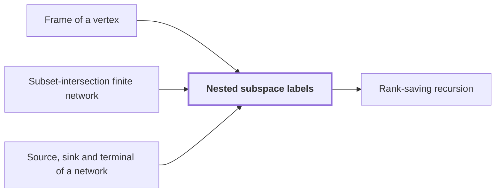

# Nested subspace labels

!!! info "Before this page"

    Nested subspace labels *make cheap the changes of* [Frame of a vertex](frame.md "The labels are chosen to make cheap the changes of Frame of a vertex on each edge: the stored array at $w$ is $D_w g$ when the logical array is $g$, and along an edge from $\sigma$ to $\nu$ it changes by $D_\nu D_\sigma^{-1}$."), *are built on* [Subset-intersection finite network](subset-network.md "The labels are built on a Subset-intersection finite network.") and *sit at* [Source, sink and terminal of a network](network-terminal.md "Each label sits at a gate or at a Source, sink and terminal of a network.").

!!! abstract "Where this fits"

    - Relied on to show: Interchanging two equal address fields of width $u$ costs less than linear in $u$ per unit volume. ([Fast interchange of address chunks](tape-interchange.md "A fixed-tape procedure that swaps two disjoint equal-width address fields of an array in time O(V u^τ) for a fixed τ < 1, where V is the stored volume and u the field width, using XOR combinations of intermediate data."))

??? note "Symbols from earlier pages"

    - $W$ — number of roles: The number of roles, which is the number of fixed wire places in the network. (on [Role streams from a cyclic row split](role-streams.md "Splitting the rows of an array cyclically among the W fixed wire roles of a network, so that each role carries an equal share of the volume and gates act pointwise on matching addresses."))
    - $g$ — logical array: The array on a wire before the frame is applied, the logical content the stored array encodes. (on [Frame of a vertex](frame.md "An invertible linear operator attached to a gate or terminal that sets how the array on each wire there is stored; changing frames along an edge cancels between the two ends of a route."))

Nested subspace labels are subspaces of one fixed space, attached to the gates and terminals of a network so that the dimension drop along each edge counts the smaller operations that edge needs. They give the cost bound for interchanging two equal address fields below linear in the field width.

Fix a space $E$ of dimension $m$, the common space of all labels; here $m$ is that dimension, not the numerator of a dyadic rational. The labels are built on a [Subset-intersection finite network](subset-network.md "A linear network over three-element subsets of a fixed ground set, whose gather, scatter, copy and side wires implement the scalar exchange of two banks by intersection-size coefficients over F_2 or Z[i,1/2]."). Each vertex $w$ of the network, a gate or a terminal, carries a label $L(w)$, a subspace of $E$. Each label sits at a gate or at a [Source, sink and terminal of a network](network-terminal.md "A source or sink of a linear network is an end vertex of a wire, where data enter the network or leave it, and the terminals are the sources and sinks at which the network meets its banks of values.").

An edge runs from its tail $\sigma$ to its head $\nu$; these letters name vertices, not bank values. Along it the labels are nested, $L(\nu)\subseteq L(\sigma)$, and the drop of the edge is $\dim L(\sigma)-\dim L(\nu)$.<cite class="exegenius-ref" data-source="paper" data-locator="§1.2 Linear networks and the recursive saving" data-quote="The subspaces at adjacent vertices are nested." title="The subspaces at adjacent vertices are nested."> (see §1.2 Linear networks and the recursive saving)</cite> For example, a plane $L(\sigma)$ containing a line $L(\nu)$ has drop $2-1=1$.

Each gate or sink with label $U$ has a projection $P_U$ onto $U$ along its orthogonal complement $U^\perp$. For an edge from $\sigma$ to $\nu$, the difference $P_{L(\sigma)}-P_{L(\nu)}$ is the projection onto the part of $L(\sigma)$ orthogonal to $L(\nu)$, a space of dimension $\dim L(\sigma)-\dim L(\nu)$. The edge matrix is this difference up to sign, so its rank is the drop.

The labels are chosen to make cheap the changes of [Frame of a vertex](frame.md "An invertible linear operator attached to a gate or terminal that sets how the array on each wire there is stored; changing frames along an edge cancels between the two ends of a route.") on each edge: the stored array at $w$ is $D_w g$ when the logical array is $g$, and along an edge from $\sigma$ to $\nu$ it changes by $D_\nu D_\sigma^{-1}$. Along a route the intermediate frames cancel, so only the two end frames fix the operator on the route.

Let $s$ be the total number of smaller calls, the sum of the drops over all edges.<cite class="exegenius-ref" data-source="paper" data-locator="§4.2 Transferring a finite circuit to address permutations" data-quote="The number of recursive calls is the sum of the edge ranks, exactly $s$." title="The number of recursive calls is the sum of the edge ranks, exactly $s$."> (see §4.2 Transferring a finite circuit to address permutations)</cite> A smaller call is the same procedure run on one role stream.<cite class="exegenius-ref" data-source="paper" data-locator="§4.2 Transferring a finite circuit to address permutations" data-quote="Each acts on one role stream of volume $V/W$" title="Each acts on one role stream of volume $V/W$"> (see §4.2 Transferring a finite circuit to address permutations)</cite>, where $W$ is the number of roles.

The claim is that $s$ is below $Wm$.<cite class="exegenius-ref" data-source="paper" data-locator="§1.2 Linear networks and the recursive saving" data-quote="The decisive property is that the total number $s$ of smaller calls satisfies $s&lt;Wm$." title="The decisive property is that the total number $s$ of smaller calls satisfies $s&lt;Wm$."> (see §1.2 Linear networks and the recursive saving)</cite>

## Connections

Used by:

- [Rank-saving recursion](recursive-saving.md "The cost is measured by nested subspace labels on the edges.") *is measured by* Nested subspace labels

??? quote "From the sources"

    > The subspaces at adjacent vertices are nested.
    >
    > — [Integer multiplication below n log n (OpenAI, 2026)](https://github.com/openai/math/tree/fd4aeeb2ee4fc729c18d98444fed42fd0529eeeb/preprints/Integer-multiplication-below-n-log-n-September-23-2026)
