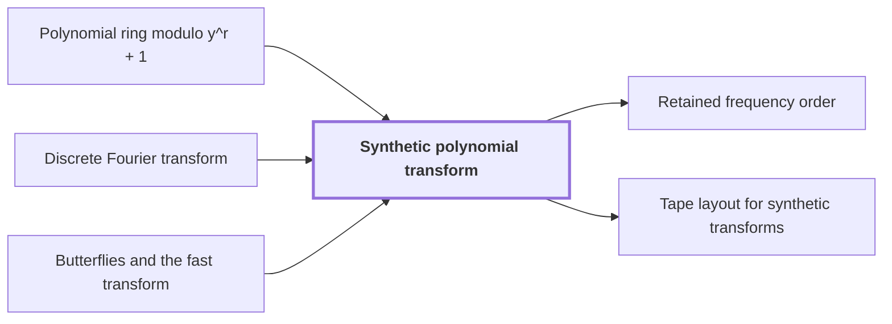

# Synthetic polynomial transform

!!! info "Before this page"

    Synthetic polynomial transform *is a transform over* [Polynomial ring modulo y^r + 1](ring-y.md "A synthetic polynomial transform is a transform over the Polynomial ring modulo y^r + 1 whose roots of unity are powers of $y$, so every twiddle multiplication (multiplication by a root of unity) is a signed shift of a coefficient list."), *is given by the formulas of* [Discrete Fourier transform](dft.md "The synthetic transforms are given by the formulas of the Discrete Fourier transform, with $\omega_t$ in place of the complex root of unity:") and *is computed by* [Butterflies and the fast transform](butterfly.md "As in the complex case, $F_t^-$ is computed by Butterflies and the fast transform in $\log_2 t$ layers, each twiddle multiplication being a signed shift.").

!!! abstract "Where this fits"

    - Relied on to show: Synthetic transforms over $\mathcal R_r$ on $d-1$ axes of lengths $t_i\in\{2^{\ell-1},2^\ell\}$ with outputs kept in a retained layout $LB$ cost $O(Tp[dK+pK^{\tau-1}+\ell d^{\lambda'}])$ with error less than $\sqrt2\ell\,2^{-p}$. ([Tape layout for synthetic transforms](transform-layout.md "Placing the selected bits of the participating axes at a common offset in K-bit chunks so each round of the synthetic transform is one simultaneous layer, costing less than log t passes."))
    - Relied on to show: The synthetic transform $F_t^-$ over $\mathcal R_r=\mathbb C[y]/(y^r+1)$, with roots of unity $\omega_t=y^{2r/t}$, is computed by decimation in frequency with outputs written in bit-reversed order, $B_tF_t^-$; the pointwise product keeps this order and the reverse procedure computes $F_t^+B_t^{-1}$, so no reordering is executed. ([Retained frequency order](frequency-order.md "The forward synthetic transform writes its outputs in bit-reversed order, the pointwise product keeps that order, and the opposite transform consumes it, so no reordering is executed."))
    - Relied on to show: Normalized cyclic convolution over the polynomial ring $\mathbb C[y]/(y^r+1)$ on the remaining $d-1$ axes is computed from two forward synthetic transforms in retained order, $M$ pointwise polynomial products and the opposite transform, in $O(Tp[dK+pK^{\tau-1}+\ell d^{\lambda'}+\log(rp)])$ time with error less than $\sqrt2\,M(3\ell+1)2^{-p}$. ([Convolution from the retained transform layout](ring-convolution.md "Convolution over the ring modulo y^r + 1 on the remaining axes by two forward synthetic transforms, pointwise polynomial products and the opposite transform, normalized by 1/(rM)."))

??? note "Symbols from earlier pages"

    - $y$ — ring variable: The indeterminate of the polynomials; it satisfies y^r = -1 in the ring. (on [Polynomial ring modulo y^r + 1](ring-y.md "Polynomials of degree below r over the complex numbers with y^r = −1, so multiplying by a power of y is a signed shift of the coefficient list."))
    - $r$ — record length: The number of complex coefficients in a polynomial of the ring, always a power of two. (on [Polynomial ring modulo y^r + 1](ring-y.md "Polynomials of degree below r over the complex numbers with y^r = −1, so multiplying by a power of y is a signed shift of the coefficient list."))
    - $z_k$ — input value: The input value at position k. (on [Butterflies and the fast transform](butterfly.md "A two-point averaging/differencing step H₀(u,v) = ((u+v)/2, (u−v)/2) whose repeated use over address bits, with twiddle multiplications, computes a transform in log t layers."))

A synthetic polynomial transform is a transform over the [Polynomial ring modulo y^r + 1](ring-y.md "Polynomials of degree below r over the complex numbers with y^r = −1, so multiplying by a power of y is a signed shift of the coefficient list.") whose roots of unity are powers of $y$, so every twiddle multiplication (multiplication by a root of unity) is a signed shift of a coefficient list. It lets the other axes of a multidimensional transform be handled without complex multiplications.

In that ring $y^r=-1$, so multiplying a record by $y^s$ moves each coefficient up $s$ places and negates those that wrap past degree $r-1$. Powers of $y$ can therefore serve as roots of unity<cite class="exegenius-ref" data-source="paper" data-locator="§1.1 The two tape operations" data-quote="Powers of $y$ then serve as roots of unity in the remaining axes, and multiplication by such a root is a signed shift of the coefficient list." title="Powers of $y$ then serve as roots of unity in the remaining axes, and multiplication by such a root is a signed shift of the coefficient list."> (see §1.1 The two tape operations)</cite>.

For example, take $r=4$: multiplying $a_0+a_1y+a_2y^2+a_3y^3$ by $y^2$ gives $-a_2-a_3y+a_0y^2+a_1y^3$.

Let $t$ be the transform length, the number of ring elements along one axis, a power of two dividing $2r$. Define $\omega_t=y^{2r/t}$<cite class="exegenius-ref" data-source="paper" data-locator="§6.1 Roots, butterflies, and stored frequency order" data-quote="For a power of two $t$ dividing $2r$, define $\omega_t=y^{2r/t}$." title="For a power of two $t$ dividing $2r$, define $\omega_t=y^{2r/t}$."> (see §6.1 Roots, butterflies, and stored frequency order)</cite>. Since $y^{2r}=1$ and $y^r=-1$, we get $\omega_t^t=1$ and $\omega_t^{t/2}=-1$.

The synthetic transforms are given by the formulas of the [Discrete Fourier transform](dft.md "The normalized transform (F_q u)_k = (1/q) Σ u_j e^{−2πi jk/q}, which turns convolution into pointwise multiplication."), with $\omega_t$ in place of the complex root of unity:

$$(F_t^-z)_j=\frac1t\sum_{k=0}^{t-1}\omega_t^{-jk}z_k,\qquad (F_t^+z)_j=\frac1t\sum_{k=0}^{t-1}\omega_t^{jk}z_k .$$

Here $z=(z_0,\dots,z_{t-1})$ is a list of $t$ ring elements and $0\le j<t$.

## Both transforms are contractions

The size of a ring element $\sum_k a_k y^k$ is $\max_k|a_k|$; the size of a list is the largest size of its entries. A signed shift only permutes coefficients and flips signs, so multiplying by a power of $\omega_t$ leaves size unchanged. An entry of $F_t^\pm z$ is $\frac1t$ times a sum of $t$ shifted entries of $z$; by the triangle inequality on each coefficient, it has size at most that of $z$. A map that never increases size is a contraction, so both transforms are contractions<cite class="exegenius-ref" data-source="paper" data-locator="§6.1 Roots, butterflies, and stored frequency order" data-quote="Every power of $\omega_t$ is an isometry, and each transform entry is an average of $t$ such images." title="Every power of $\omega_t$ is an isometry, and each transform entry is an average of $t$ such images."> (see §6.1 Roots, butterflies, and stored frequency order)</cite>.

## Undoing a transform

Over the complex numbers one cancels sums of roots of unity by dividing by $\omega_t^j-1$. The ring has zero divisors, so the cancellation is verified directly<cite class="exegenius-ref" data-source="paper" data-locator="§6.1 Roots, butterflies, and stored frequency order" data-quote="The ring has zero divisors, so we verify character cancellation directly instead of dividing by $\omega_t^j-1$." title="The ring has zero divisors, so we verify character cancellation directly instead of dividing by $\omega_t^j-1$."> (see §6.1 Roots, butterflies, and stored frequency order)</cite>. For an integer $j$,
$$\sum_{k=0}^{t-1}\omega_t^{jk}=\begin{cases}t,&t\mid j,\\0,&t\nmid j.\end{cases}$$
If $t\nmid j$, write $j$ as $2^e$ times an odd number, with $0\le e<\log_2 t$. Replacing $k$ by $k+t/2^{e+1}$ modulo $t$ permutes the summands and multiplies each by $\omega_t^{jt/2^{e+1}}=y^{r\cdot\text{odd}}=-1$. The sum equals its own negative, so it is $0$.

Expanding $F_t^+F_t^-$, the coefficient of $z_k$ in entry $i$ is $t^{-2}\sum_j\omega_t^{j(i-k)}$, which is $t^{-1}$ if $i=k$ and $0$ otherwise. Hence $F_t^+F_t^-=t^{-1}I$: applying $F_t^+$ undoes $F_t^-$ up to the factor $1/t$.

As in the complex case, $F_t^-$ is computed by [Butterflies and the fast transform](butterfly.md "A two-point averaging/differencing step H₀(u,v) = ((u+v)/2, (u−v)/2) whose repeated use over address bits, with twiddle multiplications, computes a transform in log t layers.") in $\log_2 t$ layers, each twiddle multiplication being a signed shift.

## Connections

Used by:

- [Retained frequency order](frequency-order.md "It orders the outputs of the synthetic polynomial transform over $\mathcal R_r=\mathbb C[y]/(y^r+1)$, normed by the largest coefficient modulus.") *orders the outputs of* Synthetic polynomial transform
- [Tape layout for synthetic transforms](transform-layout.md "The tape layout reorders address bits so that each round of a synthetic polynomial transform on several axes runs as one simultaneous butterfly layer instead of one pass per axis, which is where the transform's cost drops below the standard pass count.") *reorders the address bits of* Synthetic polynomial transform

??? quote "From the sources"

    > Powers of $y$ then
    >
    > — [Integer multiplication below n log n (OpenAI, 2026)](https://github.com/openai/math/tree/fd4aeeb2ee4fc729c18d98444fed42fd0529eeeb/preprints/Integer-multiplication-below-n-log-n-September-23-2026)

    > For a power of two $t$ dividing $2r$, define $\omega_t=y^{2r/t}$.
    >
    > — [Integer multiplication below n log n (OpenAI, 2026)](https://github.com/openai/math/tree/fd4aeeb2ee4fc729c18d98444fed42fd0529eeeb/preprints/Integer-multiplication-below-n-log-n-September-23-2026)
