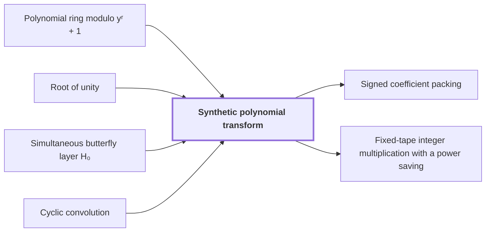

# Synthetic polynomial transform

!!! info "Before this page"

    Synthetic polynomial transform *is computed over* [Polynomial ring modulo yʳ + 1](polynomial-ring.md "The transform is computed over the Polynomial ring modulo yʳ + 1."), *takes its roots from* [Root of unity](roots-of-unity.md "It takes its roots from the powers of $y$, which are a Root of unity of order $2r$."), *is computed by successive layers of* [Simultaneous butterfly layer H₀](butterfly-layer.md "The transform is computed by successive layers of Simultaneous butterfly layer H₀.") and *computes normalized* [Cyclic convolution](cyclic-convolution.md "It computes normalized Cyclic convolution on the power-of-two axes.").

!!! abstract "Where this fits"

    1. The integer product is computed exactly on one fixed-tape machine in $O(n(\lg n)^{1-\kappa})$ worst-case time, for $\kappa=2^{-182}$. — how: reduce exact multiplication to convolution of radix digits on distinct prime axes, compute the convolution by synthetic transforms on tape layouts, and bound the total tape cost with a power saving ([Fixed-tape integer multiplication with a power saving](fixed-tape-multiplication.md "A deterministic fixed-tape Turing machine that multiplies two n-bit integers exactly in O(n(lg n)^(1−κ)) worst-case time, for a fixed κ = 2^(−182), disproving the n log n optimality conjecture in this model."))
    2. **This page:** Normalized cyclic convolution on the power-of-two axes is computed over the polynomial ring $\mathbb C[y]/(y^r+1)$ by synthetic transforms and packed polynomial products.

??? note "Symbols from earlier pages"

    - $y$ — polynomial variable: The formal variable of the ring, whose powers act as roots of unity on the remaining axes. (on [Polynomial ring modulo yʳ + 1](polynomial-ring.md "The ring of complex polynomials of degree less than r, with multiplication reduced modulo y^r + 1; multiplication by a power of y permutes and sign-changes the coefficient list."))
    - $r$ — coefficient count: The number of complex coefficients in each polynomial record, which is a power of two. (on [Polynomial ring modulo yʳ + 1](polynomial-ring.md "The ring of complex polynomials of degree less than r, with multiplication reduced modulo y^r + 1; multiplication by a power of y permutes and sign-changes the coefficient list."))
    - $a$ — first coefficient list: The first input list, whose i-th coefficient is a_i. (on [Cyclic convolution](cyclic-convolution.md "The product of two coefficient lists in the ring of polynomials modulo x^S − 1, in which exponents wrap around modulo S."))
    - $S$ — list length: The number of coefficients in each list, which fixes the wraparound modulus. (on [Cyclic convolution](cyclic-convolution.md "The product of two coefficient lists in the ring of polynomials modulo x^S − 1, in which exponents wrap around modulo S."))
    - $m$ — integer numerator: The integer numerator of a dyadic rational written as $m/2^k$. (on [Gaussian dyadic numbers](glossary.md#gaussian-dyadic "Complex numbers whose real and imaginary parts are both dyadic rationals, that is, have power-of-two denominators."))
    - $u$ — first butterfly input: The first value of an input pair to the butterfly map $H_0$. (on [Gaussian dyadic numbers](glossary.md#gaussian-dyadic "Complex numbers whose real and imaginary parts are both dyadic rationals, that is, have power-of-two denominators."))
    - $v$ — second butterfly input: The second value of an input pair to the butterfly map $H_0$. (on [Gaussian dyadic numbers](glossary.md#gaussian-dyadic "Complex numbers whose real and imaginary parts are both dyadic rationals, that is, have power-of-two denominators."))
    - $H_0$ — butterfly map: The map sending a pair $(u,v)$ to $((u+v)/2, (u-v)/2)$. (on [Gaussian dyadic numbers](glossary.md#gaussian-dyadic "Complex numbers whose real and imaginary parts are both dyadic rationals, that is, have power-of-two denominators."))
    - $i$ — first index: An index into the first list, running over 0 to S-1. (on [Cyclic convolution](cyclic-convolution.md "The product of two coefficient lists in the ring of polynomials modulo x^S − 1, in which exponents wrap around modulo S."))
    - $j$ — second index: An index into the second list, running over 0 to S-1. (on [Cyclic convolution](cyclic-convolution.md "The product of two coefficient lists in the ring of polynomials modulo x^S − 1, in which exponents wrap around modulo S."))
    - $k$ — output index: The index of an entry of $\hat u$, running from $0$ to $q-1$. (on [Discrete Fourier transform](fourier-transform.md "The map sending a vector u of length q to the vector whose k-th entry is (1/q) times the sum over j of u_j times exp(−2πijk/q)."))
    - $l$ — convolution output index: The index of an entry of the cyclic convolution $c$, running over the entries of $c$. (on [Discrete Fourier transform](fourier-transform.md "The map sending a vector u of length q to the vector whose k-th entry is (1/q) times the sum over j of u_j times exp(−2πijk/q)."))

A synthetic polynomial transform is a [discrete Fourier transform](fourier-transform.md "The map sending a vector u of length q to the vector whose k-th entry is (1/q) times the sum over j of u_j times exp(−2πijk/q).") whose roots of unity are powers of $y$, so each multiplication by a root is a signed shift. It computes the convolution step of the integer product with shifts and butterflies.

The transform is computed over the [Polynomial ring modulo yʳ + 1](polynomial-ring.md "The ring of complex polynomials of degree less than r, with multiplication reduced modulo y^r + 1; multiplication by a power of y permutes and sign-changes the coefficient list."). It takes its roots from the powers of $y$, which are a [Root of unity](roots-of-unity.md "A number whose some positive integer power equals one; here powers of y in the polynomial ring play this role.") of order $2r$. Write the twiddle factors as $y^\phi$, where $\phi$ is the exponent of the twiddle factor, an integer from $0$ to $2r-1$. A twiddle factor is the root a butterfly multiplies by.

Multiplying by $y^\phi$ with $\phi<r$ moves each coefficient $\phi$ places up, and a coefficient that passes position $r-1$ returns with its sign reversed; $y^{\phi+r}=-y^\phi$ covers the rest. For $r=4$, using $y^4=-1$,
$$y\,(a_0+a_1y+a_2y^2+a_3y^3)=-a_3+a_0y+a_1y^2+a_2y^3.$$
Each such multiplication is a signed shift of the coefficient list<cite class="exegenius-ref" data-source="paper" data-locator="§1.1 The two tape operations" data-quote="multiplication by such a root is a signed shift of the coefficient list" title="multiplication by such a root is a signed shift of the coefficient list"> (see §1.1 The two tape operations)</cite>.

It computes normalized [Cyclic convolution](cyclic-convolution.md "The product of two coefficient lists in the ring of polynomials modulo x^S − 1, in which exponents wrap around modulo S.") on the power-of-two axes. Let $\theta$ be a primitive $S$-th root of unity such that $\theta^m-1$ is invertible for $0<m<S$; the powers of $y$ satisfy this with $S=2r$. Let $\xi$ and $\eta$ be lists of $S$ coefficients. The transform of a list $\xi$ is $\hat\xi$, with $\hat\xi_k=\frac1S\sum_{j}\xi_j\theta^{jk}$. Let $\psi$ be their normalized cyclic convolution, $\psi_l=\frac1S\sum_{i+j\equiv l \pmod S}\xi_i\eta_j$. Since $\theta^{lk}$ depends only on $l \bmod S$, $\hat\psi_k=\frac1{S^2}\sum_{i,j}\xi_i\eta_j\theta^{(i+j)k}=\hat\xi_k\,\hat\eta_k$.

The transform is computed by successive layers of [Simultaneous butterfly layer H₀](butterfly-layer.md "The map H₀(u,v) = ((u+v)/2, (u−v)/2) applied at once to a selected coordinate bit of every chunk, a two-point butterfly acting coefficientwise on polynomial records."). Let $\varepsilon$ be the number of layers. A layer pairs records whose indices differ in one selected bit, multiplies one record of each pair by its twiddle factor, and replaces the pair $(u,v)$ by $H_0(u,v)=((u+v)/2,(u-v)/2)$.

Assume the input coefficients are [Gaussian dyadic numbers](glossary.md#gaussian-dyadic "Complex numbers whose real and imaginary parts are both dyadic rationals, that is, have power-of-two denominators."). Signed shifts and sums keep them Gaussian dyadic, and halving $m/2^k$ gives $m/2^{k+1}$, where halving<cite class="exegenius-ref" data-source="paper" data-locator="§5.4 An explicit guard-width bound" data-quote="halving adds at most one denominator bit" title="halving adds at most one denominator bit"> (see §5.4 An explicit guard-width bound)</cite>. Each layer halves at most once, so after $\varepsilon$ layers every denominator is at most $2^\varepsilon$ times that of the inputs, and all intermediate values stay exact Gaussian dyadic numbers.

## Connections

Used by:

- [Signed coefficient packing](signed-packing.md "Signed coefficient packing turns the polynomial products of the synthetic polynomial transform into integer products, so they run on an integer multiplier.") *turns the polynomial products of* Synthetic polynomial transform
- [Fixed-tape integer multiplication with a power saving](fixed-tape-multiplication.md "It computes its transforms by a Synthetic polynomial transform over $\mathbb C[y]/(y^r+1)$.") *computes its transforms by* Synthetic polynomial transform

??? quote "From the sources"

    > These are the synthetic polynomial transforms of Nussbaumer and Quandalle and
    >
    > — [Integer multiplication below n log n (OpenAI, 2026)](https://github.com/openai/math/tree/fd4aeeb2ee4fc729c18d98444fed42fd0529eeeb/preprints/Integer-multiplication-below-n-log-n-September-23-2026)
