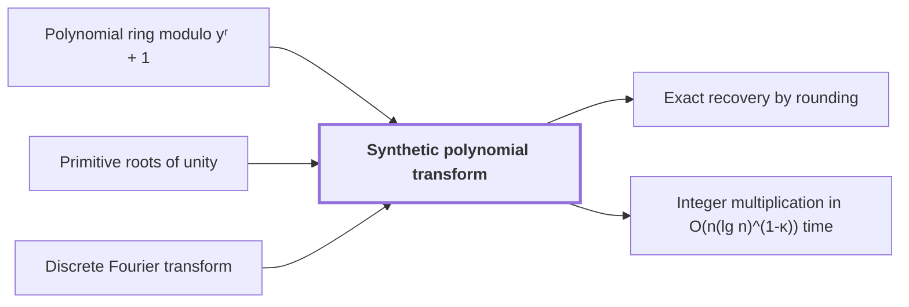

# Synthetic polynomial transform

!!! info "Before this page"

    Synthetic polynomial transform *works in* [Polynomial ring modulo yʳ + 1](polynomial-ring-y.md "It works in the polynomial ring modulo yʳ + 1."), *is built on* [Primitive roots of unity](glossary.md#roots-of-unity "It is built on $y$ as a primitive root of unity of order $2r$: $y^r=-1$, so $y^{2r}=1$, and no smaller positive power of $y$ equals $1$.") and *generalizes* [Discrete Fourier transform](fourier-transform.md "A synthetic polynomial transform generalizes the discrete Fourier transform to a polynomial ring whose roots of unity are powers of $y$.").

!!! abstract "Where this fits"

    1. Two $n$-bit integers can be multiplied exactly in $O(n(\lg n)^{1-\kappa})$ worst-case time on a deterministic multitape Turing machine, for a fixed $\kappa=2^{-182}$. — how: reduce the product to a digit convolution, compute that convolution through transform layers whose tape cost saves a power, and recover the exact product by rounding ([Integer multiplication in O(n(lg n)^(1-κ)) time](integer-multiplication-target.md "A deterministic multitape Turing machine that multiplies two n-bit integers exactly in O(n(lg n)^(1-κ)) worst-case time for a fixed κ = 2^(-182) > 0, beating the n log n conjecture in this model."))
    2. **This page:** The two forward synthetic transforms keep the same frequency order through their pointwise product, and the opposite transform consumes that order.

??? note "Symbols from earlier pages"

    - $y$ — ring indeterminate: The variable of the polynomial ring whose powers serve as roots of unity in the remaining axes. (in the name of [Polynomial ring modulo yʳ + 1](polynomial-ring-y.md "The ring of complex polynomials in y reduced modulo y^r + 1, where multiplying by a power of y is a signed cyclic shift of the coefficient list."))
    - $r$ — coefficient count: The number of coefficients in the coefficient list of one polynomial record, a power of two. (in the name of [Polynomial ring modulo yʳ + 1](polynomial-ring-y.md "The ring of complex polynomials in y reduced modulo y^r + 1, where multiplying by a power of y is a signed cyclic shift of the coefficient list."))

A synthetic polynomial transform generalizes the [discrete Fourier transform](fourier-transform.md "The map sending a length-n sequence to its values at the n-th roots of unity, i.e. the sums of the sequence weighted by powers of a root of unity.") to a polynomial ring whose roots of unity are powers of $y$. It transforms the [cyclic convolution](cyclic-convolution.md "The product of two sequences in which indices are taken modulo a fixed length, so each coefficient of the result is a sum of products over residues.") that a multiplication of digits reduces to, and each of its stages needs only signed shifts and additions.

It works in the [polynomial ring modulo yʳ + 1](polynomial-ring-y.md "The ring of complex polynomials in y reduced modulo y^r + 1, where multiplying by a power of y is a signed cyclic shift of the coefficient list."). It is built on $y$ as a [primitive root of unity](glossary.md#roots-of-unity "A complex number ω is a primitive n-th root of unity when ω^n = 1 and no smaller positive power equals 1.") of order $2r$: $y^r=-1$, so $y^{2r}=1$, and no smaller positive power of $y$ equals $1$.

Let $u_0,\dots,u_{2r-1}$ be a sequence of ring elements; here $u$ names a sequence, not the first butterfly input of earlier pages. Let $t$ be the input position and $s$ the frequency index, $s=0,\dots,2r-1$. Its transform has entries $\hat u_s=\sum_{t=0}^{2r-1} y^{st}u_t$.

Split the inputs into the halves $t<r$ and $t+r$. Write $i$ for the index of the pair of frequencies $2i$ and $2i+1$, so $i$ runs over $0,\dots,r-1$. Since $y^{s(t+r)}=(-1)^s y^{st}$ (because $y^r=-1$), we get $\hat u_{2i}=\sum_{t<r} y^{2it}(u_t+u_{t+r})$ and $\hat u_{2i+1}=\sum_{t<r} y^{2it}\,y^t(u_t-u_{t+r})$. One stage therefore forms, for each pair $(u_t,u_{t+r})$, the sum and the difference times the twiddle factor $y^t$, the power of $y$ that multiplies that difference. The even and odd entries are then transforms of length $r$ of these two lists, with root $y^2$.

Multiplying by a power of $y$ is a signed shift of the coefficient list<cite class="exegenius-ref" data-source="paper" data-locator="§1.1 The two tape operations" data-quote="multiplication by such a root is a signed shift of the coefficient list" title="multiplication by such a root is a signed shift of the coefficient list"> (see §1.1 The two tape operations)</cite>. So each stage needs only signed shifts and butterfly additions. For $r=4$, $y^3(1+2y)=y^3+2y^4=-2+y^3$, since $y^4=-1$: the coefficient list $(1,2,0,0)$ becomes $(-2,0,0,1)$.

The inverse is $u_t=\frac{1}{2r}\sum_{s=0}^{2r-1} y^{-st}\hat u_s$, with $y^{-1}=y^{2r-1}$. This holds because $\sum_{s=0}^{2r-1} y^{sk}$ equals $2r$ when $k\equiv 0 \pmod{2r}$ and $0$ otherwise. Since $r$ is a power of two, $y^r+1$ has $r$ distinct roots, all primitive $2r$-th roots of unity. A ring element of degree below $r$ that vanishes at all of them is zero, and at each root the sum is an ordinary geometric sum, which vanishes when the root's $k$-th power is not $1$.

Both forward transforms use the same index convention, so their outputs share the frequency order $s=0,\dots,2r-1$. Let $z_0,\dots,z_{2r-1}$ be a second sequence of ring elements, with transform $\hat z_s=\sum_{q=0}^{2r-1} y^{sq}z_q$, where $q$ is the input position in $z$. The entrywise products $\hat u_s\hat z_s$ therefore pair equal frequencies, and the inverse reads them in that order.

Expanding, $\hat u_s\hat z_s=\sum_{t,q} y^{s(t+q)}u_tz_q$. Let $u\ast z$ be the cyclic convolution of $u$ and $z$, with entries $(u\ast z)_h=\sum_{t+q\equiv h \pmod{2r}} u_tz_q$, where $h$ is the output position. Since $y^{2r}=1$, the exponent depends only on $h\equiv t+q \pmod{2r}$, so $\hat u_s\hat z_s=\sum_h y^{sh}(u\ast z)_h$. The inverse transform therefore returns $u\ast z$: transforms turn entrywise products into a cyclic convolution.

## Connections

Used by:

- [Exact recovery by rounding](rounding-recovery.md "Exact recovery by rounding works on the output of the Synthetic polynomial transform run in the opposite direction.") *works on the output of* Synthetic polynomial transform
- [Integer multiplication in O(n(lg n)^(1-κ)) time](integer-multiplication-target.md "It computes its forward transforms by Synthetic polynomial transform, which keep frequency order through their pointwise product.") *computes its forward transforms by* Synthetic polynomial transform

??? quote "From the sources"

    > These are the synthetic polynomial transforms of Nussbaumer and Quandalle
    >
    > — [Integer multiplication below n log n (OpenAI, 2026)](https://github.com/openai/math/tree/fd4aeeb2ee4fc729c18d98444fed42fd0529eeeb/preprints/Integer-multiplication-below-n-log-n-September-23-2026)
