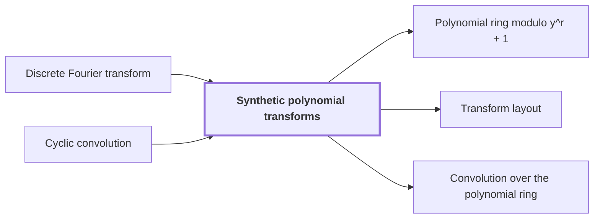

# Synthetic polynomial transforms

!!! info "Before this page"

    Synthetic polynomial transforms *is based on* [Discrete Fourier transform](discrete-fourier-transform.md "A synthetic polynomial transform is based on the Discrete Fourier transform: it has the same form, but its roots of unity are powers of a ring variable, so that multiplying by a root is a signed shift of coefficients.") and *compute* [Cyclic convolution](glossary.md#cyclic-convolution "Together, the two forward transforms, the pointwise product and the opposite transform compute a cyclic convolution of records."). Assumed known: Polynomials.

!!! abstract "Where this fits"

    - Relied on to show: Convolution on the remaining axes over $\mathbb{C}[y]/(y^r+1)$ is computed by two forward synthetic transforms, a pointwise product, and an opposite transform. ([Convolution over the polynomial ring](polynomial-ring-convolution.md "The normalized product of two arrays of records in the polynomial ring, computed by two forward synthetic transforms, a pointwise product, and an opposite transform."))
    - Relied on to show: The two forward synthetic transforms keep the same frequency order through their pointwise product.

??? note "Symbols from earlier pages"

    - $m$ — integer exponent: An integer whose divisibility by q decides whether the root-of-unity sum vanishes. (on [Discrete Fourier transform](discrete-fourier-transform.md "The map sending a vector of q values to its q values weighted by powers of a q-th root of unity, normalized by 1/q."))
    - $k$ — output index: The index of an output entry, ranging over 0 to q-1. (on [Discrete Fourier transform](discrete-fourier-transform.md "The map sending a vector of q values to its q values weighted by powers of a q-th root of unity, normalized by 1/q."))

A synthetic polynomial transform is based on the [Discrete Fourier transform](discrete-fourier-transform.md "The map sending a vector of q values to its q values weighted by powers of a q-th root of unity, normalized by 1/q."): it has the same form, but its roots of unity are powers of a ring variable, so that multiplying by a root is a signed shift of coefficients. It is the transform used in the convolution step of the multiplier, where it replaces ordinary complex roots of unity.

Let $r$ be a power of two, the number of complex coefficients in a record. A record is a polynomial of degree less than $r$ with complex coefficients. Let $y$ be the variable of the ring $\mathbb{C}[y]/(y^r+1)$, in which $y^r$ is identified with $-1$.

Hence $y^{2r}=1$, and $y^{m}\ne 1$ for $0<m<2r$: for $0<m<r$, $y^m$ is a monomial other than 1, and for $r\le m<2r$, $y^m=-y^{m-r}\ne 1$. Take a transform length $q$, the number of values in one transform, that divides $2r$. Then $\omega = y^{2r/q}$ is a primitive $q$-th root of unity in this ring: $\omega^q=y^{2r}=1$, and $\omega^m=1$ only when $q$ divides $m$.

Write $p=(p_0,\dots,p_{q-1})$ for the input vector of $q$ records. The transform is
$$\hat p_k=\frac{1}{q}\sum_{j=0}^{q-1}\omega^{jk}p_j, \qquad 0\le k<q,$$
where $\hat p_k$ is the transformed record at frequency index $k$. The opposite transform uses $\omega^{-jk}$ in place of $\omega^{jk}$.

For example, with $r=4$,
$$y\,(p_0+p_1y+p_2y^2+p_3y^3)=-p_3+p_0y+p_1y^2+p_2y^3,$$
because $y\cdot y^3=y^4=-1$. The coefficients move one place and the one that wraps around changes sign. Multiplying by a root is therefore a signed shift, not a complex multiplication, so the transform reduces to address rearrangements, signed shifts and two-point butterflies.<cite class="exegenius-ref" data-source="paper" data-locator="§11 A consequence for matrix transposition, p. 3" data-quote="In this representation, the transform calculation consists of address rearrangements, signed shifts, and two-point butterfly operations." title="In this representation, the transform calculation consists of address rearrangements, signed shifts, and two-point butterfly operations."> (see §11 A consequence for matrix transposition, p. 3)</cite>

Entry $k$ of each transform sits at frequency $\omega^k$, so the frequency order is $k$. Both forward transforms use the same $\omega$, so the pointwise product keeps entry $k$ at frequency $\omega^k$.

Together, the two forward transforms, the pointwise product and the opposite transform compute a [cyclic convolution](glossary.md#cyclic-convolution "The product of two sequences in which indices wrap around modulo the sequence length.") of records.

## Connections

Used by:

- [Polynomial ring modulo y^r + 1](polynomial-ring-mod-yr-plus-1.md "The ring is the coefficient ring of the Synthetic polynomial transforms, whose roots of unity are powers of $y$.") *is the coefficient ring of* Synthetic polynomial transforms
- [Transform layout](transform-layout.md "The layout lays out the rounds of Synthetic polynomial transforms on tape, one layer per round.") *lays out the rounds of* Synthetic polynomial transforms
- [Convolution over the polynomial ring](polynomial-ring-convolution.md "Convolution over the polynomial ring computes its transforms with Synthetic polynomial transforms, so the transforms need only signed shifts and additions, because multiplying by a power of $y$ is a signed shift of coefficients.") *computes its transforms with* Synthetic polynomial transforms

??? quote "From the sources"

    > These are the synthetic polynomial transforms of Nussbaumer and Quandalle and
    >
    > — Integer multiplication below n log n (OpenAI, 2026)
