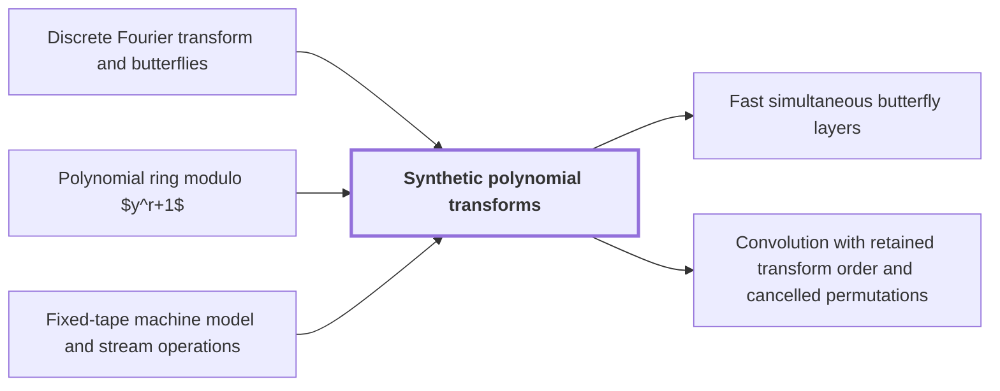

# Synthetic polynomial transforms

!!! info "Before this page"

    Synthetic polynomial transforms *follow the butterfly scheme of* [Discrete Fourier transform and butterflies](dft-fft.md "Synthetic transforms follow the butterfly scheme of the Discrete Fourier transform and butterflies."), *are defined over* [Polynomial ring modulo $y^r+1$](poly-ring-y-r.md "Synthetic polynomial transforms are defined over the Polynomial ring modulo $y^r+1$, where every root of unity is a power of $y$, so the transform avoids general complex multiplications.") and *are costed on* [Fixed-tape machine model and stream operations](fixed-tape-model.md "Synthetic transforms are costed on a fixed-tape machine, where the cost is data movement.").

!!! abstract "Where this fits"

    1. An $n$-bit integer product is computed by a fixed-tape machine in $O(n(\lg n)^{1-\kappa})$ time, $\kappa=2^{-182}$. — how: reduce multiplication to ring convolution and speed up its address moves and butterfly layers ([Integer multiplication in O(n(lg n)^{1-κ}) time](main-theorem.md "Deterministic fixed-tape Turing machine multiplying n-bit integers in O(n(lg n)^{1-κ}), κ=2^{-182}, by reducing to ring convolution with fast address interchanges and simultaneous butterfly layers, disproving the n log n conjecture in this model."))
    2. Convolution over $\mathbb C[y]/(y^r+1)$ on the remaining axes is computed by synthetic transforms and packed polynomial products. — how: use two forward transforms, a pointwise product and the opposite transform, with retained frequency order ([Convolution with retained transform order and cancelled permutations](ring-convolution-retained-order.md "Two forward synthetic transforms keep the same frequency order through the pointwise product, and the opposite transform consumes it, so retained permutations cancel without separate sorts."))
    3. **This page:** Synthetic transforms over the polynomial ring need only signed shifts, address rearrangements and butterflies.

??? note "Symbols from earlier pages"

    - $y$ — ring variable: The polynomial variable of the ring, whose powers act as roots of unity. (on [Polynomial ring modulo $y^r+1$](poly-ring-y-r.md "Complex-coefficient polynomials in y reduced by y^r = -1, so multiplying by a power of y is a signed shift of the coefficient list and powers of y serve as roots of unity."))
    - $r$ — ring degree: The number of complex coefficients in each element of the ring, a power of two. (on [Polynomial ring modulo $y^r+1$](poly-ring-y-r.md "Complex-coefficient polynomials in y reduced by y^r = -1, so multiplying by a power of y is a signed shift of the coefficient list and powers of y serve as roots of unity."))
    - $m$ — frequency index: The index of an entry of the transform, with $0\le m<n$; it means something else on the earlier address-fields page. (on [Discrete Fourier transform and butterflies](dft-fft.md "Evaluation of a coefficient list at roots of unity, computed in log-many levels of two-point butterfly operations; turns convolution into pointwise product."))
    - $u$ — first butterfly input: The first of the two inputs of a butterfly; it means a field width on the earlier address-fields page. (on [Discrete Fourier transform and butterflies](dft-fft.md "Evaluation of a coefficient list at roots of unity, computed in log-many levels of two-point butterfly operations; turns convolution into pointwise product."))
    - $v$ — second butterfly input: The second of the two inputs of a butterfly, multiplied by the twiddle power $\omega^s$. (on [Discrete Fourier transform and butterflies](dft-fft.md "Evaluation of a coefficient list at roots of unity, computed in log-many levels of two-point butterfly operations; turns convolution into pointwise product."))

Synthetic polynomial transforms are defined over the [Polynomial ring modulo $y^r+1$](poly-ring-y-r.md "Complex-coefficient polynomials in y reduced by y^r = -1, so multiplying by a power of y is a signed shift of the coefficient list and powers of y serve as roots of unity."), where every root of unity is a power of $y$, so the transform avoids general complex multiplications. They serve the remaining axes of the convolution.

**Signed shifts.** In this ring $y^r=-1$. Multiplying by $y^e$, where the exponent $e$ is an integer with $0\le e<2r$, moves each coefficient up $e$ places, and each wrap past the last place negates it. For $r=4$, multiplying $1+2y+3y^2+4y^3$ by $y^2$ gives $-3-4y+y^2+2y^3$, so the coefficient list $(1,2,3,4)$ becomes $(-3,-4,1,2)$.

**The transform.** Let $L$ be the number of entries along the transform axis, a power of two dividing $2r$, and let $z_0,\dots,z_{L-1}$ be the input list of ring elements. The transform maps it to the transformed list $Z_0,\dots,Z_{L-1}$, given by

$$Z_g=\frac1L\sum_{p=0}^{L-1} y^{2rgp/L}\,z_p,\qquad 0\le g<L.$$

Here $p$ is the input index and $g$ the output index, both running from $0$ to $L-1$.

**Why the powers are roots of unity.** Since $y^r=-1$, we get $y^{2r}=(y^r)^2=1$, so $y^{2r/L}$ is an $L$-th root of unity, and $y^{2rgp/L}$ is its power $gp$. The root has order exactly $L$: for $0<m<L$, the exponent $e=2rm/L$ lies strictly between $0$ and $2r$, so $y^e$ is never $1$: it is a monomial other than $1$ when $e<r$, and $-y^{e-r}$ when $e\ge r$.

**Butterflies.** Synthetic transforms follow the butterfly scheme of the [Discrete Fourier transform and butterflies](dft-fft.md "Evaluation of a coefficient list at roots of unity, computed in log-many levels of two-point butterfly operations; turns convolution into pointwise product."). Each level replaces a pair $(u,v)$ by $(u+y^{e}v,\;u-y^{e}v)$ for a suitable exponent $e$. Each $y^{e}v$ is a signed shift, the sum and difference are ring additions, and moving entries between levels is an address rearrangement.

**The factor $1/L$.** This factor is not a power of $y$. The formula is linear, so it can be pulled out of the levels and applied once to the output. It is a division by a power of two, which can round; see [Fixed-point precision and exact recovery](fixed-point-precision.md "Complex fixed-point coefficients; bounding error below 1/2 so rounding recovers exact integer coefficients and carry propagation yields the product.").

Synthetic transforms are costed on a [fixed-tape machine](fixed-tape-model.md "Machine with one fixed finite alphabet and a fixed number of one-dimensional tapes; each step touches one cell per tape, so data movement (scans, shifts, permutations) is the cost to minimize."), where the cost is data movement.

## Connections

Used by:

- [Fast simultaneous butterfly layers](fast-butterfly-layers.md "The layer performs the butterfly rounds of Synthetic polynomial transforms, which otherwise needs one whole-array pass per butterfly.") *performs the butterfly rounds of* Synthetic polynomial transforms
- [Convolution with retained transform order and cancelled permutations](ring-convolution-retained-order.md "This convolution computes its transforms by Synthetic polynomial transforms, which need only signed shifts, address rearrangements and butterflies.") *computes its transforms by* Synthetic polynomial transforms

??? quote "From the sources"

    > These are the
    >
    > — [Integer multiplication below n log n (OpenAI, 2026)](https://github.com/openai/math/tree/fd4aeeb2ee4fc729c18d98444fed42fd0529eeeb/preprints/Integer-multiplication-below-n-log-n-September-23-2026)

    > synthetic polynomial transforms of Nussbaumer and Quandalle
    >
    > — [Integer multiplication below n log n (OpenAI, 2026)](https://github.com/openai/math/tree/fd4aeeb2ee4fc729c18d98444fed42fd0529eeeb/preprints/Integer-multiplication-below-n-log-n-September-23-2026)
