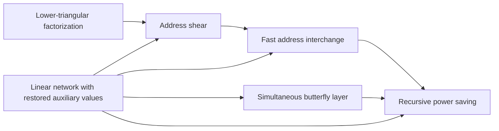

# Tape address procedures

These procedures move data on a multitape machine at cost $O(V)$ times a power of their parameter, and they are the only source of the saving in running time. [Linear network exchange](../linear-network-exchange.md "A fixed linear network that exchanges banks of values with prescribed signs and restores every auxiliary value, with each gate acting on the stored array through a frame operator that cancels between edges.") and [lower-triangular factorization](../lower-triangular-factorization.md "The factorization A = E₁ΠE₂ of a rational matrix into invertible lower-triangular factors and a partial permutation matrix with one 1 per pivot.") supply the linear-algebra core, and [address shear](../address-shear.md "The permutation (H, D) ↦ (H + AD, D) on two ordered groups of address fields, which is performed with as many pairwise interchanges as the rank of A.") turns it into an exchange of address fields. [Address interchange](../address-interchange.md "A tape procedure that swaps two disjoint contiguous address fields of an array in time O(V u^τ) for width u, computed through XOR combinations of intermediate data.") and [simultaneous butterfly layers](../simultaneous-butterfly-layer.md "A butterfly operation applied at once on one selected address bit of every record, with exact Gaussian dyadic intermediates and a single truncation after the layer.") use these to swap fields and apply butterflies to all records at once, and [recursive power saving](../recursive-power-saving.md "The mechanism in which a network with s smaller calls on W roles and parameter m gives a recursion with cost ratio s/W < m, so that repeated recursion saves a power of the parameter.") combines them into the recursion that gives an exponent below one.

## Pages

1. [Linear network with restored auxiliary values](../linear-network-exchange.md "A fixed linear network that exchanges banks of values with prescribed signs and restores every auxiliary value, with each gate acting on the stored array through a frame operator that cancels between edges.") — A fixed linear network that exchanges banks of values with prescribed signs and restores every auxiliary value, with each gate acting on the stored array through a frame operator that cancels between edges.
2. [Lower-triangular factorization](../lower-triangular-factorization.md "The factorization A = E₁ΠE₂ of a rational matrix into invertible lower-triangular factors and a partial permutation matrix with one 1 per pivot.") — The factorization A = E₁ΠE₂ of a rational matrix into invertible lower-triangular factors and a partial permutation matrix with one 1 per pivot.
3. [Address shear](../address-shear.md "The permutation (H, D) ↦ (H + AD, D) on two ordered groups of address fields, which is performed with as many pairwise interchanges as the rank of A.") — The permutation (H, D) ↦ (H + AD, D) on two ordered groups of address fields, which is performed with as many pairwise interchanges as the rank of A.
4. [Fast address interchange](../address-interchange.md "A tape procedure that swaps two disjoint contiguous address fields of an array in time O(V u^τ) for width u, computed through XOR combinations of intermediate data.") — A tape procedure that swaps two disjoint contiguous address fields of an array in time O(V u^τ) for width u, computed through XOR combinations of intermediate data.
5. [Simultaneous butterfly layer](../simultaneous-butterfly-layer.md "A butterfly operation applied at once on one selected address bit of every record, with exact Gaussian dyadic intermediates and a single truncation after the layer.") — A butterfly operation applied at once on one selected address bit of every record, with exact Gaussian dyadic intermediates and a single truncation after the layer.
6. [Recursive power saving](../recursive-power-saving.md "The mechanism in which a network with s smaller calls on W roles and parameter m gives a recursion with cost ratio s/W < m, so that repeated recursion saves a power of the parameter.") — The mechanism in which a network with s smaller calls on W roles and parameter m gives a recursion with cost ratio s/W < m, so that repeated recursion saves a power of the parameter.

## Map

Arrows point from a page to the pages that build on it.

