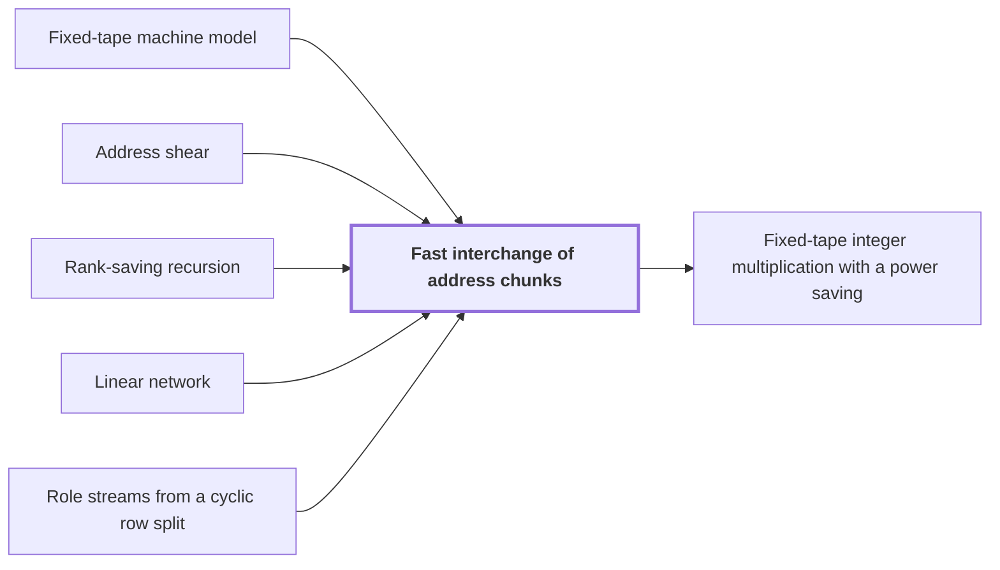

# Fast interchange of address chunks

!!! info "Before this page"

    Fast interchange of address chunks *runs on* [Fixed-tape machine model](fixed-tape-model.md "Fast interchange of address chunks is a procedure that runs on a Fixed-tape machine model and swaps two disjoint, equal-width address fields of an array."), *reduces to* [Address shear](address-shear.md "The interchange reduces to three updates, and the middle one is the Address shear, which replaces $H$ by $H+D$ and leaves $D$ fixed."), *is computed by* [Rank-saving recursion](recursive-saving.md "The shear is computed by a Rank-saving recursion on that network."), *is carried by* [Linear network](linear-network.md "The shear is carried by a bit network, a Linear network whose wires each carry one bit.") and *acts on* [Role streams from a cyclic row split](role-streams.md "Each smaller call acts on one of the $W$ wire streams, each of volume $V/W$.").

!!! abstract "Where this fits"

    1. The integer product is computed exactly on one fixed-tape machine in $O(n(\lg n)^{1-\kappa})$ worst-case time, for $\kappa=2^{-182}$. — how: reduce exact multiplication to convolution of radix digits on distinct prime axes, compute the convolution by synthetic transforms on tape layouts, and bound the total tape cost with a power saving ([Fixed-tape integer multiplication with a power saving](fixed-tape-multiplication.md "A deterministic fixed-tape Turing machine that multiplies two n-bit integers exactly in O(n(lg n)^(1−κ)) worst-case time, for a fixed κ = 2^(−182), disproving the n log n optimality conjecture in this model."))
    2. The tape operations of the algorithm cost $O(V(\lg n)^{1-\kappa})$ in total, for stored volume $V=\Theta(n)$. — how: bound the cost of each tape procedure by a fixed power of its width below linear, then choose compatible fixed rational parameters
    3. **This page:** Interchanging two equal address fields of width $u$ costs less than linear in $u$ per unit volume.

??? note "Symbols from earlier pages"

    - $W$ — number of roles: The number of roles, which is the number of fixed wire places in the network. (on [Role streams from a cyclic row split](role-streams.md "Splitting the rows of an array cyclically among the W fixed wire roles of a network, so that each role carries an equal share of the volume and gates act pointwise on matching addresses."))
    - $X$ — first bank: The bank of scalars $x_S$, one for each triple $S$. (on [Subset-intersection finite network](subset-network.md "A linear network over three-element subsets of a fixed ground set, whose gather, scatter, copy and side wires implement the scalar exchange of two banks by intersection-size coefficients over F_2 or Z[i,1/2]."))
    - $Y$ — second bank: The bank of scalars $y_S$, one for each triple $S$. (on [Subset-intersection finite network](subset-network.md "A linear network over three-element subsets of a fixed ground set, whose gather, scatter, copy and side wires implement the scalar exchange of two banks by intersection-size coefficients over F_2 or Z[i,1/2]."))

Fast interchange of address chunks is a procedure that runs on a [Fixed-tape machine model](fixed-tape-model.md "A multitape Turing machine with one fixed finite alphabet and a fixed finite number of one-dimensional tapes, the same for every input length.") and swaps two disjoint, equal-width address fields of an array. The multiplication algorithm uses it so that tape cost per unit of stored data is sublinear in the field width.

Let $H$ and $D$ be the two fields, each of $u$ bits, and let $V$ be the stored volume, the number of data units in the array. Here $u$ and $V$ are rebound: on the dyadic and frame pages $u$ is a butterfly input or a tail vertex, and on the role-streams page $V$ is a padded bit volume. The exponent $\tau$ is a fixed number below 1 that sets the saving. The interchange costs $O(Vu^{\tau})$<cite class="exegenius-ref" data-source="paper" data-locator="§1.1 The two tape operations" data-quote="Its cost is $O(Vu^\tau)$ for a fixed $\tau&lt;1$" title="Its cost is $O(Vu^\tau)$ for a fixed $\tau&lt;1$"> (see §1.1 The two tape operations)</cite>.

The interchange reduces to three updates, and the middle one is the [Address shear](address-shear.md "The address permutation that replaces the first of two address fields H by H + D, leaving D fixed, which is the endpoint operator of the bit network on arrays."), which replaces $H$ by $H+D$ and leaves $D$ fixed. The updates are $D\leftarrow D-H$, $H\leftarrow H+D$, $D\leftarrow H-D$, where $\leftarrow$ is assignment: the field on its left takes the value on its right. The outer two cost linear time.

The shear is carried by a bit network, a [Linear network](linear-network.md "A fixed network of wires with gates that apply fixed linear maps to the values on their wires, used here to exchange two banks of values while restoring all auxiliary values.") whose wires each carry one bit. Each vertex holds a rational $\mu\times\mu$ matrix, where $\mu$ is its number of rows. An edge matrix, the head's matrix minus the tail's, of rank $a$ costs $a$ smaller calls, so $s$ is the sum of these ranks. Each smaller call acts on one of the $W$ [wire streams](role-streams.md "Splitting the rows of an array cyclically among the W fixed wire roles of a network, so that each role carries an equal share of the volume and gates act pointwise on matching addresses."), each of volume $V/W$. The bound needs $s<W\mu$<cite class="exegenius-ref" data-source="paper" data-locator="§1.2 Linear networks and the recursive saving" data-quote="s&lt;Wm" title="s&lt;Wm"> (see §1.2 Linear networks and the recursive saving)</cite>, and the paper's explicit network has $W=W_{\rm b}$ and $s=s_{\rm b}$<cite class="exegenius-ref" data-source="paper" data-locator="§4.2 Transferring a finite circuit to address permutations" data-quote="supplies these conditions with $W=W_{\rm b}$ and $s=s_{\rm b}$" title="supplies these conditions with $W=W_{\rm b}$ and $s=s_{\rm b}$"> (see §4.2 Transferring a finite circuit to address permutations)</cite>.

The shear is computed by a [Rank-saving recursion](recursive-saving.md "A recursive scheme in which an edge matrix of rank a costs a smaller calls and the total number s of smaller calls over W roles satisfies s < Wm, so that multiplying the parameter by m multiplies the cost by less than m per unit volume.") on that network. Let $F_d$ be the time per unit volume of a width-$\mu^d$ interchange, where $d$ is the recursion depth. Width one ($d=0$) is a single-digit operation, so $F_0=O(1)$. At depth $d$, the $s$ smaller calls are interchanges of width $\mu^{d-1}$ on streams of volume $V/W$, which costs $(s/W)F_{d-1}$ per unit volume. Splitting, merging and gates are a fixed number of linear passes, $O(1)$ per unit volume. So $F_d\le\lambda F_{d-1}+O(1)$, with $\lambda=s/W$, and unrolling gives $F_d=O(1+\lambda+\cdots+\lambda^d)$.

The bound needs $\lambda<\mu^{\tau}$ for one fixed $\tau<1$, not merely $\lambda<\mu$. Write $\eta=(W\mu-s)/(W\mu)$, so $\lambda=\mu(1-\eta)$. For the explicit network the paper computes $\eta>20\cdot2^{-50}$<cite class="exegenius-ref" data-source="paper" data-locator="§3.6 Explicit rational bounds for the two recurrences" data-quote="Both exact deficits displayed above are greater than $20\cdot2^{-50}$." title="Both exact deficits displayed above are greater than $20\cdot2^{-50}$."> (see §3.6 Explicit rational bounds for the two recurrences)</cite> Take $\tau=1-2^{-50}$. Since $\mu<2^{20}$, $\ln\mu<20$, so $\mu^{-2^{-50}}=\exp(-2^{-50}\ln\mu)>1-20\cdot2^{-50}>1-\eta$, and hence $\lambda<\mu^{\tau}$. If $\lambda\le1$ the sum is at most $d+1$. If $\lambda>1$ it is $O(\lambda^d)$, and $\lambda^d<\mu^{d\tau}$. As $\mu\ge2$, $F_d=O(\mu^{d\tau})$, which for width $u=\mu^d$ is $O(u^{\tau})$ per unit volume.

For any initial auxiliary values, a forward invocation from $X$ to $Y$ adds $x_S$ into $y_S$ and changes no other value<cite class="exegenius-ref" data-source="paper" data-locator="§3.1 Scalar operations and restored auxiliary values" data-quote="a forward invocation changes $y_S$ to $y_S+x_S$ and leaves every other value unchanged" title="a forward invocation changes $y_S$ to $y_S+x_S$ and leaves every other value unchanged"> (see §3.1 Scalar operations and restored auxiliary values)</cite>. The shear is such an invocation, with $D$ as $X$ and $H$ as $Y$, so it is exact for any initial auxiliary contents. A forward, inverse, forward schedule of these invocations exchanges the two banks and returns every auxiliary wire to its starting value<cite class="exegenius-ref" data-source="paper" data-locator="§1.2 Linear networks and the recursive saving" data-quote="restores every auxiliary value" title="restores every auxiliary value"> (see §1.2 Linear networks and the recursive saving)</cite>.

## Connections

Used by:

- [Fixed-tape integer multiplication with a power saving](fixed-tape-multiplication.md "It carries out its address rearrangements by Fast interchange of address chunks, which swaps two equal-width address fields of width $u$.") *carries out its address rearrangements by* Fast interchange of address chunks

??? quote "From the sources"

    > The first procedure interchanges two disjoint contiguous address fields
    >
    > — [Integer multiplication below n log n (OpenAI, 2026)](https://github.com/openai/math/tree/fd4aeeb2ee4fc729c18d98444fed42fd0529eeeb/preprints/Integer-multiplication-below-n-log-n-September-23-2026)
