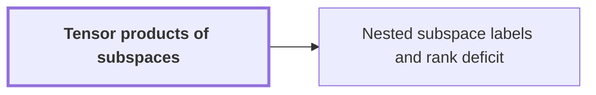

# Tensor products of subspaces

!!! info "Before this page"

    Assumed known: Vector spaces, subspaces, dimension and rank and Matrices and linear operators.

!!! abstract "Where this fits"

    - Relied on to show: Attaching to the gates nondegenerate subspaces of an $m$-dimensional space, nested along every edge, the number of smaller calls (the total rank of the edge changes) is $s_{\rm b}=W_{\rm b}m-N+2L_{\rm b}$ for the bit network and $s_{\rm c}=W_{\rm c}m-2N+2L_{\rm c}$ for the complex network, both strictly less than $Wm$, because $L/N<1/2$. ([Nested subspace labels and rank deficit](subspace-labels.md "Assigning nondegenerate subspaces of an m-dimensional space to gates so adjacent labels are nested; the total dimension change over edges, the number s of smaller calls, is strictly less than W·m."))

??? note "Symbols from earlier pages"

    - $m$ — label-space dimension: The dimension of the label space used on later pages. (on [Linear exchange network with restored scratch wires](exchange-network.md "A fixed network of linear gates on wires holding values that swaps two banks with a prescribed sign while undoing the effect of arbitrary initial scratch values, built from three-element subsets."))

The tensor product $E\otimes G$ of two finite-dimensional vector spaces $E$ and $G$ over the same field is a space of dimension $\dim E\cdot\dim G$ on which operators and bilinear forms of the two factors act factorwise. It builds the gate label space from three copies of one small space.

Let $(\mathbf e_i)$ be a basis of $E$ and $(\mathbf g_j)$ a basis of $G$. The space $E\otimes G$ has as basis the symbols $\mathbf e_i\otimes\mathbf g_j$, one for each pair, so its dimension is $\dim E\cdot\dim G$. For $\xi\in E$ and $\eta\in G$, the pure tensor $\xi\otimes\eta$ is defined by expanding bilinearly. If $E$ and $G$ both have dimension $2$, an element of $E\otimes G$ is a $2\times2$ array and $\xi\otimes\eta$ has entries $\xi_i\eta_j$; $\mathbf e_1\otimes\mathbf g_1+\mathbf e_2\otimes\mathbf g_2$ is not a pure tensor.

**Factorwise action.** For linear maps $\phi:E\to E$ and $\psi:G\to G$, the map $\phi\otimes\psi$ is linear with $(\phi\otimes\psi)(\xi\otimes\eta)=\phi(\xi)\otimes\psi(\eta)$; its matrix is the Kronecker product of the two matrices. Bilinear forms combine the same way:
$$\langle \xi\otimes\eta,\ \xi'\otimes\eta'\rangle=\langle \xi,\xi'\rangle_E\,\langle \eta,\eta'\rangle_G .$$
A form is nondegenerate when its Gram matrix (the matrix of pairings of basis vectors) is invertible, which is why dimensions must be finite. The Gram matrix of the product form is the Kronecker product of the two Gram matrices, so a product of nondegenerate forms is nondegenerate.

**Subspaces.** Let $A$ and $C$ be finite-dimensional spaces with nondegenerate forms, $P\subseteq A$ a subspace, and $Q\subseteq C$ a subspace. Extending bases of $P$ and $Q$ to bases of $A$ and $C$ shows that $P\otimes Q$ is a subspace of $A\otimes C$ of dimension $\dim P\cdot\dim Q$.

Let $P$ be nondegenerate and $B=P^\perp$ its orthogonal complement in $A$, so $A=B\perp P$. Take a basis of $A$ made of a basis of $B$ followed by one of $P$. The basis vectors $\mathbf b\otimes\mathbf g_j$ of $A\otimes C$ span $B\otimes C$ and the vectors $\mathbf p\otimes\mathbf g_j$ span $P\otimes C$, so together they span $A\otimes C$ with no overlap. The two subspaces are orthogonal, because $\langle\mathbf b\otimes\mathbf g_j,\mathbf p\otimes\mathbf g_{j'}\rangle=\langle\mathbf b,\mathbf p\rangle\langle\mathbf g_j,\mathbf g_{j'}\rangle=0$ and pure tensors span. Hence
$$A\otimes C=(B\otimes C)\perp(P\otimes C),\qquad \dim(A\otimes C)=\dim B\cdot\dim C+\dim P\cdot\dim C.$$
This is how gate-label dimensions are computed in the nested-label construction.

**In the argument.** Take a space $F$ of dimension $h$ with a nondegenerate form. The label space is $F\otimes F\otimes F$, of dimension $h^3=m$, and it is nondegenerate<cite class="exegenius-ref" data-source="paper" data-locator="§3.3 Subspaces attached to the gates" data-quote="It has dimension $m$ and is nondegenerate." title="It has dimension $m$ and is nondegenerate."> (see §3.3 Subspaces attached to the gates)</cite> An empty tensor product counts as the ground field, of dimension one<cite class="exegenius-ref" data-source="paper" data-locator="§3.3 Subspaces attached to the gates" data-quote="An empty tensor product is the one-dimensional ground field" title="An empty tensor product is the one-dimensional ground field"> (see §3.3 Subspaces attached to the gates)</cite>, so a stage with no factors contributes a factor $1$.

## Connections

Used by:

- [Nested subspace labels and rank deficit](subspace-labels.md "Dimension counting rests on three facts about tensor products of subspaces: for subspaces $E,E',G$ of tensor powers of $F$, $\dim(E\otimes G)=\dim E\cdot\dim G$; the form multiplies factorwise, so products of nondegenerate subspaces are nondegenerate; and $(E\perp E')\otimes G=(E\otimes G)\perp(E'\otimes G)$.") *rests on facts about* Tensor products of subspaces
