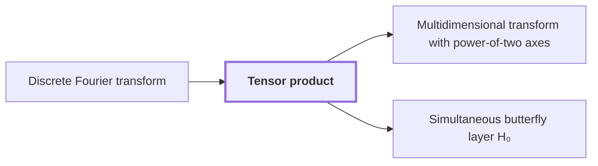

# Tensor product

!!! info "Before this page"

    Tensor product *is built from* [Discrete Fourier transform](fourier-transform.md "The tensor product of one-dimensional transforms is built from one Discrete Fourier transform per axis."). Assumed known: Linear map and matrix and Vector space, subspace, basis and dimension.

!!! abstract "Where this fits"

    - Relied on to show: Each prime-length Fourier transform is expressed through a tensor transform with power-of-two axis lengths, keeping the source and target permutations inside the identity. ([Gaussian resampling](gaussian-resampling.md "A rewriting of a Fourier transform of prime length as a transform with power-of-two axis lengths, with source and target coordinate permutations kept inside the transform identity."))
    - Relied on to show: Gaussian resampling expresses each source Fourier transform through a power-of-two tensor transform.

??? note "Symbols from earlier pages"

    - $H_0$ — butterfly map: The map sending a pair $(u,v)$ to $((u+v)/2, (u-v)/2)$. (on [Gaussian dyadic numbers](glossary.md#gaussian-dyadic "Complex numbers whose real and imaginary parts are both dyadic rationals, that is, have power-of-two denominators."))
    - $u$ — first butterfly input: The first value of an input pair to the butterfly map $H_0$. (on [Gaussian dyadic numbers](glossary.md#gaussian-dyadic "Complex numbers whose real and imaginary parts are both dyadic rationals, that is, have power-of-two denominators."))
    - $v$ — second butterfly input: The second value of an input pair to the butterfly map $H_0$. (on [Gaussian dyadic numbers](glossary.md#gaussian-dyadic "Complex numbers whose real and imaginary parts are both dyadic rationals, that is, have power-of-two denominators."))

The tensor product of two vector spaces is the space spanned by pairs of basis vectors, one from each factor, and it turns a linear map on each factor into one linear map on the product.

Let $E$ and $F$ be vector spaces over $\mathbb{C}$. Every $e\in E$ is a general vector of $E$, and every $f\in F$ a general vector of $F$. Let $e_1,\dots,e_n$ be a basis of $E$ and $f_1,\dots,f_q$ a basis of $F$, where $n$ is the number of basis vectors of $E$ (the letter changes meaning from the input length of earlier pages) and $q$ is the number of basis vectors of $F$. Here $e_i$ is the $i$th basis vector of $E$, $f_j$ the $j$th of $F$, and $1\le i\le n$, $1\le j\le q$.

A concrete model of $E\otimes F$ is the space of $n\times q$ complex arrays, tables with $n$ rows and $q$ columns, where $e_i\otimes f_j$ has a single $1$ in row $i$, column $j$ and zeros elsewhere. These $nq$ arrays form a basis. Each $e$ is a unique combination of the $e_i$, and each $f$ of the $f_j$, so $e\otimes f$ has entry $(i,j)$ equal to the coefficient of $e$ on $e_i$ times the coefficient of $f$ on $f_j$. This product is bilinear, meaning it is linear in each factor separately.

Let $L$ be a linear map of $E$ and $T$ of $F$; the letters $L$ and $T$ change meaning here. Define $L\otimes T$ on the basis by $(L\otimes T)(e_i\otimes f_j)=Le_i\otimes Tf_j$. A linear map is fixed by its values on a basis, so this defines exactly one map. Bilinearity then gives $(L\otimes T)(e\otimes f)=Le\otimes Tf$ for all $e\in E$ and $f\in F$.

For example, take $E=F=\mathbb{C}^2$ with standard bases $e_1,e_2$, and let $L=T$ satisfy $Le_1=e_1+e_2$ and $Le_2=e_1-e_2$. Then
$$(L\otimes T)(e_1\otimes e_2)=(e_1+e_2)\otimes(e_1-e_2)=e_1\otimes e_1-e_1\otimes e_2+e_2\otimes e_1-e_2\otimes e_2,$$
where the last step uses bilinearity. Two maps on two-dimensional spaces are now one map on a four-dimensional space.

Here $D$ counts the selected bits, not the address field $D$. The butterfly $H_0(u,v)=((u+v)/2,(u-v)/2)$ is the $2\times 2$ matrix $\tfrac12\begin{pmatrix}1&1\\1&-1\end{pmatrix}$ acting on $\begin{pmatrix}u\\v\end{pmatrix}$, and with the other bits fixed, each selected bit carries such a pair. Applying $H_0$ to every selected bit at once is the single linear map $H_0\otimes\cdots\otimes H_0$ with $D$ factors, rather than $D$ separate passes.<cite class="exegenius-ref" data-source="paper" data-locator="§5 Fast simultaneous synthetic butterfly layers" data-quote="The intended operation is the tensor product of $H_0(u,v)=((u+v)/2,(u-v)/2)$ on the $D$ selected bits" title="The intended operation is the tensor product of $H_0(u,v)=((u+v)/2,(u-v)/2)$ on the $D$ selected bits"> (see §5 Fast simultaneous synthetic butterfly layers)</cite>.

The tensor product of one-dimensional transforms is built from one [Discrete Fourier transform](fourier-transform.md "The map sending a vector u of length q to the vector whose k-th entry is (1/q) times the sum over j of u_j times exp(−2πijk/q).") per axis. [Gaussian resampling](gaussian-resampling.md "A rewriting of a Fourier transform of prime length as a transform with power-of-two axis lengths, with source and target coordinate permutations kept inside the transform identity.") uses this to express each source Fourier transform as a power-of-two tensor transform.

## Connections

Used by:

- [Multidimensional transform with power-of-two axes](multidim-transform.md "It is built with the tensor product of these one-axis maps, so each map acts only along its own axis.") *is built with* Tensor product
- [Simultaneous butterfly layer H₀](butterfly-layer.md "Applying $B_d$ to all $d$ selected bits is built by the Tensor product of the $d$ single-bit butterflies, so applying them one at a time in any order gives the same result.") *is built by* Tensor product

??? quote "From the sources"

    > An empty tensor product is the one-dimensional ground field
    >
    > — [Integer multiplication below n log n (OpenAI, 2026)](https://github.com/openai/math/tree/fd4aeeb2ee4fc729c18d98444fed42fd0529eeeb/preprints/Integer-multiplication-below-n-log-n-September-23-2026)

    > The intended operation is the tensor product
    >
    > — [Integer multiplication below n log n (OpenAI, 2026)](https://github.com/openai/math/tree/fd4aeeb2ee4fc729c18d98444fed42fd0529eeeb/preprints/Integer-multiplication-below-n-log-n-September-23-2026)
