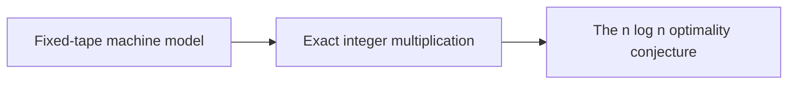

# The model and the conjecture

This part fixes the machine model and the problem being solved. The reader needs the [Fixed-tape machine model](../fixed-tape-model.md "A Turing machine with one fixed finite alphabet and one fixed finite number of one-dimensional tapes, whose size does not grow with the input.") to know what counts as a step, and the [Exact integer multiplication](../exact-integer-multiplication.md "Given binary strings x and y of length n, output the 2n-bit binary representation of their product.") problem to know what must be output. The [n log n optimality conjecture](../n-log-n-conjecture.md "The conjecture that n log n is the optimal order of growth of the time needed to multiply two n-bit integers.") is the claim the result refutes.

## Pages

1. [Fixed-tape machine model](../fixed-tape-model.md "A Turing machine with one fixed finite alphabet and one fixed finite number of one-dimensional tapes, whose size does not grow with the input.") — A Turing machine with one fixed finite alphabet and one fixed finite number of one-dimensional tapes, whose size does not grow with the input.
2. [Exact integer multiplication](../exact-integer-multiplication.md "Given binary strings x and y of length n, output the 2n-bit binary representation of their product.") — Given binary strings x and y of length n, output the 2n-bit binary representation of their product.
3. [The n log n optimality conjecture](../n-log-n-conjecture.md "The conjecture that n log n is the optimal order of growth of the time needed to multiply two n-bit integers.") — The conjecture that n log n is the optimal order of growth of the time needed to multiply two n-bit integers.

## Map

Arrows point from a page to the pages that build on it.

