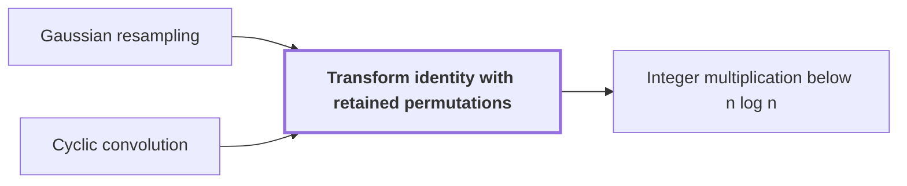

# Transform identity with retained permutations

!!! info "Before this page"

    Transform identity with retained permutations *rewrites* [Gaussian resampling](gaussian-resampling.md "The transform identity with retained permutations rewrites Gaussian resampling so that the source and target coordinate permutations stay inside the formula.") and *is applied inside* [Cyclic convolution](glossary.md#cyclic-convolution "It is applied inside a cyclic convolution, so its transforms run without executing those permutations as sorts.").

!!! abstract "Where this fits"

    1. A deterministic fixed-tape machine multiplies two $n$-bit integers exactly in $O(n(\lg n)^{1-\kappa})$ time, with $\kappa=2^{-182}$, below the $n\lg n$ conjecture in this model. — how: bound the cost of an exact multiplication whose transform layers are made cheap by two tape procedures, then fix parameters so every cost term fits ([Integer multiplication below n log n](main-theorem.md "A deterministic fixed-tape machine that multiplies two n-bit integers exactly in O(n (lg n)^(1−κ)) time with κ = 2^−182, which disproves the n log n optimality conjecture in this model."))
    2. The exact product of two $n$-bit integers is obtained from the convolution of their radix-digit coefficients, computed by transforms on a fixed tape layout and then recovered and carried. — how: reduce the convolution by a Chinese-remainder map, Gaussian resampling, Bluestein's identity and a phase twist to a convolution over a polynomial ring, then recover coefficients and propagate carries ([Radix-digit convolution](radix-digit-convolution.md "Writing both integers as polynomials in a power of two whose coefficients are their digits, so that their product is a polynomial convolution of short coefficients."))
    3. **This page:** The source and target coordinate permutations are retained in the transform identity, so they need not be executed as separate sorts.

The transform identity with retained permutations rewrites [Gaussian resampling](gaussian-resampling.md "A technique that replaces a Fourier transform of arbitrary length by transforms whose axis lengths are powers of two, using Gaussian weights to move between the two sets of frequencies.") so that the source and target coordinate permutations stay inside the formula. It is applied inside a [cyclic convolution](glossary.md#cyclic-convolution "The product of two sequences in which indices wrap around modulo the sequence length."), so its transforms run without executing those permutations as sorts.

Gaussian resampling replaces a transform of arbitrary length by transforms whose lengths are powers of two. Its usual implementation sorts each coordinate twice, once into source order and once into target order, and on a fixed tape each sort is paid for in full. The identity instead keeps both permutations in the formula and computes that formula directly.<cite class="exegenius-ref" data-source="paper" data-locator="§2 M (3ℓ + 1)2-p, p. 48" data-quote="We retain both permutations in the transform formula" title="We retain both permutations in the transform formula"> (see §2 M (3ℓ + 1)2-p, p. 48)</cite>.

Take four coordinates whose source order reverses them. Sorting into that order moves every coordinate once, and sorting back moves them all again. With the permutation kept symbolic, nothing moves. A permutation followed by its inverse is the identity, so the formula can drop such a pair, and the pair is never executed.

## Connections

Used by:

- [Integer multiplication below n log n](main-theorem.md "The transform identity is based on the transform identity with retained permutations, so permutations cancel instead of being sorted.") *is based on* Transform identity with retained permutations

??? quote "From the sources"

    > We retain both permutations in the transform formula
    >
    > — Integer multiplication below n log n (OpenAI, 2026)
