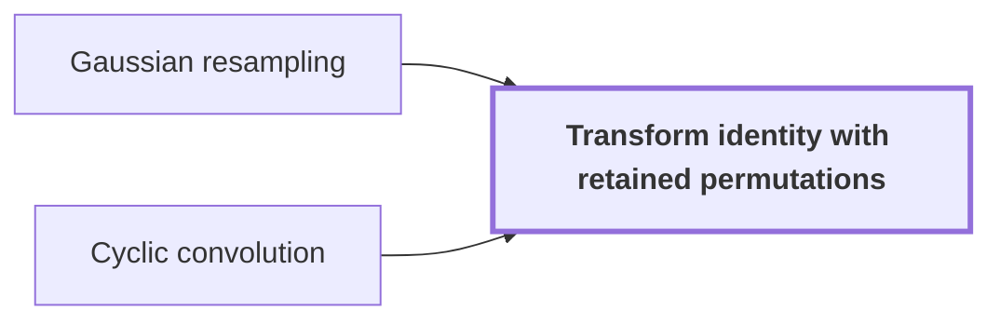

# Transform identity with retained permutations

!!! info "Before this page"

    Transform identity with retained permutations *rests on* [Gaussian resampling](gaussian-resampling.md "The transform identity rests on Gaussian resampling.") and *cancels its retained permutation across* [Cyclic convolution](cyclic-convolution.md "The transform identity cancels its retained permutation across a cyclic convolution.").

??? note "Symbols from earlier pages"

    - $P_s$ — source permutation: The coordinate permutation on vectors of length s, sending g to the vector with entries g_{ti}. (on [Gaussian resampling](gaussian-resampling.md "A technique that replaces a Fourier transform of arbitrary length by transforms whose axis lengths are powers of two, using Gaussian weights to move between the two sets of frequencies."))
    - $F_s$ — source transform: The normalized Fourier transform of length s. (on [Gaussian resampling](gaussian-resampling.md "A technique that replaces a Fourier transform of arbitrary length by transforms whose axis lengths are powers of two, using Gaussian weights to move between the two sets of frequencies."))
    - $\alpha$ — Gaussian width: The integer width parameter of the Gaussian weights. (on [Gaussian resampling](gaussian-resampling.md "A technique that replaces a Fourier transform of arbitrary length by transforms whose axis lengths are powers of two, using Gaussian weights to move between the two sets of frequencies."))
    - $B_0$ — target contraction: The contraction 2^{-(2 alpha^2-2)} D N^{-1} C/2 from vectors of length t to vectors of length s. (on [Gaussian resampling](gaussian-resampling.md "A technique that replaces a Fourier transform of arbitrary length by transforms whose axis lengths are powers of two, using Gaussian weights to move between the two sets of frequencies."))
    - $P_t$ — target permutation: The coordinate permutation on vectors of length t, sending h to the vector with entries h_{-sm}. (on [Gaussian resampling](gaussian-resampling.md "A technique that replaces a Fourier transform of arbitrary length by transforms whose axis lengths are powers of two, using Gaussian weights to move between the two sets of frequencies."))
    - $F_t$ — target transform: The normalized Fourier transform of length t. (on [Gaussian resampling](gaussian-resampling.md "A technique that replaces a Fourier transform of arbitrary length by transforms whose axis lengths are powers of two, using Gaussian weights to move between the two sets of frequencies."))
    - $A$ — source contraction: The contraction S/2 applied to vectors of length s. (on [Gaussian resampling](gaussian-resampling.md "A technique that replaces a Fourier transform of arbitrary length by transforms whose axis lengths are powers of two, using Gaussian weights to move between the two sets of frequencies."))
    - $s$ — source length: The number of coordinates of a source vector, a count. (on [Gaussian resampling](gaussian-resampling.md "A technique that replaces a Fourier transform of arbitrary length by transforms whose axis lengths are powers of two, using Gaussian weights to move between the two sets of frequencies."))
    - $t$ — target length: The number of coordinates of a target vector, a count. (on [Gaussian resampling](gaussian-resampling.md "A technique that replaces a Fourier transform of arbitrary length by transforms whose axis lengths are powers of two, using Gaussian weights to move between the two sets of frequencies."))

Transform identity with retained permutations is the form of the [Gaussian resampling](gaussian-resampling.md "A technique that replaces a Fourier transform of arbitrary length by transforms whose axis lengths are powers of two, using Gaussian weights to move between the two sets of frequencies.") identity that keeps the coordinate permutations inside the formula instead of executing them as sorts. On the way to [exact integer multiplication](exact-integer-multiplication.md "Given binary strings x and y of length n, output the 2n-bit binary representation of their product."), its job is to let the source permutation cancel across a convolution.

The transform identity rests on [Gaussian resampling](gaussian-resampling.md "A technique that replaces a Fourier transform of arbitrary length by transforms whose axis lengths are powers of two, using Gaussian weights to move between the two sets of frequencies."). Its one-dimensional form $P_sF_s = 2^{2\alpha^2}B_0P_tF_tA$ holds with linear contractions $A$ and $B_0$, where a contraction is a linear map that does not increase the norm, the measure of a vector's length.

The usual implementation applies $P_s$ and $P_t$ as full sorts, twice on each coordinate. Keeping both permutations in the formula means these sorts are never executed.<cite class="exegenius-ref" data-source="paper" data-locator="§2 M (3ℓ + 1)2-p, p. 48" data-quote="We retain both permutations in the transform formula" title="We retain both permutations in the transform formula"> (see §2 M (3ℓ + 1)2-p, p. 48)</cite>.

The transform identity cancels its retained permutation across a [cyclic convolution](cyclic-convolution.md "The product of two sequences in which indices wrap around modulo the sequence length."). Let $R$ be the source permutation $P_s$ applied along every source axis. Let $\phi$ and $\psi$ be arrays indexed by the source box, which has $M=\prod_i s_i$ entries, where $s_i$ is the length of source axis $i$. Let $F_s^{+}$ be the opposite transform, whose roots of unity have reversed sign. Write $\cdot$ for entrywise multiplication and $\ast$ for cyclic convolution on the box. Then

$$RF_s^{+}R\bigl(F_s\phi\cdot F_s\psi\bigr)=\frac{\phi\ast\psi}{M^2}.$$

The opposite transform sends $R$ to its inverse, $F_s^{+}R=R^{-1}F_s^{+}$, so $RF_s^{+}R=F_s^{+}$ and the left side is $F_s^{+}(F_s\phi\cdot F_s\psi)$. The normalizations $F_s^{+}F_s=I/M$ and $F_s(\phi\ast\psi)=M\,(F_s\phi)\cdot(F_s\psi)$ then give $(\phi\ast\psi)/M^2$.

So the retained permutation is undone inside the opposite transform. The product of two retained transforms yields the convolution directly, scaled by $1/M^2$, and no sort is needed to restore natural order.

## Connections

??? quote "From the sources"

    > We retain both permutations in the transform formula
    >
    > — Integer multiplication below n log n (OpenAI, 2026)
