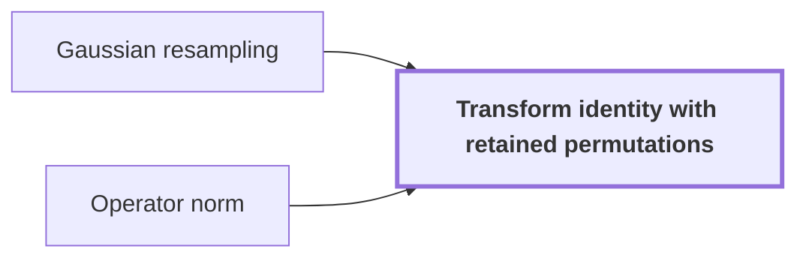

# Transform identity with retained permutations

!!! info "Before this page"

    Transform identity with retained permutations *is obtained by inverting* [Gaussian resampling](gaussian-resampling.md "It is obtained by inverting the Gaussian resampling identity, which keeps both permutations.") and *is bounded in* [Operator norm](operator-norm.md "The two maps are linear contractions, bounded in the operator norm by one, meaning each sends a vector to one of norm at most its input norm.").

??? note "Symbols from earlier pages"

    - $F_s$ — source transform: The normalized Fourier transform on length-$s$ vectors. (on [Gaussian resampling](gaussian-resampling.md "A technique that replaces a Fourier transform of arbitrary length by transforms whose axis lengths are powers of two, using Gaussian weights to move between the two sets of frequencies."))
    - $F_t$ — target transform: The normalized Fourier transform on length-$t$ vectors. (on [Gaussian resampling](gaussian-resampling.md "A technique that replaces a Fourier transform of arbitrary length by transforms whose axis lengths are powers of two, using Gaussian weights to move between the two sets of frequencies."))
    - $P_s$ — source permutation: The coordinate permutation of length-$s$ vectors with $(P_s u)_j=u_{tj}$. (on [Gaussian resampling](gaussian-resampling.md "A technique that replaces a Fourier transform of arbitrary length by transforms whose axis lengths are powers of two, using Gaussian weights to move between the two sets of frequencies."))
    - $P_t$ — target permutation: The coordinate permutation of length-$t$ vectors with $(P_t g)_k=g_{-sk}$. (on [Gaussian resampling](gaussian-resampling.md "A technique that replaces a Fourier transform of arbitrary length by transforms whose axis lengths are powers of two, using Gaussian weights to move between the two sets of frequencies."))
    - $s$ — source length: The number of entries of the source vector $u$. (on [Gaussian resampling](gaussian-resampling.md "A technique that replaces a Fourier transform of arbitrary length by transforms whose axis lengths are powers of two, using Gaussian weights to move between the two sets of frequencies."))
    - $t$ — target length: The number of entries of the target vector $g$. (on [Gaussian resampling](gaussian-resampling.md "A technique that replaces a Fourier transform of arbitrary length by transforms whose axis lengths are powers of two, using Gaussian weights to move between the two sets of frequencies."))
    - $\alpha$ — Gaussian width: The integer that sets the width of the Gaussian weights in $S$ and $T$. (on [Gaussian resampling](gaussian-resampling.md "A technique that replaces a Fourier transform of arbitrary length by transforms whose axis lengths are powers of two, using Gaussian weights to move between the two sets of frequencies."))
    - $\theta$ — relative gap: The relative gap $t/s-1$ between the target and source lengths. (on [Gaussian resampling](gaussian-resampling.md "A technique that replaces a Fourier transform of arbitrary length by transforms whose axis lengths are powers of two, using Gaussian weights to move between the two sets of frequencies."))
    - $j$ — source position: A position in the source vector $u$, not an output index of the DFT. (on [Gaussian resampling](gaussian-resampling.md "A technique that replaces a Fourier transform of arbitrary length by transforms whose axis lengths are powers of two, using Gaussian weights to move between the two sets of frequencies."))
    - $S$ — gathering map: The Gaussian-weighted map from length-$s$ to length-$t$ vectors that gathers entries of $u$ near $sk/t$. (on [Gaussian resampling](gaussian-resampling.md "A technique that replaces a Fourier transform of arbitrary length by transforms whose axis lengths are powers of two, using Gaussian weights to move between the two sets of frequencies."))
    - $T$ — spreading map: The Gaussian-weighted map from length-$s$ to length-$t$ vectors that spreads each $u_j$ over targets near $tj/s$. (on [Gaussian resampling](gaussian-resampling.md "A technique that replaces a Fourier transform of arbitrary length by transforms whose axis lengths are powers of two, using Gaussian weights to move between the two sets of frequencies."))
    - $N$ — near-identity map: The map $CTD$ from length-$s$ to length-$s$ vectors, close to the identity. (on [Gaussian resampling](gaussian-resampling.md "A technique that replaces a Fourier transform of arbitrary length by transforms whose axis lengths are powers of two, using Gaussian weights to move between the two sets of frequencies."))
    - $C$ — coordinate selection: The map $(Cg)_j=g_{\ell_j}$ that selects, for each $j$, the entry of $g$ at $\ell_j$. (on [Gaussian resampling](gaussian-resampling.md "A technique that replaces a Fourier transform of arbitrary length by transforms whose axis lengths are powers of two, using Gaussian weights to move between the two sets of frequencies."))
    - $D$ — diagonal map: The diagonal map scaling $u_j$ by $e^{\pi\alpha^2\beta_j^2}$. (on [Gaussian resampling](gaussian-resampling.md "A technique that replaces a Fourier transform of arbitrary length by transforms whose axis lengths are powers of two, using Gaussian weights to move between the two sets of frequencies."))
    - $S'$ — scaled Gaussian map: Half of a Gaussian resampling map, used as the map A. (on [Operator norm](operator-norm.md "The norm of a linear map L is the supremum of ‖Lu‖ over vectors u with ‖u‖ ≤ 1, where the vector norm of a complex vector is the largest modulus among its coordinates; a linear contraction is a linear map of norm at most one."))
    - $J'$ — scaled inverse map: Half the inverse of an invertible map close to the identity. (on [Operator norm](operator-norm.md "The norm of a linear map L is the supremum of ‖Lu‖ over vectors u with ‖u‖ ≤ 1, where the vector norm of a complex vector is the largest modulus among its coordinates; a linear contraction is a linear map of norm at most one."))
    - $D'$ — scaled diagonal map: A diagonal map scaled by a fixed factor at most one. (on [Operator norm](operator-norm.md "The norm of a linear map L is the supremum of ‖Lu‖ over vectors u with ‖u‖ ≤ 1, where the vector norm of a complex vector is the largest modulus among its coordinates; a linear contraction is a linear map of norm at most one."))

The transform identity with retained permutations is an exact identity between the [normalized Fourier transforms](discrete-fourier-transform.md "The map sending a vector of q values to its q values weighted by powers of a q-th root of unity, normalized by 1/q.") $F_s$ and $F_t$ of two lengths, in which the coordinate permutations $P_s$ and $P_t$ stay as explicit factors. Because they remain factors, they can cancel across a convolution instead of being executed as sorts. It is the step that lets transforms of power-of-two length stand in for the coprime transform lengths of the integer product.

It is obtained by inverting the [Gaussian resampling](gaussian-resampling.md "A technique that replaces a Fourier transform of arbitrary length by transforms whose axis lengths are powers of two, using Gaussian weights to move between the two sets of frequencies.") identity, which keeps both permutations. The usual implementation sorts twice on each coordinate, and the paper makes the alternative explicit.<cite class="exegenius-ref" data-source="paper" data-locator="§2 M (3ℓ + 1)2-p, p. 48" data-quote="We retain both permutations in the transform formula" title="We retain both permutations in the transform formula"> (see §2 M (3ℓ + 1)2-p, p. 48)</cite>. Its motivation is that computing the formula directly avoids those sorts.

Let $2\le s<t$ with $s$ and $t$ coprime, let $\alpha\ge 2$, and let $\theta=t/s-1$ satisfy $\alpha^2\theta>1$. Here $P_s$ permutes the coordinates of length-$s$ vectors and $P_t$ permutes those of length-$t$ vectors, with subscripts taken modulo $s$ and $t$. Here $A$ is a linear map from length-$s$ to length-$t$ vectors. $B_0$ is a linear map from length-$t$ to length-$s$ vectors. The identity is
$$P_sF_s=2^{2\alpha^2}B_0P_tF_tA,$$
The claim is stated in<cite class="exegenius-ref" data-source="paper" data-locator="§2 M (3ℓ + 1)2-p, p. 48" data-quote="Lemma 19 (Resampling without executing the two permutations)" title="Lemma 19 (Resampling without executing the two permutations)"> (see §2 M (3ℓ + 1)2-p, p. 48)</cite>. The two maps are linear contractions, bounded in the [operator norm](operator-norm.md "The norm of a linear map L is the supremum of ‖Lu‖ over vectors u with ‖u‖ ≤ 1, where the vector norm of a complex vector is the largest modulus among its coordinates; a linear contraction is a linear map of norm at most one.") by one, meaning each sends a vector to one of norm at most its input norm.

The proof uses the Gaussian maps $S$ and $T$, which send length-$s$ vectors to length-$t$ vectors, and the Gaussian identity $TP_sF_s=P_tF_tS$. Let $N=CTD$, where $C$ selects the coordinates $\ell_j$ and $D$ is the diagonal factor. The inverse estimate of prior work, proved in [15, Theorem 4.2 and Lemma 4.6], gives $\|N-I\|<2^{-\alpha^2\theta}$, which is below $1/2$ because $\alpha^2\theta>1$. So $\|E\|<1$ for $E=I-N$, and the Neumann series $\sum_{r\ge 0}E^r$, the matrix analogue of the geometric series, converges, so $N$ is invertible.

Set $S'=S/2$, $J'=N^{-1}/2$ and $D'=2^{-(2\alpha^2-2)}D$, and take $A=S'$ and $B_0=D'J'C$. Both are linear contractions, since $\|C\|=1$ and $\|S'\|$, $\|J'\|$, $\|D'\|$ are below their stated bounds.

Since $N=CTD$ and $D$ is invertible, $CT=ND^{-1}$, so $(DN^{-1}C)T=I$. The map $DN^{-1}C$ is a left inverse of $T$. Applying it to the Gaussian identity gives $DN^{-1}CP_tF_tS=P_sF_s$, and hence
$$B_0P_tF_tA=2^{-(2\alpha^2-2)}\cdot\tfrac12\cdot\tfrac12\,DN^{-1}CP_tF_tS=2^{-2\alpha^2}P_sF_s.$$
Multiplying by $2^{2\alpha^2}$ gives the identity.

The constant depends only on $\alpha$. Its scalar factors multiply to $2^{-(2\alpha^2-2)}\cdot\tfrac12\cdot\tfrac12=2^{-2\alpha^2}$, a power of two whose exponent is set by $\alpha$ alone. The lengths $s$ and $t$ and the Gaussian weights sit inside $S$, $T$ and $N$, and never reach the constant.

## Connections

??? quote "From the sources"

    > We retain both permutations in the transform formula
    >
    > — Integer multiplication below n log n (OpenAI, 2026)
