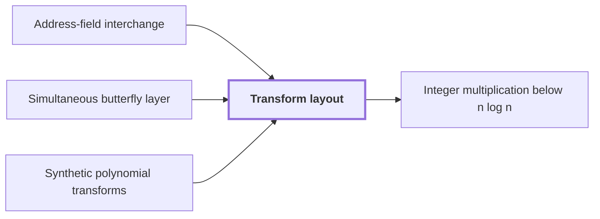

# Transform layout

!!! info "Before this page"

    Transform layout *is reached by swapping* [Address-field interchange](address-interchange.md "Transform layout is reached by swapping contiguous chunks, as in Address-field interchange."), *feeds* [Simultaneous butterfly layer](simultaneous-butterfly-layer.md "It feeds the Simultaneous butterfly layer its bits in this form.") and *lays out the rounds of* [Synthetic polynomial transforms](synthetic-transforms.md "The layout lays out the rounds of Synthetic polynomial transforms on tape, one layer per round.").

!!! abstract "Where this fits"

    1. A deterministic fixed-tape machine multiplies two $n$-bit integers exactly in $O(n(\lg n)^{1-\kappa})$ time, with $\kappa=2^{-182}$, below the $n\lg n$ conjecture in this model. — how: bound the cost of an exact multiplication whose transform layers are made cheap by two tape procedures, then fix parameters so every cost term fits ([Integer multiplication below n log n](main-theorem.md "A deterministic fixed-tape machine that multiplies two n-bit integers exactly in O(n (lg n)^(1−κ)) time with κ = 2^−182, which disproves the n log n optimality conjecture in this model."))
    2. A simultaneous normalized butterfly layer on $d$ selected chunks of stored volume $V$ costs $O(V d^{\lambda'})$. — how: realize the tensor product of the two-point kernel by an exact complex phase network with dyadic frame changes, then convert it to the normalized $H_0$ layer ([Simultaneous butterfly layer](simultaneous-butterfly-layer.md "The tensor product of the two-point map H0 applied to several selected address bits at once, computed exactly in one pass rather than one axis at a time."))
    3. **This page:** On the layouts of the multiplication algorithm, the same bit position is selected in each of at most $d$ equal-width address chunks.

Transform layout is a permutation of address bits that puts the selected bits of all participating axes at a common offset in consecutive chunks, so that a [Simultaneous butterfly layer](simultaneous-butterfly-layer.md "The tensor product of the two-point map H0 applied to several selected address bits at once, computed exactly in one pass rather than one axis at a time.") can act on each transform round.

An axis is one dimension of the array of records. Its index occupies a contiguous field of address bits, and the fields start in axis order. A round acts on the selected bits of the participating axes, so those bits must be moved to a common offset first. Chunks are $K$ address bits wide, where $K$ is the number of bits in one chunk. The layout is built from single-bit moves and chunk interchanges.<cite class="exegenius-ref" data-source="paper" data-locator="§1 X 2 -hk -bk zk + (-1)b zk+t/2, p. 40" data-quote="The layout uses the single-bit moves of Lemma 3 and the chunk interchanges of Lemma 12" title="The layout uses the single-bit moves of Lemma 3 and the chunk interchanges of Lemma 12"> (see §1 X 2 -hk -bk zk + (-1)b zk+t/2, p. 40)</cite>

Take $K = 2$ and two axes of four bits each, so the address has eight bits in four chunks. Chunks 1 and 2 hold the first axis, and chunks 3 and 4 hold the second. A round selects the first bit of each axis, which sits at offset 0 of chunks 1 and 3. Swapping chunks 2 and 3 puts the second axis's first bit at offset 0 of chunk 2. The selected bits now sit at a common offset in consecutive chunks, so one pass of the layer covers both axes. Transform layout is reached by swapping contiguous chunks, as in [Address-field interchange](address-interchange.md "A tape procedure that swaps two disjoint contiguous address fields of an array in time that grows like a power of the field width, rather than linearly.").

The layout lays out the rounds of [Synthetic polynomial transforms](synthetic-transforms.md "Fourier-type transforms whose roots of unity are powers of y in a polynomial ring, so that multiplying by a root is a signed shift of coefficients.") on tape, one layer per round. It feeds the [Simultaneous butterfly layer](simultaneous-butterfly-layer.md "The tensor product of the two-point map H0 applied to several selected address bits at once, computed exactly in one pass rather than one axis at a time.") its bits in this form.

## Connections

Used by:

- [Integer multiplication below n log n](main-theorem.md "It computes its transforms on a transform layout that places the selected bits of each axis at a common offset.") *computes its transforms on* Transform layout

??? quote "From the sources"

    > A layout on which the parallel layers apply
    >
    > — Integer multiplication below n log n (OpenAI, 2026)
