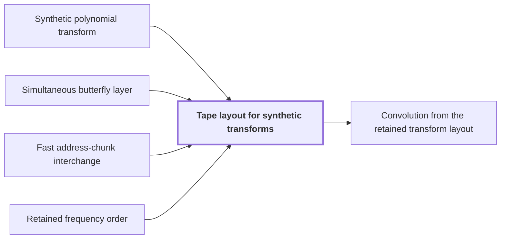

# Tape layout for synthetic transforms

!!! info "Before this page"

    Tape layout for synthetic transforms *reorders the address bits of* [Synthetic polynomial transform](synthetic-transform.md "The tape layout reorders address bits so that each round of a synthetic polynomial transform on several axes runs as one simultaneous butterfly layer instead of one pass per axis, which is where the transform's cost drops below the standard pass count."), *runs as one* [Simultaneous butterfly layer](simultaneous-layer.md "The tape layout reorders address bits so that each round of a synthetic polynomial transform on several axes runs as one simultaneous butterfly layer instead of one pass per axis, which is where the transform's cost drops below the standard pass count."), *exchanges chunks by* [Fast address-chunk interchange](address-interchange.md "This is at most $Dq-1$ exchanges, each done by the fast address-chunk interchange in $O(TpK^\tau)$ even for nonadjacent chunks") and *consumes that order by* [Retained frequency order](frequency-order.md "By retained frequency order the forward transform leaves its outputs in bit-reversed order, written $B$ here (the bit-reversal permutation on all axes), and the opposite transform consumes that order, so no reordering is executed.").

!!! abstract "Where this fits"

    1. A single deterministic Turing machine with a fixed finite alphabet and a fixed finite number of one-dimensional tapes multiplies two $n$-bit integers exactly in $O(n(\lg n)^{1-\kappa})$ worst-case time with $\kappa=2^{-182}$, disproving the $n\log n$ optimality conjecture of Sch\"onhage and Strassen in this model. — how: Build two power-saving tape procedures (chunk interchange and simultaneous butterfly layer) from fixed finite linear networks; use them to accelerate the synthetic polynomial transforms and ring convolution; use Gaussian resampling with retained permutations and chirps to reduce the prime-length cyclic convolution of the radix-digit coefficients to those power-of-two transforms; assemble the exact product with a proof that the error is below $1/2$; and total the cost to show a power of $\log n$ is saved. ([Power-saving integer multiplication](main-result.md "A deterministic fixed-tape Turing machine multiplying two n-bit integers exactly in O(n(lg n)^{1−κ}) time with κ = 2^{−182}, disproving the n log n optimality conjecture in this model."))
    2. **This page:** Synthetic transforms over $\mathcal R_r$ on $d-1$ axes of lengths $t_i\in\{2^{\ell-1},2^\ell\}$ with outputs kept in a retained layout $LB$ cost $O(Tp[dK+pK^{\tau-1}+\ell d^{\lambda'}])$ with error less than $\sqrt2\ell\,2^{-p}$.

??? note "Symbols from earlier pages"

    - $r$ — record length: The number of complex coefficients in a polynomial of the ring, always a power of two. (on [Polynomial ring modulo y^r + 1](ring-y.md "Polynomials of degree below r over the complex numbers with y^r = −1, so multiplying by a power of y is a signed shift of the coefficient list."))
    - $d$ — axis count: The number of axes of the underlying cyclic convolution. (on [Cyclic convolution](convolution.md "The product of two sequences (or elements of a polynomial quotient ring) where indices wrap around: (f∗g)_k = Σ f_j g_{k−j}."))
    - $\tau$ — interchange exponent: The exponent in the cost of a chunk interchange. (on [Parameter and prime-length choice](parameter-choice.md "Fixed rational exponents and sizes (precision p = 6b, d axes, K = d^c, T and r powers of two, prime lengths s_i just below t_i) making every hypothesis of the lemmas hold."))
    - $\lambda'$ — layer exponent: The final exponent of the layer cost V d^{lambda'}. (on [Parameter and prime-length choice](parameter-choice.md "Fixed rational exponents and sizes (precision p = 6b, d axes, K = d^c, T and r powers of two, prime lengths s_i just below t_i) making every hypothesis of the lemmas hold."))
    - $i$ — axis index: An index of one axis of the array, between 1 and d. (on [Multidimensional transforms](multidim-transform.md "A transform over several axes at once, the tensor product of one-dimensional transforms, applied to an array one axis at a time."))
    - $t_i$ — padded axis length: The length of axis i after padding with zero records, a power of two between r/2 and r. (on [Chinese-remainder address map](crt-map.md "An isomorphism that places a cyclic convolution of length S = s₁⋯s_d on pairwise coprime prime axes, implemented as triangular controlled shifts."))
    - $\boldsymbol t$ — padded axis lengths: The tuple of padded power-of-two axis lengths. (on [Multidimensional transforms](multidim-transform.md "A transform over several axes at once, the tensor product of one-dimensional transforms, applied to an array one axis at a time."))
    - $p$ — fractional bits: The number of fractional bits of the grid on which stored values lie. (on [Fixed-point Gaussian dyadic records](fixed-point.md "Complex values stored as signed two's-complement integers over a power-of-two denominator 2^{-p}; intermediate values are exact and one truncation Q_p rounds back to the p-bit grid."))
    - $T$ — padded record count: The number of padded records, the product of the padded axis lengths. (on [Chinese-remainder address map](crt-map.md "An isomorphism that places a cyclic convolution of length S = s₁⋯s_d on pairwise coprime prime axes, implemented as triangular controlled shifts."))
    - $\mathcal H$ — parallel butterfly: The parallel butterfly applying H_0 on every participating axis in one round. (on [Retained frequency order](frequency-order.md "The forward synthetic transform writes its outputs in bit-reversed order, the pointwise product keeps that order, and the opposite transform consumes it, so no reordering is executed."))
    - $J_E$ — recordwise monomial: The recordwise operation multiplying each record by y^E. (on [Retained frequency order](frequency-order.md "The forward synthetic transform writes its outputs in bit-reversed order, the pointwise product keeps that order, and the opposite transform consumes it, so no reordering is executed."))
    - $Q_p$ — truncation: The truncation that drops the bits below 2^{-p} in each real and imaginary part, returning a record to the p-bit grid. (on [Fixed-point Gaussian dyadic records](fixed-point.md "Complex values stored as signed two's-complement integers over a power-of-two denominator 2^{-p}; intermediate values are exact and one truncation Q_p rounds back to the p-bit grid."))

The tape layout reorders address bits so that each round of a [synthetic polynomial transform](synthetic-transform.md "A transform over the ring modulo y^r + 1 whose roots of unity are powers of y, so every twiddle multiplication is a signed shift of a coefficient list.") on several axes runs as one [simultaneous butterfly layer](simultaneous-layer.md "The second tape procedure: applying H₀ coefficientwise on the same bit of up to d address chunks in time O(V·d^λ′) for a fixed λ′ < 1, instead of d passes.") instead of one pass per axis, which is where the transform's cost drops below the standard pass count.

Write $\ell=\log_2 r$, the number of address bits of a long axis, and $D=d-1$, the number of transformed axes (not a chunk or a chunk count from the other pages). Axis $i$ has length $t_i\in\{2^{\ell-1},2^\ell\}$. $K$ is the chunk width in bits, and $\tau,\lambda'<1$ are the interchange and layer exponents. With $\boldsymbol t=(t_1,\dots,t_D)$, $F_{\boldsymbol t}^-$ is the forward transform on all $D$ axes and $F_{\boldsymbol t}^+$ its opposite. By [retained frequency order](frequency-order.md "The forward synthetic transform writes its outputs in bit-reversed order, the pointwise product keeps that order, and the opposite transform consumes it, so no reordering is executed.") the forward transform leaves its outputs in bit-reversed order, written $B$ here (the bit-reversal permutation on all axes), and the opposite transform consumes that order, so no reordering is executed.

## Why a layout is needed

[Fixed-point Gaussian dyadic records](fixed-point.md "Complex values stored as signed two's-complement integers over a power-of-two denominator 2^{-p}; intermediate values are exact and one truncation Q_p rounds back to the p-bit grid.") use $\Theta(p)$ bits per coefficient, so the $T$ coefficients occupy $\Theta(Tp)$ bits and one pass of a tape machine over them costs $O(Tp)$. The transform has $\ell$ rounds, and each round applies the two-point averaging and differencing step to one address bit of every axis. Done axis by axis this is about $D\ell$ passes, and since $d\ell=O(p)$ that is $O(Tp\cdot p)$. The layer does a round on $D$ axes in $O(Tpd^{\lambda'})$ rather than $D$ passes, but it acts on the same bit of $D$ consecutive $K$-bit chunks. Axis-major storage does not provide this: the bits of different axes are far apart. The record permutation $L$, built below, moves them together once. Every later round is then a single layer.

## Building the layout

Call an axis long if it has $\ell$ address bits and short if $\ell-1$. Put $b=(\ell-1)\bmod K$, the number of leftover low bits of an axis, and $q=\lfloor(\ell-1)/K\rfloor$, its number of whole chunks. Move to a prefix, one at a time, the top bit of each long axis and the $b$ lowest bits of each axis. What remains of each axis is exactly $q$ consecutive $K$-bit chunks. At most $D(b+1)=O(dK)$ bits move, so the moves cost $O(TpdK)$<cite class="exegenius-ref" data-source="paper" data-locator="§6.2 A layout on which the parallel layers apply" data-quote="listed slots, so the moves cost $O(TpdK)$." title="listed slots, so the moves cost $O(TpdK)$."> (see §6.2 A layout on which the parallel layers apply)</cite>

Label each chunk by its axis and its rank from the high end of the axis, so the first chunk of axis 2 is $(2,1)$. The chunks are stored as $(1,1),\dots,(1,q),(2,1),\dots,(D,q)$ and must become $(1,1),(2,1),\dots,(D,1),(1,2),\dots,(D,q)$, so that the chunks of equal rank in all axes are adjacent. Scan the target positions from left to right and, at each one except the last, exchange the chunk there with the required one if they differ. This is at most $Dq-1$ exchanges, each done by the [fast address-chunk interchange](address-interchange.md "The first tape procedure: exchanging two disjoint equal-width address fields of u digits in time O(V·u^τ) for a fixed τ < 1, using XOR combinations of intermediate data.") in $O(TpK^\tau)$ even for nonadjacent chunks<cite class="exegenius-ref" data-source="paper" data-locator="§6.2 A layout on which the parallel layers apply" data-quote="exchanges of width-$K$ address chunks, even when the chunks are" title="exchanges of width-$K$ address chunks, even when the chunks are"> (see §6.2 A layout on which the parallel layers apply)</cite>. Since $DqK\le d\ell=O(p)$, the total is $O(Tp\,DqK^\tau)=O(Tp\,pK^{\tau-1})$. The prefix moves and exchanges define the record permutation $L$; recording them in reverse gives $L^{-1}$ at the same cost.

## Running the rounds

There are $qK$ rounds on chunk bits and $b+1$ on prefix bits, $\ell$ in all. In a chunk round the selected bit has the same offset in the $D$ consecutive chunks of equal rank, so one layer performs it. The cost is $O(Tpd^{\lambda'})$ per round and $O(Tp\ell d^{\lambda'})$ in total<cite class="exegenius-ref" data-source="paper" data-locator="§6.2 A layout on which the parallel layers apply" data-quote="$O(Tpd^{\lambda'})$ per round and $O(Tp\ell d^{\lambda'})$ in total." title="$O(Tpd^{\lambda'})$ per round and $O(Tp\ell d^{\lambda'})$ in total."> (see §6.2 A layout on which the parallel layers apply)</cite> A prefix round processes at most $D\le d$ bits individually, each in $O(Tp)$. There are at most $b+1\le K$ such rounds, so they cost $O(TpdK)$.

Adding the three costs, the moves, exchanges and rounds give $O(Tp[dK+pK^{\tau-1}+\ell d^{\lambda'}])$. Here $K^{\tau-1}<1$ and $d^{\lambda'}<d$ are the savings over $D\ell$ passes.

## Error

Each round is the exact contraction $\mathcal H$ (which does not increase the norm of an error), the signed coefficient permutation $J_E$, and one truncation $Q_p$. Truncation toward zero is odd and acts separately on each real and imaginary part, so for the array $z$ entering the round $J_EQ_p(\mathcal Hz)=Q_p(J_E\mathcal Hz)$: the computed round equals one truncation after the exact round. That truncation moves each entry by less than $\sqrt2\,2^{-p}$, so by the triangle inequality each round adds less than $\sqrt2\,2^{-p}$ to the error. The permutations in $L$ are isometries and add none. Starting from zero error, the $\ell$ rounds leave error less than $\sqrt2\,\ell\,2^{-p}$<cite class="exegenius-ref" data-source="paper" data-locator="§6.2 A layout on which the parallel layers apply" data-quote="zero error, at most $\ell$ rounds therefore" title="zero error, at most $\ell$ rounds therefore"> (see §6.2 A layout on which the parallel layers apply)</cite>.

## Which operator is computed

Arithmetic executed on named slots after $L$ is the logical operation conjugated by $L$. The forward procedure first moves records by $L$ and then runs $BF_{\boldsymbol t}^-$, so its operator is $(LBF_{\boldsymbol t}^-L^{-1})L=LBF_{\boldsymbol t}^-$. The opposite procedure runs its arithmetic and then restores the order by $L^{-1}$, so its operator is $L^{-1}(LF_{\boldsymbol t}^+B^{-1}L^{-1})=F_{\boldsymbol t}^+B^{-1}L^{-1}$. Both therefore have error less than $\sqrt2\,\ell\,2^{-p}$ and cost $O(Tp[dK+pK^{\tau-1}+\ell d^{\lambda'}])$, including building and undoing the layout.

## Connections

Used by:

- [Convolution from the retained transform layout](ring-convolution.md "The transforms are laid out as in Tape layout for synthetic transforms, which makes each round one simultaneous layer.") *transforms laid out as in* Tape layout for synthetic transforms

??? quote "From the sources"

    > Transform layout and cost
    >
    > — [Integer multiplication below n log n (OpenAI, 2026)](https://github.com/openai/math/tree/fd4aeeb2ee4fc729c18d98444fed42fd0529eeeb/preprints/Integer-multiplication-below-n-log-n-September-23-2026)

    > A layout on which the parallel layers apply
    >
    > — [Integer multiplication below n log n (OpenAI, 2026)](https://github.com/openai/math/tree/fd4aeeb2ee4fc729c18d98444fed42fd0529eeeb/preprints/Integer-multiplication-below-n-log-n-September-23-2026)
