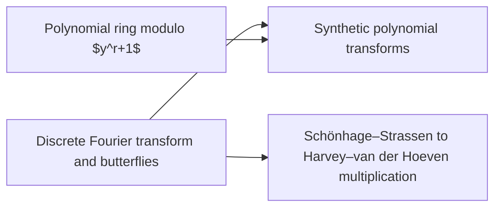

# Transforms and cheap roots

The [discrete Fourier transform](../dft-fft.md "Evaluation of a coefficient list at roots of unity, computed in log-many levels of two-point butterfly operations; turns convolution into pointwise product.") turns convolution into a pointwise product, which is the basis of the fast multiplication route. [Polynomial rings modulo $y^r+1$](../poly-ring-y-r.md "Complex-coefficient polynomials in y reduced by y^r = -1, so multiplying by a power of y is a signed shift of the coefficient list and powers of y serve as roots of unity.") make roots of unity into signed shifts, and [synthetic transforms](../synthetic-transforms.md "Nussbaumer-style transforms over the polynomial ring where root multiplications are signed shifts, leaving address rearrangements, shifts and butterflies.") exploit this. The [Schönhage–Strassen to Harvey–van der Hoeven chain](../ss-hh-background.md "Chain of multitape algorithms from O(n log n log log n) to the unconditional O(n log n) bound, using transforms over rings with cheap roots of unity.") shows what these transforms achieve in the multitape setting.

## Pages

1. [Polynomial ring modulo $y^r+1$](../poly-ring-y-r.md "Complex-coefficient polynomials in y reduced by y^r = -1, so multiplying by a power of y is a signed shift of the coefficient list and powers of y serve as roots of unity.") — Complex-coefficient polynomials in y reduced by y^r = -1, so multiplying by a power of y is a signed shift of the coefficient list and powers of y serve as roots of unity.
2. [Discrete Fourier transform and butterflies](../dft-fft.md "Evaluation of a coefficient list at roots of unity, computed in log-many levels of two-point butterfly operations; turns convolution into pointwise product.") — Evaluation of a coefficient list at roots of unity, computed in log-many levels of two-point butterfly operations; turns convolution into pointwise product.
3. [Schönhage–Strassen to Harvey–van der Hoeven multiplication](../ss-hh-background.md "Chain of multitape algorithms from O(n log n log log n) to the unconditional O(n log n) bound, using transforms over rings with cheap roots of unity.") — Chain of multitape algorithms from O(n log n log log n) to the unconditional O(n log n) bound, using transforms over rings with cheap roots of unity.
4. [Synthetic polynomial transforms](../synthetic-transforms.md "Nussbaumer-style transforms over the polynomial ring where root multiplications are signed shifts, leaving address rearrangements, shifts and butterflies.") — Nussbaumer-style transforms over the polynomial ring where root multiplications are signed shifts, leaving address rearrangements, shifts and butterflies.

## Map

Arrows point from a page to the pages that build on it.

