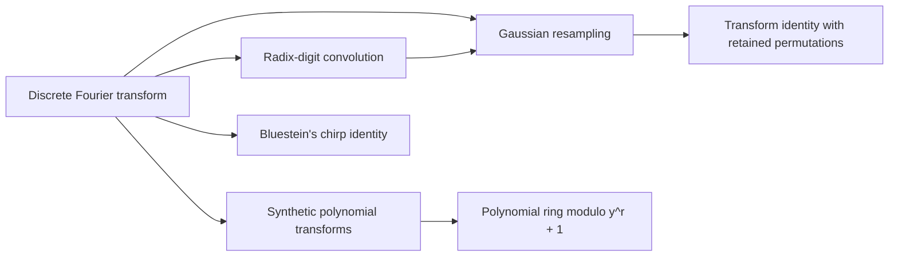

# Transforms and convolution

This part builds the transform machinery that the rest of the wiki uses for fast convolution. It starts from the [Discrete Fourier transform](../discrete-fourier-transform.md "The map sending a vector of q values to its q values weighted by powers of a q-th root of unity, normalized by 1/q.") and extends it to [Synthetic polynomial transforms](../synthetic-transforms.md "Fourier-type transforms whose roots of unity are powers of y in a polynomial ring, so that multiplying by a root is a signed shift of coefficients.") and to the [Polynomial ring modulo $y^r + 1$](../polynomial-ring-mod-yr-plus-1.md "The ring of polynomials with complex coefficients in which y^r is identified with −1, so that y has order 2r and wrap-around flips a sign."). The [Radix-digit convolution](../radix-digit-convolution.md "Writing both integers as polynomials in a power of two whose coefficients are their digits, so that their product is a polynomial convolution of short coefficients.") and [Gaussian resampling](../gaussian-resampling.md "A technique that replaces a Fourier transform of arbitrary length by transforms whose axis lengths are powers of two, using Gaussian weights to move between the two sets of frequencies.") then connect these transforms to integer multiplication.

## Pages

1. [Discrete Fourier transform](../discrete-fourier-transform.md "The map sending a vector of q values to its q values weighted by powers of a q-th root of unity, normalized by 1/q.") — The map sending a vector of q values to its q values weighted by powers of a q-th root of unity, normalized by 1/q.
2. [Radix-digit convolution](../radix-digit-convolution.md "Writing both integers as polynomials in a power of two whose coefficients are their digits, so that their product is a polynomial convolution of short coefficients.") — Writing both integers as polynomials in a power of two whose coefficients are their digits, so that their product is a polynomial convolution of short coefficients.
3. [Gaussian resampling](../gaussian-resampling.md "A technique that replaces a Fourier transform of arbitrary length by transforms whose axis lengths are powers of two, using Gaussian weights to move between the two sets of frequencies.") — A technique that replaces a Fourier transform of arbitrary length by transforms whose axis lengths are powers of two, using Gaussian weights to move between the two sets of frequencies.
4. [Synthetic polynomial transforms](../synthetic-transforms.md "Fourier-type transforms whose roots of unity are powers of y in a polynomial ring, so that multiplying by a root is a signed shift of coefficients.") — Fourier-type transforms whose roots of unity are powers of y in a polynomial ring, so that multiplying by a root is a signed shift of coefficients.
5. [Polynomial ring modulo y^r + 1](../polynomial-ring-mod-yr-plus-1.md "The ring of polynomials with complex coefficients in which y^r is identified with −1, so that y has order 2r and wrap-around flips a sign.") — The ring of polynomials with complex coefficients in which y^r is identified with −1, so that y has order 2r and wrap-around flips a sign.
6. [Bluestein's chirp identity](../bluestein-chirp-identity.md "An identity that rewrites a Fourier transform as a cyclic convolution multiplied by chirp factors, so that it can be computed with convolution.") — An identity that rewrites a Fourier transform as a cyclic convolution multiplied by chirp factors, so that it can be computed with convolution.
7. [Transform identity with retained permutations](../transform-identity.md "The Gaussian resampling identity in which the source and target coordinate permutations are kept as part of the formula, so that they cancel across a convolution instead of being executed as sorts.") — The Gaussian resampling identity in which the source and target coordinate permutations are kept as part of the formula, so that they cancel across a convolution instead of being executed as sorts.

## Map

Arrows point from a page to the pages that build on it.

