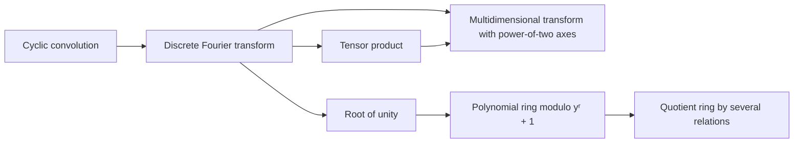

# Transforms and polynomial rings

Multiplication is reduced to convolution and transforms, so the reader needs [cyclic convolution](../cyclic-convolution.md "The product of two coefficient lists in the ring of polynomials modulo x^S − 1, in which exponents wrap around modulo S.") and the [discrete Fourier transform](../fourier-transform.md "The map sending a vector u of length q to the vector whose k-th entry is (1/q) times the sum over j of u_j times exp(−2πijk/q).") first. [Tensor products](../tensor-product.md "The tensor product V ⊗ W of vector spaces is the space spanned by pairs of basis vectors, and the tensor product of linear maps acts on each factor separately, so one-dimensional operations on several coordinates combine into one operation on the product space.") and [multidimensional transforms](../multidim-transform.md "A transform on an array indexed by several coordinates, each with length a power of two, obtained as a tensor product of one-dimensional Fourier transforms.") express one-dimensional operations on several coordinates as a single operation. [Roots of unity](../roots-of-unity.md "A number whose some positive integer power equals one; here powers of y in the polynomial ring play this role.") in the [polynomial ring](../polynomial-ring.md "The ring of complex polynomials of degree less than r, with multiplication reduced modulo y^r + 1; multiplication by a power of y permutes and sign-changes the coefficient list.") and its [quotient by several relations](../quotient-ring.md "The quotient ring of a polynomial ring by several relations is the ring obtained by identifying two polynomials whenever their difference lies in the ideal generated by those relations.") supply the algebra used by the Chinese-remainder step.

## Pages

1. [Cyclic convolution](../cyclic-convolution.md "The product of two coefficient lists in the ring of polynomials modulo x^S − 1, in which exponents wrap around modulo S.") — The product of two coefficient lists in the ring of polynomials modulo x^S − 1, in which exponents wrap around modulo S.
2. [Discrete Fourier transform](../fourier-transform.md "The map sending a vector u of length q to the vector whose k-th entry is (1/q) times the sum over j of u_j times exp(−2πijk/q).") — The map sending a vector u of length q to the vector whose k-th entry is (1/q) times the sum over j of u_j times exp(−2πijk/q).
3. [Tensor product](../tensor-product.md "The tensor product V ⊗ W of vector spaces is the space spanned by pairs of basis vectors, and the tensor product of linear maps acts on each factor separately, so one-dimensional operations on several coordinates combine into one operation on the product space.") — The tensor product V ⊗ W of vector spaces is the space spanned by pairs of basis vectors, and the tensor product of linear maps acts on each factor separately, so one-dimensional operations on several coordinates combine into one operation on the product space.
4. [Multidimensional transform with power-of-two axes](../multidim-transform.md "A transform on an array indexed by several coordinates, each with length a power of two, obtained as a tensor product of one-dimensional Fourier transforms.") — A transform on an array indexed by several coordinates, each with length a power of two, obtained as a tensor product of one-dimensional Fourier transforms.
5. [Root of unity](../roots-of-unity.md "A number whose some positive integer power equals one; here powers of y in the polynomial ring play this role.") — A number whose some positive integer power equals one; here powers of y in the polynomial ring play this role.
6. [Polynomial ring modulo yʳ + 1](../polynomial-ring.md "The ring of complex polynomials of degree less than r, with multiplication reduced modulo y^r + 1; multiplication by a power of y permutes and sign-changes the coefficient list.") — The ring of complex polynomials of degree less than r, with multiplication reduced modulo y^r + 1; multiplication by a power of y permutes and sign-changes the coefficient list.
7. [Quotient ring by several relations](../quotient-ring.md "The quotient ring of a polynomial ring by several relations is the ring obtained by identifying two polynomials whenever their difference lies in the ideal generated by those relations.") — The quotient ring of a polynomial ring by several relations is the ring obtained by identifying two polynomials whenever their difference lies in the ideal generated by those relations.

## Map

Arrows point from a page to the pages that build on it.

