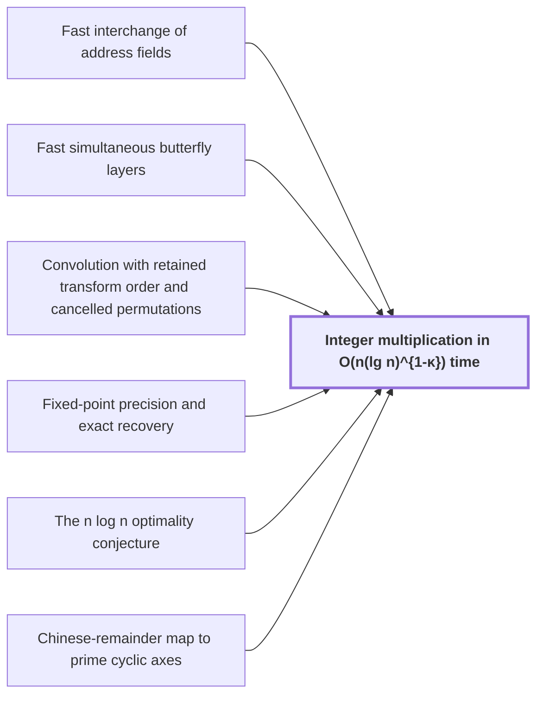

# Integer multiplication in $O(n(\lg n)^{1-\kappa})$ time

!!! info "Before this page"

    Integer multiplication in O(n(lg n)^{1-κ}) time *performs its address moves by* [Fast interchange of address fields](fast-address-interchange.md "The machine performs its address moves by Fast interchange of address fields."), *performs its butterfly layers by* [Fast simultaneous butterfly layers](fast-butterfly-layers.md "It performs its butterfly layers by Fast simultaneous butterfly layers."), *computes its convolution by* [Convolution with retained transform order and cancelled permutations](ring-convolution-retained-order.md "The machine computes its convolution by Convolution with retained transform order and cancelled permutations."), *recovers its coefficients by* [Fixed-point precision and exact recovery](fixed-point-precision.md "The machine recovers its coefficients by Fixed-point precision and exact recovery."), *disproves* [The n log n optimality conjecture](nlogn-conjecture.md "It disproves the n log n optimality conjecture for this model.") and *places its coefficient list by* [Chinese-remainder map to prime cyclic axes](crt-address-map.md "The machine places its coefficient list by the Chinese-remainder map to prime cyclic axes.").

??? note "Symbols from earlier pages"

    - $n$ — integer length: The number of bits in each of the two integers being multiplied. (on [The n log n optimality conjecture](nlogn-conjecture.md "Schönhage–Strassen's proposal that n log n is the optimal order of cost for multiplying n-bit integers."))
    - $\kappa$ — logarithm exponent gap: A fixed positive constant, equal to 2^{-182}. (on [The n log n optimality conjecture](nlogn-conjecture.md "Schönhage–Strassen's proposal that n log n is the optimal order of cost for multiplying n-bit integers."))
    - $V$ — stored bit volume: The total number of bits the array holds. (on [Address fields and array layout on tapes](address-fields.md "Arrays stored in tape order with addresses forming a Cartesian product of digit fields; rearranging fields costs time."))
    - $u$ — field width: The number of bits in one address field. (on [Address fields and array layout on tapes](address-fields.md "Arrays stored in tape order with addresses forming a Cartesian product of digit fields; rearranging fields costs time."))
    - $\tau$ — cost exponent: The fixed exponent below 1 in the cost $O(Vu^\tau)$ of an address interchange of $u$-bit fields. (on [Fast interchange of address fields](fast-address-interchange.md "Interchange two disjoint contiguous u-bit address fields in an array in O(V u^τ) for fixed τ<1, via XOR combinations that end as an exact permutation."))
    - $d$ — chunk bound: An upper bound on the number of selected address chunks, which counts the chunks. (on [Fast simultaneous butterfly layers](fast-butterfly-layers.md "Applies H0(u,v)=((u+v)/2,(u-v)/2) on selected address bits of polynomial-valued arrays with exact Gaussian dyadics in O(V d^λ') with λ'<1, one truncation at the end."))
    - $\lambda'$ — layer exponent: The fixed exponent below 1 in the layer cost $O(Vd^{\lambda'})$. (on [Fast simultaneous butterfly layers](fast-butterfly-layers.md "Applies H0(u,v)=((u+v)/2,(u-v)/2) on selected address bits of polynomial-valued arrays with exact Gaussian dyadics in O(V d^λ') with λ'<1, one truncation at the end."))
    - $m$ — growth factor: The factor by which the parameter of a call grows between a call and its recursive subcalls. (on [Recursive power saving from s<Wm](recursive-power-saving.md "Recursive call at parameter mf uses s calls at parameter f on streams of volume V/W; since s/W<m the volume-normalized cost grows as a power, giving a fixed power saving."))
    - $L$ — lost dimension: The total dimension lost on decreasing edges. (on [Three-element subset intersection construction](subset-intersection-construction.md "Gather/scatter with auxiliary wires cancelling unwanted coefficients, using indicator-vector orthogonality to assign subspaces; gives s<Wm smaller calls."))
    - $P_U$ — label projection: The projection onto the label $U$ along $U^\perp$. (on [Three-element subset intersection construction](subset-intersection-construction.md "Gather/scatter with auxiliary wires cancelling unwanted coefficients, using indicator-vector orthogonality to assign subspaces; gives s<Wm smaller calls."))
    - $q$ — digit radix: A fixed odd prime, the radix of the digits of each field. (on [Address shear and lower-triangular factorization](address-shear-factorization.md "Endpoint operator (H,D)->(H+D,D) over a residue ring, with rank reduction via a singular-matrix Bruhat factorization into lower-triangular factors."))
    - $\lambda$ — power exponent: The fixed exponent, below 1, of the power of the parameter that bounds the cost per bit. (on [Recursive power saving from s<Wm](recursive-power-saving.md "Recursive call at parameter mf uses s calls at parameter f on streams of volume V/W; since s/W<m the volume-normalized cost grows as a power, giving a fixed power saving."))
    - $\sigma$ — fixed exponent: The fixed exponent $1-2^{-50}$ that bounds $\Psi/W$ by a power of $m$. (on [Fast simultaneous butterfly layers](fast-butterfly-layers.md "Applies H0(u,v)=((u+v)/2,(u-v)/2) on selected address bits of polynomial-valued arrays with exact Gaussian dyadics in O(V d^λ') with λ'<1, one truncation at the end."))

Here $n$ is the number of bits in each input and $\kappa=2^{-182}$ is a fixed saving exponent. The main theorem is that one fixed deterministic Turing machine multiplies two $n$-bit integers in $O(n(\lg n)^{1-\kappa})$ time. It disproves the [n log n optimality conjecture](nlogn-conjecture.md "Schönhage–Strassen's proposal that n log n is the optimal order of cost for multiplying n-bit integers.") for this model.

The machine uses a fixed finite alphabet and a fixed number of one-dimensional tapes, and computes the exact product for every $n\ge1$<cite class="exegenius-ref" data-source="paper" data-locator="§1 Introduction" data-quote="There is one deterministic Turing machine $A$, with a fixed finite" title="There is one deterministic Turing machine $A$, with a fixed finite"> (see §1 Introduction)</cite>.

[Reduction of integer product to digit convolution](radix-digit-reduction.md "Splitting the inputs into radix digits turns the integer product into a convolution of short integer coefficients, followed by carry propagation.") turns the product into a convolution of short coefficients. The machine places its coefficient list by the [Chinese-remainder map to prime cyclic axes](crt-address-map.md "Places the coefficient list on a product of distinct prime cyclic axes by a map preserving convolution, implemented via triangular controlled shifts and axis moves."). The machine computes its convolution by [Convolution with retained transform order and cancelled permutations](ring-convolution-retained-order.md "Two forward synthetic transforms keep the same frequency order through the pointwise product, and the opposite transform consumes it, so retained permutations cancel without separate sorts."). The machine recovers its coefficients by [Fixed-point precision and exact recovery](fixed-point-precision.md "Complex fixed-point coefficients; bounding error below 1/2 so rounding recovers exact integer coefficients and carry propagation yields the product.").

The machine performs its address moves by [Fast interchange of address fields](fast-address-interchange.md "Interchange two disjoint contiguous u-bit address fields in an array in O(V u^τ) for fixed τ<1, via XOR combinations that end as an exact permutation."). It performs its butterfly layers by [Fast simultaneous butterfly layers](fast-butterfly-layers.md "Applies H0(u,v)=((u+v)/2,(u-v)/2) on selected address bits of polynomial-valued arrays with exact Gaussian dyadics in O(V d^λ') with λ'<1, one truncation at the end."). These cost $O(Vu^\tau)$ and $O(Vd^{\lambda'})$, where $V$ is the stored bit volume, $u$ the field width, $d$ the number of selected chunks, and $\tau,\lambda'<1$ fixed exponents. Here $u$ and $d$ are powers of $\lg n$ with exponents below one.

The $n\log n$ cost scans all $V$ stored bits at each of the $\Theta(\log n)$ transform levels, so cheaper moves and layers lower the whole bound.

The logarithmic factor drops by the fixed power $\kappa$ because $\kappa$ is set by the smallest margin in the sources' cost table. Each row of that table is a power of $\lg n$, up to a constant factor, with exponent one minus a margin. The smallest margin is $2^{-181}$<cite class="exegenius-ref" data-source="paper" data-locator="§9.8 The complete time bound" data-quote="Thus $\min_i g_i=2^{-181}=2\kappa$" title="Thus $\min_i g_i=2^{-181}=2\kappa$"> (see §9.8 The complete time bound)</cite>, which is $2\kappa$, so the largest power is $(\lg n)^{1-2\kappa}$. A fixed power of $\log\lg n$ is at most $(\lg n)^{\kappa}$ for large $n$, so $(\lg n)^{1-2\kappa}$ times it is $O((\lg n)^{1-\kappa})$.

Both procedures come from one fixed linear network with $W$ roles and $s$ child calls. For the bit network, $s$ equals $Wm$ minus $N$, the number of negative source projections, plus twice the lost label dimension $L$<cite class="exegenius-ref" data-source="paper" data-locator="§3.4 The rational matrix interface" data-quote="W_{\rm b}m-N+2L_{\rm b}" title="W_{\rm b}m-N+2L_{\rm b}"> (see §3.4 The rational matrix interface)</cite>, so $s<Wm$ needs $N>2L$. A negative source projection is a source operator $-P_U$, where $P_U$ projects onto a label subspace along its orthogonal complement.

Let $f=m^k$ be the number of radix-$q$ digits in a chunk at recursion level $k$, where $m$ is the number of fields per chunk and $q$ is a fixed prime. Let $\Phi(f)$ be the time divided by $V$ at that level. Each chunk is cut into $m$ fields of $f/m$ digits. A call makes $s$ child calls on streams of volume $V/W$, and its own splitting, gates and reassembly cost $O(1)$ per unit volume<cite class="exegenius-ref" data-source="paper" data-locator="§4.2 Transferring a finite circuit to address permutations" data-quote="merging, gates, and triangular operations have total cost $O(V)$ because" title="merging, gates, and triangular operations have total cost $O(V)$ because"> (see §4.2 Transferring a finite circuit to address permutations)</cite>.

Hence $\Phi(f)\le (s/W)\Phi(f/m)+O(f^\tau+1)$ with $\Phi(1)=O(1)$, since the children cost $s(V/W)\Phi(f/m)$ and dividing by $V$ gives $s/W$. Since $s/W<m$, some rational $\tau<1$ gives $(s/W)/m^\tau<1$; this is where $s<Wm$ is used. Dividing by $m^{k\tau}$ gives $m^{-k\tau}\Phi(m^k)\le \frac{s/W}{m^\tau}\,m^{-(k-1)\tau}\Phi(m^{k-1})+O(1)$, since $f^\tau+1\le 2f^\tau$. Unrolling gives a geometric sum with ratio $(s/W)/m^\tau<1$, so $\Phi(m^k)=O(m^{k\tau})$. A field of $f$ radix-$q$ digits has $\Theta(f)$ bits, because $q$ is fixed, so $f$ is proportional to $u$ and the interchange costs $O(Vu^\tau)$. The butterfly layer uses a second fixed network, also with $s<Wm$, and runs the same recursion on the $d$ selected chunks, so it costs $O(Vd^{\lambda'})$ once $\lambda'$ exceeds two exponents. Nodes with at least $\sqrt d$ active chunks have node overhead of $O(f^\lambda)$ per unit volume, with $f\le d$ and $\lambda=1-2^{-52}$. Smaller nodes, the small-level leaves, cost $O(d^{\sigma+(1-\sigma)/2})$ with $\sigma=1-2^{-50}$. So $\lambda'$ must exceed $\lambda$ and $\sigma+(1-\sigma)/2$, and $\lambda'=1-2^{-54}$ does.

## Connections

??? quote "From the sources"

    > There is one deterministic Turing machine $A$, with a fixed finite
    >
    > — [Integer multiplication below n log n (OpenAI, 2026)](https://github.com/openai/math/tree/fd4aeeb2ee4fc729c18d98444fed42fd0529eeeb/preprints/Integer-multiplication-below-n-log-n-September-23-2026)
