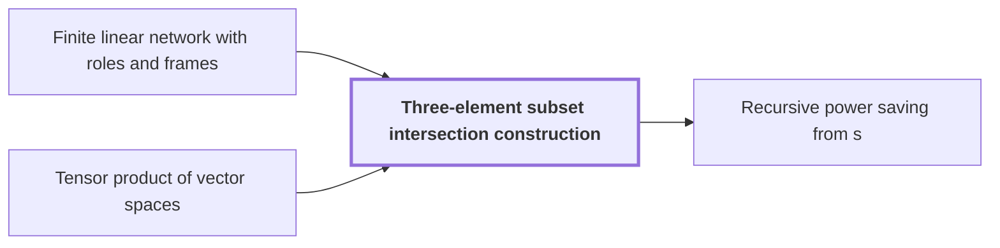

# Three-element subset intersection construction

!!! info "Before this page"

    Three-element subset intersection construction *is built inside* [Finite linear network with roles and frames](linear-network-roles.md "It is built inside a Finite linear network with roles and frames.") and *is built from* [Tensor product of vector spaces](glossary.md#tensor-product-of-vector-spaces "Let $\mathcal F=(\mathbb Q^h)^{\otimes 3}$, a space built from the Tensor product of vector spaces of three copies of $\mathbb Q^h$, and let $m=h^3$ be its dimension (the letter $m$ changes meaning here).").

!!! abstract "Where this fits"

    1. An $n$-bit integer product is computed by a fixed-tape machine in $O(n(\lg n)^{1-\kappa})$ time, $\kappa=2^{-182}$. — how: reduce multiplication to ring convolution and speed up its address moves and butterfly layers ([Integer multiplication in O(n(lg n)^{1-κ}) time](main-theorem.md "Deterministic fixed-tape Turing machine multiplying n-bit integers in O(n(lg n)^{1-κ}), κ=2^{-182}, by reducing to ring convolution with fast address interchanges and simultaneous butterfly layers, disproving the n log n conjecture in this model."))
    2. Two fixed-tape procedures, an address interchange and a simultaneous butterfly layer, cost $O(Vu^\tau)$ and $O(Vd^{\lambda'})$ for fixed exponents below 1, where $V$ is the stored bit volume. — how: build both procedures from one finite linear network and a recursion that saves a power
    3. **This page:** The network is built from three-element subsets with gather, scatter and cancelling auxiliary wires, so that the total number $s$ of smaller calls satisfies $s<Wm$.

??? note "Symbols from earlier pages"

    - $W$ — number of roles: The number of roles, the wires' fixed places in the network, over which rows are distributed. (on [Finite linear network with roles and frames](linear-network-roles.md "Fixed linear network exchanging two banks of values with prescribed signs and restoring auxiliary values; wires have roles, rows are distributed cyclically among roles, and invertible frame operators cancel along routes leaving an endpoint operator."))

The three-element subset intersection construction is a fixed network of gather, scatter and auxiliary wires that makes few enough smaller calls for the recursion to save a power. It is built inside a [Finite linear network with roles and frames](linear-network-roles.md "Fixed linear network exchanging two banks of values with prescribed signs and restoring auxiliary values; wires have roles, rows are distributed cyclically among roles, and invertible frame operators cancel along routes leaving an endpoint operator.").

Let $[h]=\{1,\dots,h\}$ be the ground set, where $h=100$ is its number of elements. For a three-element subset $T$ of $[h]$, called a triple, $t_T$ is its indicator vector, and $\mathcal T$ is the set of all triples. Two triples $T$ and $S$ are *neighbors* when $|T\cap S|=1$. Each triple $T$ carries a value $g_T$.

**Coefficients.** Over $\mathbb F_2$, gather adds the sum of $g_T$ over the triples $T\ni i$ to a central wire $C_i$, for each $i\in[h]$. Scatter adds $\sum_{i\in S}C_i$ to the target $S$, so $g_T$ reaches $S$ with coefficient $|S\cap T|$ mod $2$. For each neighbor pair, an auxiliary wire $A_{ST}$ carries a copy of $g_T$ into $S$, which adds $1$ exactly when $|S\cap T|=1$. Distinct triples share at most two elements, so the net coefficient of $g_T$ at $S$ is $|S\cap T|+[|S\cap T|=1]$ mod $2$. This is $0$ for $T\ne S$ and $1$ for $T=S$, so only $g_S$ remains.

**Labels.** Over $\mathbb Q$, let $J$ be the all-ones matrix (the letter $J$ changes meaning here), and the bilinear form with matrix $I-J/9$ gives $\langle t_T,t_S\rangle=|T\cap S|-1$, so neighbors are orthogonal. Let $\mathcal F=(\mathbb Q^h)^{\otimes 3}$, a space built from the [Tensor product of vector spaces](glossary.md#tensor-product-of-vector-spaces "The space built from tuples of vectors whose dimension is the product of the factors' dimensions, so (Q^h)^{⊗3} has dimension h^3.") of three copies of $\mathbb Q^h$, and let $m=h^3$ be its dimension (the letter $m$ changes meaning here). A *label* $U$ is a nondegenerate subspace of $\mathcal F$, so $\mathcal F=U\oplus U^\perp$ and the projection $P_U$ onto $U$ along $U^\perp$ is defined. For an index $\iota=(T_1,T_2,T_3)\in\mathcal T^3$, the label $U_\iota$ is the line spanned by $t_{T_1}\otimes t_{T_2}\otimes t_{T_3}$.

**Counting.** Give each gate or sink with label $U$ the matrix $P_U$, and each source with index $\iota$ the matrix $-P_{U_\iota}$. Let $v=\binom h3$ be the number of triples. Let $N=v^3$ be the number of indices $\iota$ (the letter $N$ changes meaning here), so there are $N$ sources. Let $s=\sum_e\operatorname{rank}A_e$ be the total rank over all edges $e$, where $A_e$ is the difference of the matrices at the two ends of $e$ (the letter $s$ changes meaning here). If $U\subseteq V$ for labels $U,V$, then $P_V-P_U$ is the identity on $V\cap U^\perp$ and zero on $U\oplus V^\perp$, so an edge between nested labels has rank equal to its absolute change of label dimension.

A *smaller call* is one call of the same interchange on one role's stream, a $1/W$ share of the data. Each unit of rank costs one smaller call, since a matrix of rank $a$ is a sum of $a$ rank-one pieces.<cite class="exegenius-ref" data-source="paper" data-locator="§4 Faster interchange of address chunks" data-quote="An edge matrix of rank $a$ will require $a$ smaller interchanges." title="An edge matrix of rank $a$ will require $a$ smaller interchanges."> (see §4 Faster interchange of address chunks)</cite>

The signed change on an edge is the dimension at its head minus that at its tail, so along each wire the signed changes telescope to the sink's dimension minus the source's. Summed over wires, they total $Wm-2N$<cite class="exegenius-ref" data-source="paper" data-locator="§3.3 Subspaces attached to the gates" data-quote="The signed increase is therefore $Wm-2N$." title="The signed increase is therefore $Wm-2N$."> (see §3.3 Subspaces attached to the gates)</cite>

A decreasing edge has a negative signed change, so taking absolute values adds twice its loss there. Summing gives $2L$, where $L$ is the total dimension lost on decreasing edges (the letter $L$ changes meaning here).

The network has $3v^2$ invocations: each of its three stages fixes two coordinates of the index and operates on the $v$ values obtained by varying the third. Each invocation has $h$ central wires, each with one decreasing edge of loss $h$<cite class="exegenius-ref" data-source="paper" data-locator="§3.3 Subspaces attached to the gates" data-quote="the central-wire edges from time 3 to time 4" title="the central-wire edges from time 3 to time 4"> (see §3.3 Subspaces attached to the gates)</cite>, so $L=3v^2h^2$.

Each source's first edge has rank one, adding $N$ in total.<cite class="exegenius-ref" data-source="paper" data-locator="§3.4 The rational matrix interface" data-quote="Its first edge matrix is therefore $2P_{U_a}$, of rational rank one" title="Its first edge matrix is therefore $2P_{U_a}$, of rational rank one"> (see §3.4 The rational matrix interface)</cite>. Hence
$$s=(Wm-2N+2L)+N=Wm-N+2L.$$

Since $L/N=3h^2/v=100/539$<cite class="exegenius-ref" data-source="paper" data-locator="§3.3 Subspaces attached to the gates" data-quote="The loss ratios have the exact values" title="The loss ratios have the exact values"> (see §3.3 Subspaces attached to the gates)</cite>, we have $2L<N$, so $s<Wm$. So each recursive call, making $s$ calls on streams of $1/W$ of the data, saves a fixed power.

## Connections

Used by:

- [Recursive power saving from s<Wm](recursive-power-saving.md "The recursion is built on the Three-element subset intersection construction, which gives $s<Wm$ smaller calls.") *is built on* Three-element subset intersection construction

??? quote "From the sources"

    > The construction uses
    >
    > — [Integer multiplication below n log n (OpenAI, 2026)](https://github.com/openai/math/tree/fd4aeeb2ee4fc729c18d98444fed42fd0529eeeb/preprints/Integer-multiplication-below-n-log-n-September-23-2026)

    > three-element subsets
    >
    > — [Integer multiplication below n log n (OpenAI, 2026)](https://github.com/openai/math/tree/fd4aeeb2ee4fc729c18d98444fed42fd0529eeeb/preprints/Integer-multiplication-below-n-log-n-September-23-2026)
