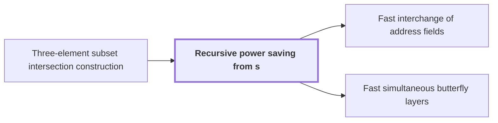

# Recursive power saving from s<Wm

!!! info "Before this page"

    Recursive power saving from s<Wm *is built on* [Three-element subset intersection construction](subset-intersection-construction.md "The recursion is built on the Three-element subset intersection construction, which gives $s<Wm$ smaller calls."). Assumed known: Big-O notation.

!!! abstract "Where this fits"

    1. An $n$-bit integer product is computed by a fixed-tape machine in $O(n(\lg n)^{1-\kappa})$ time, $\kappa=2^{-182}$. — how: reduce multiplication to ring convolution and speed up its address moves and butterfly layers ([Integer multiplication in O(n(lg n)^{1-κ}) time](main-theorem.md "Deterministic fixed-tape Turing machine multiplying n-bit integers in O(n(lg n)^{1-κ}), κ=2^{-182}, by reducing to ring convolution with fast address interchanges and simultaneous butterfly layers, disproving the n log n conjecture in this model."))
    2. Two fixed-tape procedures, an address interchange and a simultaneous butterfly layer, cost $O(Vu^\tau)$ and $O(Vd^{\lambda'})$ for fixed exponents below 1, where $V$ is the stored bit volume. — how: build both procedures from one finite linear network and a recursion that saves a power
    3. **This page:** A recursive call at parameter $mf$ uses $s$ calls at parameter $f$ on streams of volume $V/W$, so the volume-normalized cost grows as a power, giving a fixed power saving.

??? note "Symbols from earlier pages"

    - $V$ — stored bit volume: The total number of bits the array holds. (on [Address fields and array layout on tapes](address-fields.md "Arrays stored in tape order with addresses forming a Cartesian product of digit fields; rearranging fields costs time."))
    - $W$ — number of roles: The number of roles, the wires' fixed places in the network, over which rows are distributed. (on [Finite linear network with roles and frames](linear-network-roles.md "Fixed linear network exchanging two banks of values with prescribed signs and restoring auxiliary values; wires have roles, rows are distributed cyclically among roles, and invertible frame operators cancel along routes leaving an endpoint operator."))
    - $s$ — smaller call count: The total number of smaller calls, which is the sum of the edge ranks. (on [Three-element subset intersection construction](subset-intersection-construction.md "Gather/scatter with auxiliary wires cancelling unwanted coefficients, using indicator-vector orthogonality to assign subspaces; gives s<Wm smaller calls."))
    - $u$ — field width: The number of bits in one address field. (on [Address fields and array layout on tapes](address-fields.md "Arrays stored in tape order with addresses forming a Cartesian product of digit fields; rearranging fields costs time."))

Recursive power saving is the argument that a recursion's cost per bit can grow as a fixed power of its parameter, with exponent $\lambda<1$ (this letter changes meaning here: on the tensor-product page $\lambda$ is a scalar), which the main theorem needs.

Let $f$ be the parameter of a call (this letter changes meaning here: on the linear-network page $f$ is the logical array): the number of field digits for an address interchange (exchanging two disjoint address fields of $u$ bits), or the number of selected axes for a numerical layer (a butterfly layer on chosen axes of a polynomial-valued array). Here $m$ is the factor by which the parameter grows; this letter changes meaning from the subspace dimension of the prerequisite and from the tape position on the address-fields page. Let $s$ be the number of subcalls of one call. A recursive call at parameter $mf$ makes $s$ subcalls at parameter $f$, each on a stream of volume $V/W$. The recursion is built on the [Three-element subset intersection construction](subset-intersection-construction.md "Gather/scatter with auxiliary wires cancelling unwanted coefficients, using indicator-vector orthogonality to assign subspaces; gives s<Wm smaller calls."), which gives $s<Wm$ smaller calls.

Let $\Phi(f)$ be the cost of a call divided by the volume $V$ it works on. The subcalls contribute $\frac{s}{W}\Phi(f)$. Let $C$ be a constant such that the call's own outside work is at most $C(mf)^\lambda$, so

$$\Phi(mf)\le\frac{s}{W}\Phi(f)+C(mf)^\lambda.$$

The outside work is a fixed number of address-field row additions. An address interchange of $u$-bit fields costs $O(Vu^\tau)$, where $\tau<1$ is fixed.<cite class="exegenius-ref" data-source="paper" data-locator="§1.1 The two tape operations" data-quote="Its cost is $O(Vu^\tau)$ for a fixed $\tau&lt;1$." title="Its cost is $O(Vu^\tau)$ for a fixed $\tau&lt;1$."> (see §1.1 The two tape operations)</cite> Here $\Omega$ is the bit count of one axis chunk, $d$ is the paper's axis-count parameter (this letter changes meaning from the DFT page), and $\eta>0$ is fixed, with $\Omega\le d^\eta$. A row addition on fields of $u=f\Omega$ bits costs $O(V(u^\tau+1))$. Since $\vartheta=\tfrac12$ is a fixed exponent and $f\ge d^\vartheta$ at an internal node, $d\le f^{1/\vartheta}$, so the outside work divided by $V$ is $O((f\Omega)^\tau+1)\le O(f^{\tau(1+\eta/\vartheta)}+1)$, which is $O(f^\lambda)$ when $\lambda>\tau(1+\eta/\vartheta)$.

Let $\nu$ count the levels of unrolling (this letter changes meaning here: on the linear-network page $\nu$ is a network node, and on the tensor-product page a field dimension), which stop once $f/m^\nu<d^\vartheta$. Each leaf is handled by one kernel per chunk, at cost $O(f/m^\nu)$. After $\nu$ levels the weight is $(s/W)^\nu$, so the internal costs sum to

$$C f^\lambda\sum_{\nu\ge0}\Big(\frac{s/W}{m^\lambda}\Big)^\nu.$$

The saving exists because $s/W<m$.<cite class="exegenius-ref" data-source="paper" data-locator="§1.2 Linear networks and the recursive saving" data-quote="This strict inequality is the source of the power saving." title="This strict inequality is the source of the power saving."> (see §1.2 Linear networks and the recursive saving)</cite> Taking $\lambda$ with $\log_m(s/W)<\lambda<1$ makes the ratio below 1, so the internal sum is at most a constant times $f^\lambda$.

The leaves at depth $\nu$ have $u=f/m^\nu<d^\vartheta$ chunks and total weight $(s/W)^\nu$, so they cost $O((s/W)^\nu u)$. Choose $\sigma$ with $\max\{0,\log_m(s/W)\}\le\sigma<\lambda$. Then $(s/W)^\nu\le m^{\nu\sigma}=(f/u)^\sigma$, and the leaves cost $O(f^\sigma d^{\vartheta(1-\sigma)})\le O(f^\lambda)$.

For example, with $m=2$, $s=3$, $W=2$, we have $s/W=\tfrac32$ and $\log_2(3/2)\approx0.585$. For $\lambda=0.8$ the ratio is $\tfrac{3/2}{2^{0.8}}\approx0.86$.

## Connections

Used by:

- [Fast interchange of address fields](fast-address-interchange.md "The cost bound follows from Recursive power saving from s<Wm.") *follows from* Recursive power saving from s<Wm
- [Fast simultaneous butterfly layers](fast-butterfly-layers.md "The layer gets its exponent from Recursive power saving from s<Wm, which turns such a recursion into a power saving.") *gets its exponent from* Recursive power saving from s<Wm

??? quote "From the sources"

    > This strict inequality
    >
    > — [Integer multiplication below n log n (OpenAI, 2026)](https://github.com/openai/math/tree/fd4aeeb2ee4fc729c18d98444fed42fd0529eeeb/preprints/Integer-multiplication-below-n-log-n-September-23-2026)

    > is the source of the power saving.
    >
    > — [Integer multiplication below n log n (OpenAI, 2026)](https://github.com/openai/math/tree/fd4aeeb2ee4fc729c18d98444fed42fd0529eeeb/preprints/Integer-multiplication-below-n-log-n-September-23-2026)
