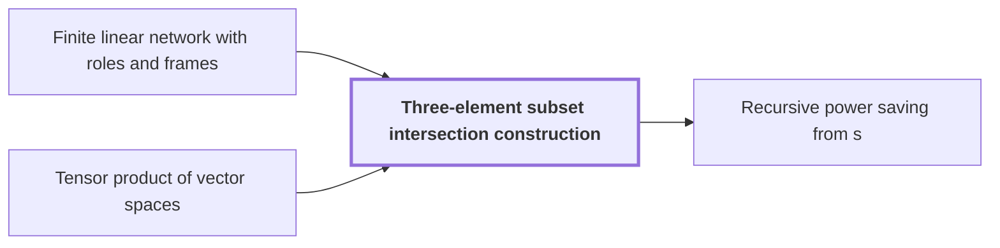

# Three-element subset intersection construction

!!! info "Before this page"

    Three-element subset intersection construction *is built inside* [Finite linear network with roles and frames](linear-network-roles.md "It is built inside a Finite linear network with roles and frames.") and *is built from* [Tensor product of vector spaces](glossary.md#tensor-product-of-vector-spaces "The label space is $\mathcal F=(\mathbb Q^h)^{\otimes 3}$, built from the Tensor product of vector spaces, with dimension $D=h^3$ (the letter $D$ changes meaning here).").

!!! abstract "Where this fits"

    1. An $n$-bit integer product is computed by a fixed-tape machine in $O(n(\lg n)^{1-\kappa})$ time, $\kappa=2^{-182}$. — how: reduce multiplication to ring convolution and speed up its address moves and butterfly layers ([Integer multiplication in O(n(lg n)^{1-κ}) time](main-theorem.md "Deterministic fixed-tape Turing machine multiplying n-bit integers in O(n(lg n)^{1-κ}), κ=2^{-182}, by reducing to ring convolution with fast address interchanges and simultaneous butterfly layers, disproving the n log n conjecture in this model."))
    2. Two fixed-tape procedures, an address interchange and a simultaneous butterfly layer, cost $O(Vu^\tau)$ and $O(Vd^{\lambda'})$ for fixed exponents below 1, where $V$ is the stored bit volume. — how: build both procedures from one finite linear network and a recursion that saves a power
    3. **This page:** The network is built from three-element subsets with gather, scatter and cancelling auxiliary wires, so that the total number $s$ of smaller calls satisfies $s<Wm$.

??? note "Symbols from earlier pages"

    - $W$ — number of roles: The number of roles, the wires' fixed places in the network, over which rows are distributed. (on [Finite linear network with roles and frames](linear-network-roles.md "Fixed linear network exchanging two banks of values with prescribed signs and restoring auxiliary values; wires have roles, rows are distributed cyclically among roles, and invertible frame operators cancel along routes leaving an endpoint operator."))

The three-element subset intersection construction is a fixed network of gather, scatter and auxiliary wires that moves values between triples, with few enough smaller calls for the recursion to save a power. It is built inside a [Finite linear network with roles and frames](linear-network-roles.md "Fixed linear network exchanging two banks of values with prescribed signs and restoring auxiliary values; wires have roles, rows are distributed cyclically among roles, and invertible frame operators cancel along routes leaving an endpoint operator.").

Let $[h]=\{1,\dots,h\}$ be the ground set, with $h=100$. A *triple* is a three-element subset $T$ of $[h]$ (the letters $T$ and $S$ change meaning here). Its indicator vector $t_T$ has entry 1 on the elements of $T$ and 0 elsewhere. Triples $T,S$ are *neighbors* when $|T\cap S|=1$. Each triple $T$ carries a value $g_T$.

**Coefficients.** Over $\mathbb F_2$, gather puts on a central wire, for each element of $[h]$, the sum of the $g_T$ over the triples containing it. Scatter adds the central wires of the elements of a triple $S$ onto $S$. So $g_T$ reaches $S$ with coefficient $|S\cap T|$ mod 2. For each neighbor pair $(S,T)$, an auxiliary wire carries a copy of $g_T$ and adds it onto $S$, a further $[\,|S\cap T|=1\,]$, which is 1 if the condition holds and 0 otherwise. The net coefficient $|S\cap T|+[\,|S\cap T|=1\,]$ mod 2 is 0 for intersection sizes 0, 1 and 2, and 1 for $T=S$. So $S$ keeps $g_S$ alone: the auxiliary wires cancel the unwanted coefficients.

**Labels.** Over $\mathbb Q$, take the bilinear form with matrix $I-J/9$, where $J$ is the all-one matrix (the letter $J$ changes meaning here). Then $\langle t_T,t_S\rangle=|T\cap S|-1$, so neighbors are orthogonal, and each triple's line is nondegenerate. The label space is $\mathcal F=(\mathbb Q^h)^{\otimes 3}$, built from the [Tensor product of vector spaces](glossary.md#tensor-product-of-vector-spaces "The space built from tuples of vectors whose dimension is the product of the factors' dimensions, so (Q^h)^{⊗3} has dimension h^3."), with dimension $D=h^3$ (the letter $D$ changes meaning here). A label is a nondegenerate subspace $U\subseteq\mathcal F$, and $P_U$ denotes the projection onto $U$ along $U^\perp$ (the letters $U$ and $P$ change meaning here, $P_U$ being the label projection used on later pages). Each gate and sink with label $U$ carries $P_U$. Each of the $N=\binom h3^3$ sources (the letter $N$ changes meaning here) is indexed by a triple of triples $(T_1,T_2,T_3)$, has the line through $t_{T_1}\otimes t_{T_2}\otimes t_{T_3}$ as label, and carries $-P_U$.

**Counting.** A wire segment between consecutive gates or terminals is an edge, and its cost is the rank of the difference of the matrices at its ends. Summing over all edges gives $s$, the total number of smaller calls (the letter $s$ changes meaning here). Each unit of rank costs one smaller call.<cite class="exegenius-ref" data-source="paper" data-locator="§4 Faster interchange of address chunks" data-quote="An edge matrix of rank $a$ will require $a$ smaller interchanges" title="An edge matrix of rank $a$ will require $a$ smaller interchanges"> (see §4 Faster interchange of address chunks)</cite>.

On an edge with labels $U\subseteq U'$, the smaller label $U$ lying inside the larger $U'$, the difference $P_{U'}-P_U$ is the identity on $U'\cap U^\perp$ and zero on $U\oplus U'^\perp$. Its rank is $\dim U'-\dim U$.

Give each edge the signed change, the dimension of its head label minus that of its tail label. Along each wire these telescope, so the signed changes sum to the sink dimension minus the source dimension.<cite class="exegenius-ref" data-source="paper" data-locator="§3.3 Subspaces attached to the gates" data-quote="The source dimensions sum to $N$ and the sink dimensions to $Wm-N$." title="The source dimensions sum to $N$ and the sink dimensions to $Wm-N$."> (see §3.3 Subspaces attached to the gates)</cite> So the signed total is $WD-2N$<cite class="exegenius-ref" data-source="paper" data-locator="§3.3 Subspaces attached to the gates" data-quote="the signed dimension changes will sum to $Wm-2N$" title="the signed dimension changes will sum to $Wm-2N$"> (see §3.3 Subspaces attached to the gates)</cite>. The paper calls $D$ here $m$.

Let $L$ be the total dimension lost on decreasing edges, where a label shrinks (the letter $L$ changes meaning here). Each decreasing edge loses $h$ dimensions<cite class="exegenius-ref" data-source="paper" data-locator="§3.3 Subspaces attached to the gates" data-quote="each of loss $h$" title="each of loss $h$"> (see §3.3 Subspaces attached to the gates)</cite>. Using absolute changes instead of signed ones, the total is $WD-2N+2L$<cite class="exegenius-ref" data-source="paper" data-locator="§3.3 Subspaces attached to the gates" data-quote="replacing signed changes by absolute changes adds $2L$" title="replacing signed changes by absolute changes adds $2L$"> (see §3.3 Subspaces attached to the gates)</cite>. Each source's first edge goes from $-P_U$ to $P_U$ with no dimension change, so its matrix $2P_U$ has rank one.<cite class="exegenius-ref" data-source="paper" data-locator="§3.4 The rational matrix interface" data-quote="Its first edge matrix is therefore $2P_{U_a}$, of rational rank one" title="Its first edge matrix is therefore $2P_{U_a}$, of rational rank one"> (see §3.4 The rational matrix interface)</cite>. Adding these $N$ ranks gives $s=WD-N+2L$.

For $h=100$, $L/N=100/539$<cite class="exegenius-ref" data-source="paper" data-locator="§3.3 Subspaces attached to the gates" data-quote="The loss ratios have the exact values" title="The loss ratios have the exact values"> (see §3.3 Subspaces attached to the gates)</cite>, so $2L<N$ and $s<WD$<cite class="exegenius-ref" data-source="paper" data-locator="§1.2 Linear networks and the recursive saving" data-quote="satisfies $s&lt;Wm$" title="satisfies $s&lt;Wm$"> (see §1.2 Linear networks and the recursive saving)</cite>. The recursion needs this: $s$ calls on streams of $1/W$ of the volume save a power only when $s<WD$.

## Connections

Used by:

- [Recursive power saving from s<Wm](recursive-power-saving.md "The recursion is built on the Three-element subset intersection construction, which gives $s<Wm$ smaller calls.") *is built on* Three-element subset intersection construction

??? quote "From the sources"

    > The construction uses
    >
    > — [Integer multiplication below n log n (OpenAI, 2026)](https://github.com/openai/math/tree/fd4aeeb2ee4fc729c18d98444fed42fd0529eeeb/preprints/Integer-multiplication-below-n-log-n-September-23-2026)

    > three-element subsets
    >
    > — [Integer multiplication below n log n (OpenAI, 2026)](https://github.com/openai/math/tree/fd4aeeb2ee4fc729c18d98444fed42fd0529eeeb/preprints/Integer-multiplication-below-n-log-n-September-23-2026)
