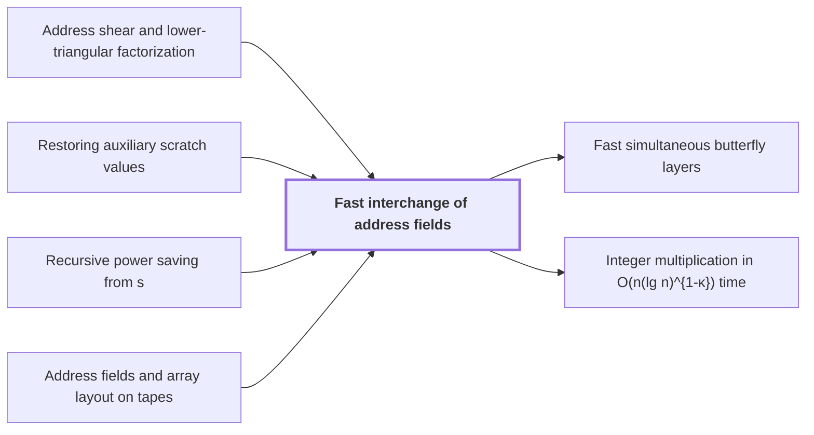

# Fast interchange of address fields

!!! info "Before this page"

    Fast interchange of address fields *is built from* [Address shear and lower-triangular factorization](address-shear-factorization.md "The procedure is built from the Address shear and lower-triangular factorization: the network's endpoint operator is the shear $(H,D)\mapsto(H+D,D)$ over $\mathbb F_2$, with rank reduced by a lower-triangular factorization."), *is secured by* [Restoring auxiliary scratch values](scratch-restoration.md "Exactness is secured by the Restoring auxiliary scratch values schedule, which subtracts the initial register value, computes, adds the result back, and reverses; the initial contents cancel, so the final permutation does not depend on them."), *follows from* [Recursive power saving from s<Wm](recursive-power-saving.md "The cost bound follows from Recursive power saving from s<Wm.") and *acts on arrays laid out* [Address fields and array layout on tapes](address-fields.md "The procedure acts on arrays laid out as in Address fields and array layout on tapes, so each field is a block of $u$ contiguous bits.").

!!! abstract "Where this fits"

    1. An $n$-bit integer product is computed by a fixed-tape machine in $O(n(\lg n)^{1-\kappa})$ time, $\kappa=2^{-182}$. — how: reduce multiplication to ring convolution and speed up its address moves and butterfly layers ([Integer multiplication in O(n(lg n)^{1-κ}) time](main-theorem.md "Deterministic fixed-tape Turing machine multiplying n-bit integers in O(n(lg n)^{1-κ}), κ=2^{-182}, by reducing to ring convolution with fast address interchanges and simultaneous butterfly layers, disproving the n log n conjecture in this model."))
    2. Two fixed-tape procedures, an address interchange and a simultaneous butterfly layer, cost $O(Vu^\tau)$ and $O(Vd^{\lambda'})$ for fixed exponents below 1, where $V$ is the stored bit volume. — how: build both procedures from one finite linear network and a recursion that saves a power
    3. **This page:** Two disjoint contiguous $u$-bit address fields can be interchanged in $O(Vu^\tau)$ for a fixed $\tau<1$, although the intermediate steps are XOR combinations.

??? note "Symbols from earlier pages"

    - $u$ — field width: The number of bits in one address field. (on [Address fields and array layout on tapes](address-fields.md "Arrays stored in tape order with addresses forming a Cartesian product of digit fields; rearranging fields costs time."))
    - $V$ — stored bit volume: The total number of bits the array holds. (on [Address fields and array layout on tapes](address-fields.md "Arrays stored in tape order with addresses forming a Cartesian product of digit fields; rearranging fields costs time."))
    - $W$ — number of roles: The number of roles, the wires' fixed places in the network, over which rows are distributed. (on [Finite linear network with roles and frames](linear-network-roles.md "Fixed linear network exchanging two banks of values with prescribed signs and restoring auxiliary values; wires have roles, rows are distributed cyclically among roles, and invertible frame operators cancel along routes leaving an endpoint operator."))
    - $s$ — total rank: The sum of the ranks of the edge differences over all edges, which counts the smaller calls. (on [Three-element subset intersection construction](subset-intersection-construction.md "Gather/scatter with auxiliary wires cancelling unwanted coefficients, using indicator-vector orthogonality to assign subspaces; gives s<Wm smaller calls."))
    - $m$ — growth factor: The factor by which the parameter of a call grows between a call and its recursive subcalls. (on [Recursive power saving from s<Wm](recursive-power-saving.md "Recursive call at parameter mf uses s calls at parameter f on streams of volume V/W; since s/W<m the volume-normalized cost grows as a power, giving a fixed power saving."))
    - $C$ — outside-work constant: A constant bounding the outside work of a call by a constant times the power of its parameter. (on [Recursive power saving from s<Wm](recursive-power-saving.md "Recursive call at parameter mf uses s calls at parameter f on streams of volume V/W; since s/W<m the volume-normalized cost grows as a power, giving a fixed power saving."))

Fast interchange of address fields is a fixed-tape procedure that swaps two disjoint contiguous address fields of an array, and the multiplication construction uses it to speed up its address moves. The procedure acts on arrays laid out as in [Address fields and array layout on tapes](address-fields.md "Arrays stored in tape order with addresses forming a Cartesian product of digit fields; rearranging fields costs time."), so each field is a block of $u$ contiguous bits. Write $H$ and $D$ for the two fields, each viewed as a vector of entries over a common residue ring; for the bit procedure this ring is $\mathbb F_2$, where subtraction and addition coincide. Here $\tau$, the fixed exponent below 1 in the cost, is the exponent in $O(Vu^\tau)$<cite class="exegenius-ref" data-source="paper" data-locator="§1.1 The two tape operations" data-quote="for a fixed $\tau&lt;1$" title="for a fixed $\tau&lt;1$"> (see §1.1 The two tape operations)</cite>. (On the address-shear page, $\tau$ is a column index; here it means only this exponent.)

Swapping takes three updates, applied componentwise:

$$D\leftarrow D-H,\qquad H\leftarrow H+D,\qquad D\leftarrow H-D.$$

Starting from $(H,D)$ they give $(H,D-H)$, then $(D,D-H)$, then $(D,H)$, since $H+(D-H)=D$ and $D-(D-H)=H$. For example, with $(H,D)=(1,0)$ over $\mathbb F_2$ the states are $(1,1)$, $(0,1)$, $(0,1)$, which is $(D,H)$.

The network performs only the middle update, which is the costly one. The procedure is built from the [Address shear and lower-triangular factorization](address-shear-factorization.md "Endpoint operator (H,D)->(H+D,D) over a residue ring, with rank reduction via a singular-matrix Bruhat factorization into lower-triangular factors."): the network's endpoint operator is the shear $(H,D)\mapsto(H+D,D)$ over $\mathbb F_2$, with rank reduced by a lower-triangular factorization. Two further linear-cost address updates complete the interchange. Both change only $D$, each combining $D$ with the earlier field $H$ in linear time.

The cost bound follows from [Recursive power saving from s<Wm](recursive-power-saving.md "Recursive call at parameter mf uses s calls at parameter f on streams of volume V/W; since s/W<m the volume-normalized cost grows as a power, giving a fixed power saving."). The network has $W$ roles, and each of its $s$ smaller calls acts on one role stream of volume $V/W$. For the bit network, $s<Wm$<cite class="exegenius-ref" data-source="paper" data-locator="§1.2 Linear networks and the recursive saving" data-quote="the total number $s$ of smaller calls satisfies $s&lt;Wm$" title="the total number $s$ of smaller calls satisfies $s&lt;Wm$"> (see §1.2 Linear networks and the recursive saving)</cite>; the paper's proof computes $s$ as $Wm$ minus a positive constant fixed by the construction. Hence $s/W<m$. Since $m^\tau\to m$ as $\tau\to1$, fix $\tau<1$ with $s/W<m^\tau$.

Let $Q_k$ bound the time per unit of volume for interchanging fields of $m^k$ bits, where $k$ is the recursion level. A level-$k$ call makes $s$ calls at level $k-1$, each on volume $V/W$, plus $O(V)$ outside work whose normalized cost is at most $C$. Hence
$$Q_0=O(1),\qquad Q_k\le \frac{s}{W}\,Q_{k-1}+C.$$
Unrolling gives $Q_k\le (s/W)^k Q_0+C\sum_{j<k}(s/W)^j$. The first term is $O(m^{k\tau})$ because $s/W<m^\tau$. The geometric sum is also $O(m^{k\tau})$: if $s/W\le1$ it is at most $k$, and if $s/W>1$ it is $O((s/W)^k)$. Both are $O(m^{k\tau})$, since $m\ge2$. A field of $u=m^k$ bits therefore has $Q_k=O(u^\tau)$, and the interchange costs $O(Vu^\tau)$.

The final effect is an exact permutation, although the network uses only pointwise XOR gates, so its intermediate values are XOR combinations of data. Over $\mathbb F_2$ each update is a pointwise XOR, since addition and subtraction are the same operation; after the first update $D$ holds the XOR of $D$ and $H$. The shear is applied to every row, including scratch rows with arbitrary contents. Exactness is secured by the [Restoring auxiliary scratch values](scratch-restoration.md "Subtract initial register value, compute, add result, reverse, so the permutation is exact for arbitrary initial auxiliary values.") schedule, which subtracts the initial register value, computes, adds the result back, and reverses; the initial contents cancel, so the final permutation does not depend on them.<cite class="exegenius-ref" data-source="paper" data-locator="§1.1 The two tape operations" data-quote="The final permutation is exact for arbitrary initial auxiliary values" title="The final permutation is exact for arbitrary initial auxiliary values"> (see §1.1 The two tape operations)</cite>.

## Connections

Used by:

- [Fast simultaneous butterfly layers](fast-butterfly-layers.md "The layer moves whole chunks by Fast interchange of address fields to realize its binary basis changes.") *moves whole chunks by* Fast interchange of address fields
- [Integer multiplication in O(n(lg n)^{1-κ}) time](main-theorem.md "The machine performs its address moves by Fast interchange of address fields.") *performs its address moves by* Fast interchange of address fields

??? quote "From the sources"

    > The first procedure interchanges two disjoint contiguous address fields
    >
    > — [Integer multiplication below n log n (OpenAI, 2026)](https://github.com/openai/math/tree/fd4aeeb2ee4fc729c18d98444fed42fd0529eeeb/preprints/Integer-multiplication-below-n-log-n-September-23-2026)
