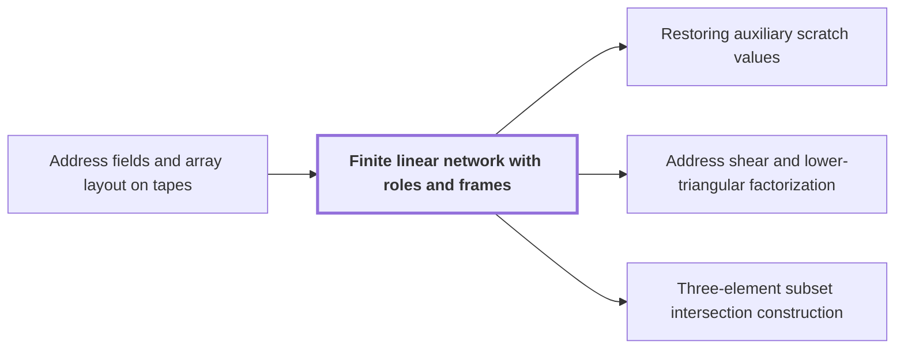

# Finite linear network with roles and frames

!!! info "Before this page"

    Finite linear network with roles and frames *acts on rows indexed by* [Address fields and array layout on tapes](address-fields.md "These rows are the suffixes of Address fields and array layout on tapes, so the network acts on rows indexed by those fields."). Assumed known: Polynomials.

!!! abstract "Where this fits"

    1. An $n$-bit integer product is computed by a fixed-tape machine in $O(n(\lg n)^{1-\kappa})$ time, $\kappa=2^{-182}$. — how: reduce multiplication to ring convolution and speed up its address moves and butterfly layers ([Integer multiplication in O(n(lg n)^{1-κ}) time](main-theorem.md "Deterministic fixed-tape Turing machine multiplying n-bit integers in O(n(lg n)^{1-κ}), κ=2^{-182}, by reducing to ring convolution with fast address interchanges and simultaneous butterfly layers, disproving the n log n conjecture in this model."))
    2. Two fixed-tape procedures, an address interchange and a simultaneous butterfly layer, cost $O(Vu^\tau)$ and $O(Vd^{\lambda'})$ for fixed exponents below 1, where $V$ is the stored bit volume. — how: build both procedures from one finite linear network and a recursion that saves a power
    3. **This page:** Each procedure comes from a fixed linear network that exchanges two banks of values with prescribed signs and restores every auxiliary value; rows are distributed among $W$ roles and frames cancel along routes.

A *finite linear network with roles and frames* is a fixed wiring of linear steps that exchanges two banks of values with prescribed signs and restores every auxiliary value it uses. Each fixed-tape procedure of the argument comes from one such network, and this page explains how a network computes its result on an array.

A wire's fixed place in the network is its *role*. Let $W$ be the number of roles. A *scratch* (auxiliary) role carries working values whose initial contents are arbitrary; the other roles carry the exchanged values.

The *scalar network* is the same wiring with each gate applied pointwise to matching addresses, so it acts on roles alone. Let $\rho$ be the permutation of roles that it applies: an input at role $w$ leaves at output role $\rho(w)$ with sign $\varepsilon_w \in \{+1,-1\}$.

To run the network on an array, regard a row as the complete ordered suffix of the array's address, at a fixed prefix and row index. These rows are the suffixes of [Address fields and array layout on tapes](address-fields.md "Arrays stored in tape order with addresses forming a Cartesian product of digit fields; rearranging fields costs time."), so the network acts on rows indexed by those fields. Distribute the rows cyclically: row $\ell$, the $\ell$th row at a fixed prefix, goes to role $\ell \bmod W$, after the row count for each prefix is padded to a multiple of $W$. Let $V$ be the number of bits stored after padding. Each role stream then holds $V/W$ bits<cite class="exegenius-ref" data-source="paper" data-locator="§1.2 Linear networks and the recursive saving" data-quote="contains $V/W$ bits" title="contains $V/W$ bits"> (see §1.2 Linear networks and the recursive saving)</cite>.

Each source, gate and sink $\nu$ carries an invertible linear operator $D_\nu$ on arrays indexed by the common address set, its *frame*. The stored array at $\nu$ is $D_\nu f$ when the logical array is $f$. A frame acts on addresses within one wire's array and never mixes wires. Along an edge from node $\alpha$ to node $\beta$ the stored array changes by $D_\beta D_\alpha^{-1}$.

A pointwise linear gate $G$ combines its $p$ input arrays $f_1,\dots,f_p$ at each address with fixed scalar coefficients. The frame $D_\nu$ of the gate is linear and the coefficients are scalars, so $$G(D_\nu f_1,\ldots,D_\nu f_p)=D_\nu G(f_1,\ldots,f_p).$$ Frames therefore pass through gates.

Along a route $\alpha_0,\alpha_1,\dots,\alpha_k$ of edges, the operators telescope: $(D_{\alpha_k}D_{\alpha_{k-1}}^{-1})\cdots(D_{\alpha_1}D_{\alpha_0}^{-1})=D_{\alpha_k}D_{\alpha_0}^{-1}$. The intermediate frames cancel and the route applies only its endpoint operator.

Take an input role $w$ and its route to output role $\rho(w)$, carrying sign $\varepsilon_w \in \{+1,-1\}$. By the telescoping, the route applies $\varepsilon_w D_{\mathrm{sink}(\rho(w))}D_{\mathrm{source}(w)}^{-1}$, where $\mathrm{source}(w)$ and $\mathrm{sink}(\rho(w))$ are the first and last nodes of that route. Undoing the exchange moves each output back to its input role, and multiplying by $\varepsilon_w$ again removes the sign. For a scratch role the construction has $\rho(w)=w$ with sign $+1$<cite class="exegenius-ref" data-source="paper" data-locator="§3.5 The binary phase interface" data-quote="each scratch input to its own output with sign $+1$" title="each scratch input to its own output with sign $+1$"> (see §3.5 The binary phase interface)</cite>, so the undoing needs no correction there. Every role keeps the endpoint operator<cite class="exegenius-ref" data-source="paper" data-locator="§1.2 Linear networks and the recursive saving" data-quote="leaves the endpoint operator on every role array" title="leaves the endpoint operator on every role array"> (see §1.2 Linear networks and the recursive saving)</cite>, auxiliary roles included.

Here $I$ is the identity operator, which leaves every array unchanged. For example, if a route has source frame $I$ and sink frame $D_\nu$, its operator is $D_\nu$, however many gates it passes through.

## Connections

Used by:

- [Restoring auxiliary scratch values](scratch-restoration.md "The procedure is applied to a Finite linear network with roles and frames, whose wires include the auxiliary registers.") *is applied to* Finite linear network with roles and frames
- [Address shear and lower-triangular factorization](address-shear-factorization.md "The address shear is the endpoint operator of the bit network, a Finite linear network with roles and frames.") *is the endpoint operator of* Finite linear network with roles and frames
- [Three-element subset intersection construction](subset-intersection-construction.md "The three-element subset intersection construction is a fixed network of gather, scatter and auxiliary wires, built inside a Finite linear network with roles and frames.") *is built inside* Finite linear network with roles and frames

??? quote "From the sources"

    > A wire's fixed place in the network is called its role.
    >
    > — [Integer multiplication below n log n (OpenAI, 2026)](https://github.com/openai/math/tree/fd4aeeb2ee4fc729c18d98444fed42fd0529eeeb/preprints/Integer-multiplication-below-n-log-n-September-23-2026)
