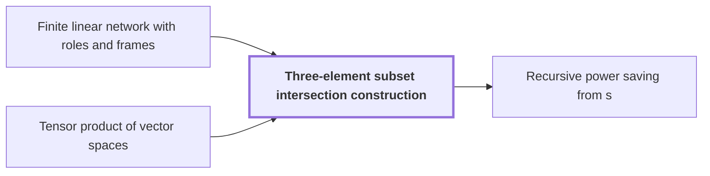

# Three-element subset intersection construction

!!! info "Before this page"

    Three-element subset intersection construction *is built inside* [Finite linear network with roles and frames](linear-network-roles.md "The three-element subset intersection construction is a fixed network of gather, scatter and auxiliary wires, built inside a Finite linear network with roles and frames.") and *is built from* [Tensor product of vector spaces](glossary.md#tensor-product-of-vector-spaces "The label space $\mathcal F=(\mathbb Q^h)^{\otimes 3}$ is built from the Tensor product of vector spaces of three copies of $\mathbb Q^h$, with the product form, and has dimension $D=h^3$, which is the paper's $m$ (the letter $m$ changes meaning here).").

!!! abstract "Where this fits"

    1. An $n$-bit integer product is computed by a fixed-tape machine in $O(n(\lg n)^{1-\kappa})$ time, $\kappa=2^{-182}$. — how: reduce multiplication to ring convolution and speed up its address moves and butterfly layers ([Integer multiplication in O(n(lg n)^{1-κ}) time](main-theorem.md "Deterministic fixed-tape Turing machine multiplying n-bit integers in O(n(lg n)^{1-κ}), κ=2^{-182}, by reducing to ring convolution with fast address interchanges and simultaneous butterfly layers, disproving the n log n conjecture in this model."))
    2. Two fixed-tape procedures, an address interchange and a simultaneous butterfly layer, cost $O(Vu^\tau)$ and $O(Vd^{\lambda'})$ for fixed exponents below 1, where $V$ is the stored bit volume. — how: build both procedures from one finite linear network and a recursion that saves a power
    3. **This page:** The network is built from three-element subsets with gather, scatter and cancelling auxiliary wires, so that the total number $s$ of smaller calls satisfies $s<Wm$.

??? note "Symbols from earlier pages"

    - $W$ — number of roles: The number of roles, the wires' fixed places in the network, over which rows are distributed. (on [Finite linear network with roles and frames](linear-network-roles.md "Fixed linear network exchanging two banks of values with prescribed signs and restoring auxiliary values; wires have roles, rows are distributed cyclically among roles, and invertible frame operators cancel along routes leaving an endpoint operator."))

The three-element subset intersection construction is a fixed network of gather, scatter and auxiliary wires, built inside a [Finite linear network with roles and frames](linear-network-roles.md "Fixed linear network exchanging two banks of values with prescribed signs and restoring auxiliary values; wires have roles, rows are distributed cyclically among roles, and invertible frame operators cancel along routes leaving an endpoint operator."). Its purpose is to make the number of smaller calls small enough for the recursion, the decisive property of the paper's argument.<cite class="exegenius-ref" data-source="paper" data-locator="§1.2 Linear networks and the recursive saving" data-quote="number $s$ of smaller calls satisfies $s&lt;Wm$" title="number $s$ of smaller calls satisfies $s&lt;Wm$"> (see §1.2 Linear networks and the recursive saving)</cite>

Let $[h]=\{1,\dots,h\}$ be the ground set, with $h=100$ (the letter $h$ changes meaning here). A three-element subset $T$ of $[h]$ is a *triple*, and $\mathcal T$ is the set of all triples. Triples $T$ and $S$ are *neighbors* when $|T\cap S|=1$. Each triple carries a value $g_T$.

Over $\mathbb F_2$, gather puts the sum of the $g_T$ with $e\in T$ on a central wire $C_e$ for each element $e$ of $[h]$, and scatter adds $\sum_{e\in S}C_e$ into the target $S$. So $g_T$ reaches $S$ with coefficient $|S\cap T|$ mod $2$. For each neighbor pair, an auxiliary wire $A_{ST}$ carries a copy of $g_T$ into $S$, which adds a further $g_T$ to $S$ exactly when $|S\cap T|=1$. The net coefficient $|S\cap T|+[|S\cap T|=1]$ mod $2$ is therefore $0$ for $|S\cap T|\in\{0,1,2\}$ and $1$ for $T=S$, so $S$ keeps only $g_S$. Here $[\cdot]$ is $1$ when its condition holds and $0$ otherwise.

The labels are over $\mathbb Q$. Let $J$ be the all-one $h\times h$ matrix (the letter $J$ changes meaning here), and let the bilinear form on $\mathbb Q^h$ have matrix $I-J/9$. Then $\langle t_T,t_S\rangle=|T\cap S|-1$, because $t_T^{\top}Jt_S=3\cdot 3=9$, so neighbors are orthogonal.

The label space $\mathcal F=(\mathbb Q^h)^{\otimes 3}$ is built from the [Tensor product of vector spaces](glossary.md#tensor-product-of-vector-spaces "The space built from tuples of vectors whose dimension is the product of the factors' dimensions, so (Q^h)^{⊗3} has dimension h^3.") of three copies of $\mathbb Q^h$, with the product form, and has dimension $D=h^3$, which is the paper's $m$ (the letter $m$ changes meaning here). A *label* $U$ is a nondegenerate subspace of $\mathcal F$. For an index $\iota=(T_1,T_2,T_3)\in\mathcal T^3$, the label $U_\iota$ is the line spanned by $t_{T_1}\otimes t_{T_2}\otimes t_{T_3}$, and $N=\binom h3^3$ counts the indices $\iota$. Each gate or sink with label $U$ carries the projection $P_U$ onto $U$ along $U^\perp$, and the source of index $\iota$ carries $-P_{U_\iota}$.

Each edge carries the difference of its endpoint matrices, and $s$ is the sum of the ranks of these differences over all edges. If $U\subseteq V$ for labels $U$ and $V$ (here $V$ is a label), then $P_V-P_U$ is the identity on $V\cap U^\perp$ and zero on $U\oplus V^\perp$, so its rank is $\dim V-\dim U$. Reversing an edge negates its matrix and keeps its rank, so an edge that changes a label by $k$ dimensions has rank $k$, except the source edges treated below.

A smaller call is one use of the same fixed procedure on a stream of smaller volume. Each unit of rank costs one such call, which the tape section calls an interchange.<cite class="exegenius-ref" data-source="paper" data-locator="§4 Faster interchange of address chunks" data-quote="An edge matrix of rank $a$ will require $a$ smaller interchanges." title="An edge matrix of rank $a$ will require $a$ smaller interchanges."> (see §4 Faster interchange of address chunks)</cite> So $s$ counts the smaller calls.

Sources have dimension $1$ and total $N$. The $N$ sinks that receive them have label $U_\iota^\perp$, of dimension $D-1$, and the other sinks have dimension $D$, so the $W$ sinks total $WD-N$. The signed dimension changes over all edges total $WD-2N$<cite class="exegenius-ref" data-source="paper" data-locator="§3.3 Subspaces attached to the gates" data-quote="Thus the signed dimension changes will sum to $Wm-2N$" title="Thus the signed dimension changes will sum to $Wm-2N$"> (see §3.3 Subspaces attached to the gates)</cite>, because the contributions at gates cancel.

Let $L$ be the total dimension lost on decreasing edges, the edges whose label shrinks (the letter $L$ changes meaning here). Taking absolute values adds $2L$, so the sum of absolute label changes over all edges is $WD-2N+2L$<cite class="exegenius-ref" data-source="paper" data-locator="§3.3 Subspaces attached to the gates" data-quote="the sum of absolute changes is $Wm-2N+2L$" title="the sum of absolute changes is $Wm-2N+2L$"> (see §3.3 Subspaces attached to the gates)</cite>. Each source's first edge has matrix $2P_{U_\iota}$, of rank one with no label change.<cite class="exegenius-ref" data-source="paper" data-locator="§3.4 The rational matrix interface" data-quote="Its first edge matrix is therefore $2P_{U_a}$, of rational rank one," title="Its first edge matrix is therefore $2P_{U_a}$, of rational rank one,"> (see §3.4 The rational matrix interface)</cite> so these $N$ ranks give
$$s=WD-2N+2L+N=WD-N+2L.$$

In the paper's bit network, built from this construction with $h=100$, the loss ratio is $L/N=100/539$<cite class="exegenius-ref" data-source="paper" data-locator="§3.3 Subspaces attached to the gates" data-quote="The loss ratios have the exact values" title="The loss ratios have the exact values"> (see §3.3 Subspaces attached to the gates)</cite>. Since $2L/N=200/539<1$, this gives $s<WD$.

## Connections

Used by:

- [Recursive power saving from s<Wm](recursive-power-saving.md "The recursion is built on the Three-element subset intersection construction, which gives $s<Wm$ smaller calls.") *is built on* Three-element subset intersection construction

??? quote "From the sources"

    > The construction uses
    >
    > — [Integer multiplication below n log n (OpenAI, 2026)](https://github.com/openai/math/tree/fd4aeeb2ee4fc729c18d98444fed42fd0529eeeb/preprints/Integer-multiplication-below-n-log-n-September-23-2026)

    > three-element subsets
    >
    > — [Integer multiplication below n log n (OpenAI, 2026)](https://github.com/openai/math/tree/fd4aeeb2ee4fc729c18d98444fed42fd0529eeeb/preprints/Integer-multiplication-below-n-log-n-September-23-2026)
